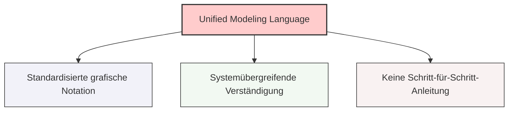

## 🧭 Navigation & Zusammenhänge
- **Vorausgesetztes Thema:** [[16_ Phasen des OOP-Vorgehensmodells]]
- **Nächstes Thema:** [[18_Übersicht der UML-Diagrammarten nach Entwicklungsphasen]]
- **Verwandte Bausteine:** [[19_Das UML-Klassendiagramm]], [[18_Übersicht der UML-Diagrammarten nach Entwicklungsphasen]]
---

## 🎯 IHK-Prüfungsrelevanz
> [!IMPORTANT] AP01: Einrichten eines IT-gestützten Arbeitsplatzes
> - **Relevanz:** Niedrig
> - **Fokus:** Grundlegendes Verständnis grafischer Systemdokumentationen.

> [!WARNING] AP02: Konzeption, Administration & Netzwerke
> - **Relevanz:** Hoch
> - **Fokus:** UML ist die absolute Standard-Notation in IHK-Abschlussprüfungen. Die IHK verlangt regelmäßig das Analysieren, Ergänzen oder eigenständige Zeichnen von UML-Diagrammen (vor allem Klassendiagramme, Anwendungsfalldiagramme und Sequenzdiagramme). Zu wissen, was UML leistet und wie die standardisierte Symbolik interpretiert wird, ist eine Kernkompetenz im IT-Projektmanagement.

---

## 📖 Einfache Erklärung & Praxisbeispiele
**UML** steht für **Unified Modeling Language** (vereinheitlichte Modellierungssprache). Es handelt sich dabei um eine international standardisierte, bereichsübergreifende und rein grafische Notation, die zur Spezifikation, Konstruktion, Dokumentation und Visualisierung von Software-Teilen und komplexen Systemen eingesetzt wird. UML wird primär für objektorientierte Systeme genutzt.

Ganz wichtig für die IHK: UML ist **keine Methode oder Anleitung**, die dir Schritt für Schritt erklärt, wie man von einer Problemstellung zu einer fertigen Anwendung gelangt. Es stellt lediglich die standardisierten grafischen Bausteine bereit, damit sich unterschiedliche Entwicklungsteams, Administratoren und Kunden über den gesamten Prozess – von der ersten Anforderungsanalyse bis hin zur fertigen Implementierung – einheitlich und fehlerfrei verständigen können.

### Kerneigenschaften und Diagramm-Ebenen:
* **Sichtweisen und Diagrammarten:** UML bietet verschiedene Diagrammtypen, die unterschiedliche Sichten auf ein System erlauben (z. B. Struktur-Sichten oder Verhaltens-Sichten zur Visualisierung von Abläufen).
* **Anwendersicht (Struktur & Funktion):** Mit UML lassen sich alle vom Kunden geforderten Funktionen und Prozesse logisch abbilden.
  * 💡 **Praxisbeispiel:** Ein FISI soll ein automatisiertes Benutzer-Onboarding-System für die Personalabteilung planen. In der Analysephase zeichnet er ein *UML-Anwendungsfalldiagramm (Use-Case)*, das grafisch zeigt, wie der "HR-Mitarbeiter" (Akteur) die Funktion "Neuen Azubi anlegen" auslöst. In der Entwurfsphase wird daraus ein *UML-Klassendiagramm*, das die technischen Klassen `User` und `ActiveDirectorySchnittstelle` definiert. Alle Beteiligten sprechen dank der Grafik sofort dieselbe Sprache.

---

## 📊 Visuelle Darstellung (Mermaid.js)

