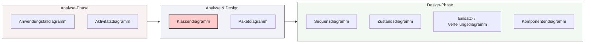

## 🧭 Navigation & Zusammenhänge
- **Vorausgesetztes Thema:** [[17_Grundlagen der Unified Modeling Language (UML)]]
- **Nächstes Thema:** [[19_Das UML-Klassendiagramm]]
- **Verwandte Bausteine:** [[17_Grundlagen der Unified Modeling Language (UML)]], [[19_Das UML-Klassendiagramm]]
---

## 🎯 IHK-Prüfungsrelevanz
> [!IMPORTANT] AP01: Einrichten eines IT-gestützten Arbeitsplatzes
> - **Relevanz:** Niedrig
> - **Fokus:** Zuordnung von Diagrammtypen zur Systemdokumentation.

> [!WARNING] AP02: Konzeption, Administration & Netzwerke
> - **Relevanz:** Hoch
> - **Fokus:** Ein Kernbereich der IHK-Systemanalyse. In Prüfungen musst du den Einsatzzweck der verschiedenen Diagramme exakt kennen. Besonders häufig geprüft werden das *Anwendungsfalldiagramm* (Analyse-Phase), das *Klassendiagramm* (Schnittstelle Analyse/Design) und das *Sequenzdiagramm* (Design-Phase). Die IHK verlangt oft, Informationen aus einem Text in den passenden Diagrammtyp zu überführen.

---

## 📖 Einfache Erklärung & Praxisbeispiele
UML bietet eine Vielzahl von Diagrammarten, die Software- und Systemarchitekturen aus unterschiedlichen Blickwinkeln beleuchten. Bei der Systementwicklung werden diese Diagramme in einer logischen Reihenfolge erstellt, wobei ein fließender Übergang von der **Analyse-Phase** (Was will der Anwender?) in die **Design-/Entwurfs-Phase** (Wie setzen wir es technisch um?) stattfindet.

### Gruppierung nach Projektphasen und IHK-Fokus:

#### 📊 1. Reine Analyse-Phase (Anforderungsebene)
* **Anwendungsfalldiagramm (Use Case):** Ermittelt alle Anwendungsfälle, die beteiligten Akteure (Benutzer/Systeme) und deren Abhängigkeiten untereinander.
  * 💡 **Praxisbeispiel:** Visualisiert, dass ein "Admin" (Akteur) die Funktion "Passwort zurücksetzen" auslöst.
* **Aktivitätsdiagramm:** Beschreibt die konkreten Arbeitsschritte innerhalb eines Anwendungsfalls und die Zustandsänderungen der beteiligten Objekte.
  * 💡 **Praxisbeispiel:** Zeigt den Ablauf einer Benutzeranmeldung inklusive Fehlermeldung bei falschem Passwort.

#### 🔄 2. Brücken-Diagramme (Analyse- & Design-Phase)
* **Klassendiagramm:** Das wichtigste UML-Diagramm für FISIs. Es zeigt beteiligte Klassen, Komponenten und Pakete, deren Attribute und Methoden sowie die Anzahl der Beziehungen (Kardinalitäten/Multiplizitäten) zwischen den Objekten.
* **Paketdiagramm:** Beschreibt, in welche logischen Pakete (Subsysteme) die Anwendung zerlegt wird und wie diese miteinander kommunizieren.

#### ⚙️ 3. Reine Design-Phase (Technische Umsetzung)
* **Sequenzdiagramm:** Stellt den zeitlichen Ablauf von Methodenaufrufen zwischen Objekten dar und zeigt, welche Objekte neu erstellt oder zerstört werden.
  * 💡 **Praxisbeispiel:** Zeigt den exakten zeitlichen Ablauf einer API-Abfrage vom Client zum Server.
* **Zustandsdiagramm:** Beschreibt für eine einzelne Klasse, welche Zustände ein Objekt annehmen kann und welche Methoden die Zustandsübergänge auslösen.
* **Kommunikationsdiagramm:** Fokussiert sich darauf, *wie* Objekte miteinander kommunizieren und in welcher Reihenfolge Methodenaufrufe stattfinden.
* **Einsatz- und Verteilungsdiagramm (Deployment):** Zeigt, welche Hardware-Systeme zusammenarbeiten und welche Software-Module auf welchen Systemen ausgeführt werden.
  * 💡 **Praxisbeispiel:** Dokumentiert, dass das Frontend auf dem Webserver und die Datenbank auf einem separaten SQL-Cluster läuft.
* **Komponentendiagramm:** Beschreibt die Zusammenhänge und Schnittstellen zwischen den einzelnen Software-Komponenten.

---

## 📊 Visuelle Darstellung (Mermaid.js)

