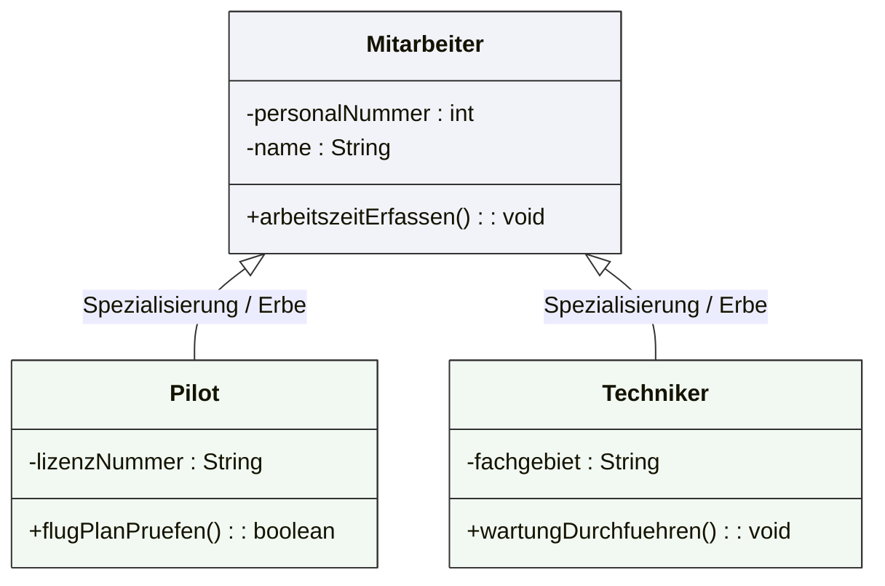

## 🧭 Navigation & Zusammenhänge
- **Vorausgesetztes Thema:** [[18_Übersicht der UML-Diagrammarten nach Entwicklungsphasen]]
- **Nächstes Thema:** [[20_Darstellung von Klassen und Objekten (UML-Spezialkonzepte)]]
- **Verwandte Bausteine:** [[20_Darstellung von Klassen und Objekten (UML-Spezialkonzepte)]], [[21_Vertiefung Klassendiagramm Beziehungen & Sichtbarkeiten]]
---

## 🎯 IHK-Prüfungsrelevanz
> [!IMPORTANT] AP01: Einrichten eines IT-gestützten Arbeitsplatzes
> - **Relevanz:** Niedrig
> - **Fokus:** Grundstruktur objektorientierter Datenmodelle nachvollziehen können.

> [!WARNING] AP02: Konzeption, Administration & Netzwerke
> - **Relevanz:** Höchste (Dauerbrenner)
> - **Fokus:** Das Klassendiagramm ist das mit Abstand am häufigsten geprüfte UML-Diagramm für Fachinformatiker. Die IHK verlangt regelmäßig das Vervollständigen von Klassenrechtecken, das korrekte Eintragen von Datentypen, das Identifizieren von Vererbungslinien sowie die korrekte Definition von Methodenparametern. Hier werden elementare Punkte für die Anwendungsentwicklung vergeben.

---

## 📖 Einfache Erklärung & Praxisbeispiele
Das **Klassendiagramm** ist ein Strukturdiagramm. Es modelliert die am System beteiligten Klassen mit ihren jeweiligen Attributen und Methoden sowie die strukturellen Beziehungen der Klassen untereinander. 

Der kleinste und wichtigste Baustein eines Klassendiagramms ist die **Klasse selbst**, welche grafisch immer als ein dreigeteiltes **Rechteck** dargestellt wird.

### Aufbau einer Klasse im Diagramm:
Ein Klassenrechteck unterteilt sich strikt in drei übereinanderliegende Bereiche:
1. **Klassenname:** Steht ganz oben (z. B. `Konto`, `Mitarbeiter`).
2. **Attributliste:** Enthält die Variablen der Klasse inklusive Datentyp (Zustand des Objekts).
3. **Methodenliste:** Enthält die Funktionalitäten inklusive Übergabeparametern und Rückgabetyp (Verhalten des Objekts).

### Beziehungen im Klassendiagramm:
Klassen existieren selten isoliert. Das Diagramm modelliert drei wesentliche Beziehungsformen:
* **Assoziation (Kommunikation):** Sagt aus, dass Klassen sich kennen und untereinander Methoden aufrufen können.
* **Aggregation und Komposition (Zusammensetzung):** Beschreibt die Aufnahme einer Klasse in eine andere und regelt, wie sich komplexe Klassen aus einfacheren Bausteinen zusammensetzen.
* **Vererbungshierarchie (Generalisierung / Spezialisierung):** Bildet ab, wie spezialisierte Unterklassen die Attribute und Methoden einer übergeordneten Basisklasse (Oberklasse) erben und um eigene Elemente erweitern.
  * 💡 **Praxisbeispiel (Vererbung):** Die Basisklasse heißt `Mitarbeiter`. Die davon abgeleiteten Unterklassen `Techniker` und `Pilot` erben automatisch alle allgemeinen Attribute (wie `personalNummer`), besitzen aber zusätzlich eigene, spezialisierte Attribute (z. B. `lizenzNummer` beim Piloten).

---

## 📊 Visuelle Darstellung (Mermaid.js)

