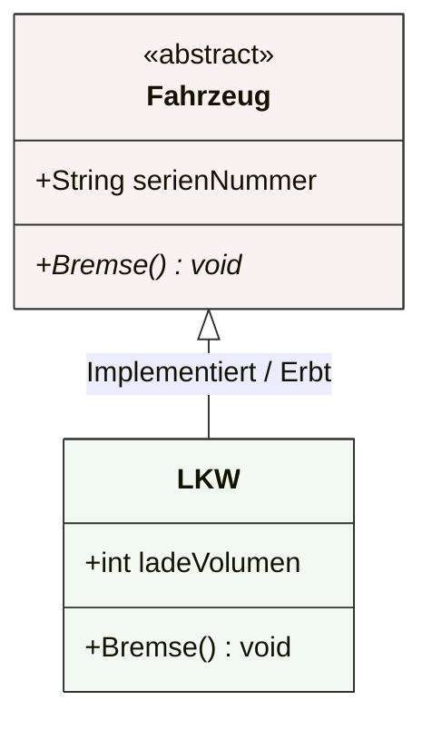

## 🧭 Navigation & Zusammenhänge
- **Vorausgesetztes Thema:** [[19_Das UML-Klassendiagramm]]
- **Nächstes Thema:** [[21_Vertiefung Klassendiagramm Beziehungen & Sichtbarkeiten]]
- **Verwandte Bausteine:** [[19_Das UML-Klassendiagramm]], [[13_Definition & Konzept Was ist eine Klasse]]
---

## 🎯 IHK-Prüfungsrelevanz
> [!IMPORTANT] AP01: Einrichten eines IT-gestützten Arbeitsplatzes
> - **Relevanz:** Niedrig
> - **Fokus:** Grundstruktur von Objektdokumentationen verstehen.

> [!WARNING] AP02: Konzeption, Administration & Netzwerke
> - **Relevanz:** Hoch
> - **Fokus:** Ein sehr beliebter IHK-Prüfungsbereich. Die IHK verlangt in der Software-Konzeption regelmäßig die korrekte Unterscheidung zwischen der Darstellung einer *Klasse* (reiner Bauplan) und eines *Objekts* (konkrete Instanz mit Werten, erkennbar an der Unterstreichung). Häufig müssen auch *abstrakte Klassen* identifiziert oder deren Methoden in abgeleiteten Klassen ausprogrammiert werden.

---

## 📖 Einfache Erklärung & Praxisbeispiele
In UML-Diagrammen wird präzise unterschieden, wie Klassen-Strukturen und reale Objekt-Instanzen dargestellt werden. Neben den Standard-Klassen existieren fortgeschrittene Konstrukte, um komplexe Systemabhängigkeiten abzubilden, Code-Duplikate zu vermeiden oder Datentypen logisch zu gruppieren.

### Fortgeschrittene Darstellungs- und Klassenkonzepte:

* **Abstrakte Klassen und Methoden:** Eine *abstrakte Klasse* dient ausschließlich als Schablone oder Vorlage für abgeleitete Klassen. Aus ihr selbst können **keine Objekte erstellt werden**. Ihre *abstrakten Methoden* besitzen keinen Rumpf (keine Implementierung), sondern stellen lediglich eine Schnittstellenbeschreibung dar. Abgeleitete Unterklassen **müssen** diese Methoden zwingend vollständig ausprogrammieren, um instanziiert werden zu können.
  - 💡 **Praxisbeispiel:** Die abstrakte Oberklasse `Fahrzeug` definiert eine abstrakte Methode `Bremse()`. Da ein Server-Skript kein allgemeines "Fahrzeug" erzeugen kann, wird erst die Unterklasse `LKW` instanziiert, welche die Methode `Bremse()` konkret ausprogrammiert.
* **Klassenattribute & Klassenmethoden (`static`):** Elemente, auf die direkt durch den Aufruf des Klassennamens zugegriffen werden kann. Es wird kein Objekt benötigt, da sie global für die Klasse existieren.
* **Klassenerweiterung (`Extend`):** Ermöglicht es, bestehende Klassen schrittweise (inkrementell) zu verändern, falls eine klassische Vererbung im System nicht anwendbar oder sinnvoll ist.
* **Stereotypen bei Attributen:** Ein Stereotyp bündelt mehrere Einzelattribute zu einer inhaltlich zusammengehörigen, komplexen Struktur.
  - 💡 **Praxisbeispiel:** Das Attribut `Kunde.anschrift` nutzt den Stereotyp `Person`, welcher automatisch die Unterdaten `Vorname`, `Nachname` und `Strasse` beinhaltet.

### Notationen für Objekte (Instanzen):
Ein Objekt wird im Diagramm daran erkannt, dass sein Name **unterstrichen** ist. Es speichert konkrete Werte in seinen Objekt-Attributen. Es gibt drei Notationsweisen für den Kopf des Rechtecks:
1. **Nur mit Objektname:** `X-Obj` (Die zugrunde liegende Klasse ist in dieser Sicht implizit oder egal).
2. **Mit Objekt- und Klassenname:** `X-Obj:Klasse xyz` (Eindeutige Zuordnung einer konkreten Instanz zu ihrem Bauplan).
3. **Nur mit Klassenname (Anonymes Objekt):** `:Klasse xyz` (Wichtig, wenn nur der Zustand eines exemplarischen Objekts dieser Klasse dargestellt werden soll).

---

## 📊 Visuelle Darstellung (Mermaid.js)

