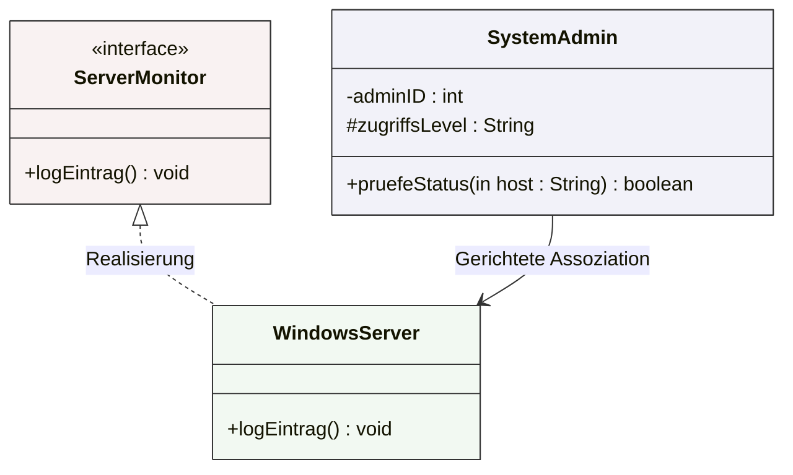

## 🧭 Navigation & Zusammenhänge
- **Vorausgesetztes Thema:** [[20_Darstellung von Klassen und Objekten (UML-Spezialkonzepte)]]
- **Nächstes Thema:** [[01_Datenbankmodelle & Schichtenmodell der Erkenntnis]] *(Übergang zu Modul 05)*
- **Verwandte Bausteine:** [[08_Objektorientierung Datenelemente & Sichtbarkeiten]], [[19_Das UML-Klassendiagramm]]
---

## 🎯 IHK-Prüfungsrelevanz
> [!IMPORTANT] AP01: Einrichten eines IT-gestützten Arbeitsplatzes
> - **Relevanz:** Niedrig
> - **Fokus:** Grundlegendes Verständnis der in IT-Systemen dokumentierten Schnittstellen.

> [!WARNING] AP02: Konzeption, Administration & Netzwerke
> - **Relevanz:** Höchste (Absoluter IHK-Standard)
> - **Fokus:** Die IHK prüft die exakte Syntax von Attributen und Operationen im Klassendiagramm auf den Punkt genau. Du musst in Prüfungen die Symbole für die Sichtbarkeiten (`+`, `-`, `#`) blind beherrschen und die genauen Richtungen von Parametern (`in`, `out`) oder Notationstypen abrufen können. Fehler bei der Doppelpunkt-Trennung oder den Klammern kosten direkt wertvolle Punkte.

---

## 📖 Einfache Erklärung & Praxisbeispiele
Ein **UML-Klassendiagramm** beschreibt die statische Struktur eines Systems. Um daraus echten Programmcode generieren zu können, nutzt UML eine hochgradig standardisierte und präzise Syntax für Datenfelder (Attribute) und Funktionen (Operationen/Methoden). Ergänzt wird dies durch exakt definierte Beziehungstypen, die regeln, wie Klassen voneinander abhängen oder miteinander kommunizieren.

### 1. Offizielle UML-Syntax für Member
* **Syntax für Attribute:** `Sichtbarkeit Attributname : Typ [Multiplizität] = Initialwert {Eigenschaften}`
  * 💡 **Praxisbeispiel:** `- ipAdresse : String [1] = "192.168.1.1" {readOnly}`
* **Syntax für Operationen (Methoden):** `Sichtbarkeit Operationsname (Parameterliste) : Rückgabetyp`
  * **Parameterliste:** `Richtung Name : Typ = Standardwert`
  * 💡 **Praxisbeispiel:** `+ sendePing (in packetSize : int = 64) : boolean` (Die Richtung `in` bedeutet, dass der Wert reines Leserecht für die Methode hat).

### 2. Die vier IHK-Sichtbarkeiten (Access Modifier)
* `+` **public:** Das Element ist komplett offen und von jeder anderen Klasse aus sichtbar.
* `#` **protected:** Sichtbar nur innerhalb der eigenen Klasse und von Klassen, die per Vererbung von ihr abgleitet wurden.
* `-` **private:** Das Element ist gekapselt. Zugriff gibt es *ausschließlich* innerhalb der eigenen Klasse.
* `~` **package:** Das Element ist für alle Klassen sichtbar, die im selben logischen Paket (Namensraum) liegen.

### 3. Grundlegende Beziehungsformen
* **Assoziation (Allgemeine Beziehung):** Eine einfache Verbindungslinie. Klassen kennen sich. Ist ein Pfeil am Ende (gerichtete Assoziation), kennt Klasse1 zwar Klasse2, aber Klasse2 weiß nichts von Klasse1.
* **Abhängigkeit (Dependency):** Eine gestrichelte Pfeillinie (`--->`). Sie besagt, dass die abhängige Klasse eine temporäre Änderung oder Nutzung der unabhängigen Klasse durchführt (z. B. als lokaler Methodenparameter). Ein Ausfall der unabhängigen Klasse bricht die abhängige Klasse.
* **Realisierung (Schnittstelle):** Eine gestrichelte Linie mit einem leeren Pfeilkopf (`---|>`). Sie zeigt an, dass eine Klasse eine vorgegebene Schnittstelle (`«interface»`) konkret ausprogrammiert.

---

## 📊 Visuelle Darstellung (Mermaid.js)

