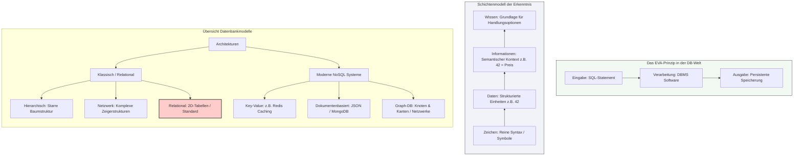

## 🧭 Navigation & Zusammenhänge
- **Vorausgesetztes Thema:** [[21_Vertiefung Klassendiagramm Beziehungen & Sichtbarkeiten]]
- **Nächstes Thema:** [[01_Grundlagen relationaler Datenbanken & ER-Modellierung]]
- **Verwandte Bausteine:** [[06_ANSI-SPARC 3-Ebenen-Architektur & ERM (Chen-Notation)]], [[04_ANSI-SPARC 3-Ebenen-Architektur & Chen-Notation]]

---

## 🎯 IHK-Prüfungsrelevanz
> [!IMPORTANT] AP01: Einrichten eines IT-gestützten Arbeitsplatzes
> - **Relevanz:** Niedrig
> - **Fokus:** Verständnis des EVA-Prinzips (Eingabe, Verarbeitung, Ausgabe) bei lokalen Systemabfragen und der persistenten Konfigurationsspeicherung.

> [!WARNING] AP02: Konzeption, Administration & Netzwerke
> - **Relevanz:** Hoch
> - **Fokus:** Systemintegratoren müssen in der Prüfung moderne relationale Systeme von klassischen oder alternativen Datenbankmodellen (z. B. NoSQL) abgrenzen können. Ein wiederkehrendes Prüfungsthema ist zudem das Verständnis des Datenbankmanagementsystems (DBMS) als Steuerungsinstanz sowie die Abgrenzung von strukturierten Datenbanken gegenüber unstrukturierten Dateisystemen zur Gewährleistung der Datenkonsistenz.

---

## 📖 Einfache Erklärung & Praxisbeispiele
Um Informationen in IT-Systemen stabil und abfragbar zu sichern, haben moderne **Datenbanken** (DB) unstrukturierte Dateisysteme abgelöst. Sie bieten eine **persistente** (langfristige und nicht-flüchtige) Datenhaltung. Das **Datenbankmanagementsystem (DBMS)** bildet hierbei die Softwarekomponente, welche die logische Sicht der Benutzer verwaltet, den Mehrbenutzerbetrieb steuert und die physische Datei auf dem Speichermedium absichert.

### Das Schichtenmodell der Erkenntnis
Bevor Daten in Systemen verarbeitet werden können, durchlaufen sie Abstraktionsstufen:
- **Zeichen (Syntax):** Die unterste Ebene, bestehend aus reinen Symbolen (Buchstaben, Ziffern) ohne jeglichen Kontext.
- **Daten:** Verknüpfen Zeichen zu einer strukturierten Einheit, sind jedoch ohne Kontext reine bedeutungslose Werte.
  - 💡 **Praxisbeispiel:** Die isolierte Zeichenfolge `42` ist ein reiner Datenwert.
- **Informationen (Semantik):** Entstehen, wenn Daten mit einem semantischen Kontext versehen und interpretiert werden.
  - 💡 **Praxisbeispiel:** Wird der Datenwert `42` mit der Spaltenüberschrift `Preis` verknüpft, entsteht die Nutzinformation: *"Der Artikel kostet 42 Euro"*.
- **Wissen (Pragmatik):** Verknüpft verschiedene Informationen miteinander, um Handlungsoptionen zu generieren und fundierte Entscheidungen zu treffen.

### Strukturmodelle im Vergleich
Je nach Anwendungszweck und historischem Kontext unterscheidet man verschiedene Datenbankarchitekturen:

#### 1. Klassische & Relationale Modelle
- **Hierarchisches Modell:** Organisiert Daten in einer starren Baumstruktur mit strikten Vater-Kind-Beziehungen (Nachteil: unflexibel bei n:m-Beziehungen).
- **Netzwerkmodell:** Erweiterung des hierarchischen Ansatzes um Querbeziehungen; Datensätze können mehrere Vorgänger besitzen (Nachteil: enormer Wartungsaufwand für Zeigerstrukturen).
- **Relationales Modell:** Der heutige IT-Standard. Speichert Daten mathematisch fundiert in zweidimensionalen Tabellen (Relationen). Datensätze bilden die Zeilen (Tupel), Spaltenüberschriften definieren die Attribute. Die Abfrage erfolgt über SQL.
- **Objektorientiertes Modell:** Speichert Objekte direkt aus dem Programmcode ab und verhindert den Performance-Verlust durch die Tabellenumwandlung (oft realisiert als OR-Mapping).

#### 2. Moderne NoSQL-Modelle (Horizontale Skalierung für Big Data)
- **Key-Value Stores:** Speicherung als extrem schnelles Paar aus Schlüssel und Wert (z. B. Redis für Caching-Systeme).
- **Dokumentenorientierte Systeme:** Daten werden flexibel ohne starres Schema in JSON- oder XML-Dokumenten abgelegt (z. B. MongoDB).
- **Graph-Datenbanken:** Speichert hochkomplexe Netzwerke und Verbindungen performant mittels Knoten und Kanten ab (z. B. für soziale Medien).

---

## 📊 Visuelle Darstellung (Mermaid.js)

