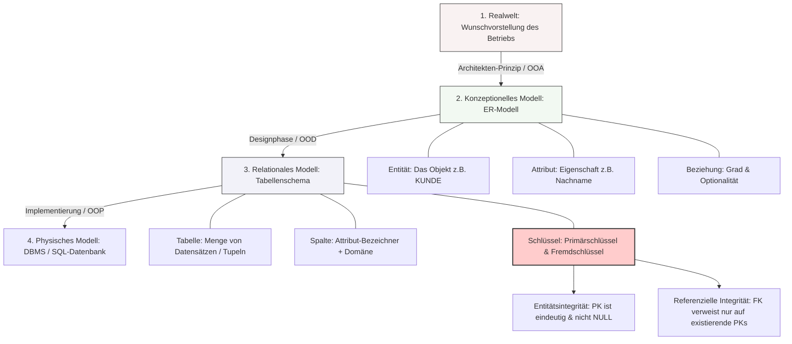

## 🧭 Navigation & Zusammenhänge
- **Vorausgesetztes Thema:** [[01_Datenbankmodelle & Schichtenmodell der Erkenntnis]]
- **Nächstes Thema:** [[02_SQL-Datentypen & Domänen im Detail]]
- **Verwandte Bausteine:** [[05_Relationales Mapping Vom ERM zum Tabellenschema]], [[08_Grundlagen der persistenten Datenhaltung & Datenmodellierung]]
---

## 🎯 IHK-Prüfungsrelevanz
> [!IMPORTANT] AP01: Einrichten eines IT-gestützten Arbeitsplatzes
> - **Relevanz:** Niedrig bis Mittel
> - **Fokus:** Verständnis grundlegender Datenstrukturen zur Speicherung von Konfigurationsdaten. Erkennen von einfachen Attributen und Werten bei lokalen Systemabfragen.

> [!WARNING] AP02: Konzeption, Administration & Netzwerke
> - **Relevanz:** Extrem Hoch
> - **Fokus:** Ein absolutes Kern- und Standardthema jeder FISI-Prüfung. Die IHK fordert regelmäßig das Zeichnen und Interpretieren von Entity-Relationship-Modellen (ERM), das Bestimmen von Kardinalitäten (1:1, 1:n, n:m), die Definition von Primär- und Fremdschlüsseln sowie die Gewährleistung von Entitätsintegrität und referenzieller Integrität.

---

## 📖 Einfache Erklärung & Praxisbeispiele
Die **konzeptionelle Datenmodellierung** beschreibt die Informationsanforderungen eines Unternehmens aus der "Modellwelt" (Was wird benötigt?), unabhängig von der späteren technischen Hardware- oder Softwareumgebung (Wie wird es umgesetzt?). Das gängigste Werkzeug hierfür ist das **Entity-Relationship-Modell (ERM)**. Beim Übergang in die **relationale Modellierung** (die physische Datenbank) werden aus den fachlichen Entitäten konkrete Tabellen und aus den Eigenschaften (Attributen) konkrete Spalten, in denen Datensätze (Tupel) gespeichert werden.

### Unterthemen & Anschauliche Beispiele:
- **Entity (Entität):** Eine Kategorie von Dingen oder Objekten, die für das Unternehmen wichtig sind und über die Daten gespeichert werden (normalerweise ein Hauptwort im Singular). Eine konkrete Ausprägung nennt man Instanz.
  - 💡 **Praxisbeispiel:** Ein FISI modelliert für ein Ticket-System die Entität `KUNDE` (Kategorie). Der konkrete Eintrag für "Max Mustermann" ist eine Instanz dieser Entität.
- **Attribut:** Eine einwertige Eigenschaft, die eine Entität näher beschreibt. Sie können obligatorisch (Not Null / zwingend erforderlich) oder optional sein.
  - 💡 **Praxisbeispiel:** In der Entität `MITARBEITER` ist das Attribut `Nachname` obligatorisch (muss beim Anlegen bekannt sein), während das Attribut `Schuhgröße` optional oder gar nicht relevant ist.
- **Primärschlüssel (PK) & Entitätsintegrität:** Ein eindeutiger Identifikator eines Datensatzes. Die Entitätsintegrität besagt, dass kein Primärschlüsselwert doppelt vorkommen darf und nicht leer (Null) sein darf.
  - 💡 **Praxisbeispiel:** Da Namen nicht eindeutig sind, führt der Systemintegrator eine künstliche, fortlaufende `Kunden_ID` als Primärschlüssel ein, um Verwechslungen bei Namensgleichheit auszuschließen.
- **Fremdschlüssel (FK) & Referenzielle Integrität:** Ein Fremdschlüssel ist ein Attribut in einer Tabelle, das auf den Primärschlüssel einer anderen Tabelle verweist, um eine Beziehung abzubilden. Die referenzielle Integrität garantiert, dass keine "toten" Verweise existieren (ein FK-Wert muss als PK in der Vatertabelle existieren).
  - 💡 **Praxisbeispiel:** In der Tabelle `BESTELLUNG` existiert die Spalte `Kunden_ID` als Fremdschlüssel. Das Datenbanksystem verhindert (z. B. via `RESTRICTED`), dass ein Kunde gelöscht wird, solange er noch offene Bestellungen besitzt.
- **Kardinalitäten & Löschen von Referenzen:** Beziehungen besitzen Grade (1:1, 1:n, n:m). Beim Löschen von Daten steuern Regeln das Systemverhalten: `CASCADE` (löscht abhängige Daten mit), `RESTRICTED` (verbietet das Löschen) oder `SET NULL` (setzt den Verweis auf leer).
  - 💡 **Praxisbeispiel:** Wird ein `PROJEKT` gelöscht, sorgt `CASCADE` dafür, dass alle zugehörigen `PROJEKTAUFGABEN` automatisch ebenfalls aus der Datenbank entfernt werden.

---

## 📊 Visuelle Darstellung (Mermaid.js)

