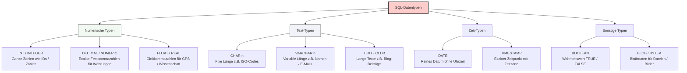

## 🧭 Navigation & Zusammenhänge
- **Vorausgesetztes Thema:** [[01_Grundlagen relationaler Datenbanken & ER-Modellierung]]
- **Nächstes Thema:** [[03_Normalisierung von Datenbanken & Anomalien]]
- **Verwandte Bausteine:** [[02_Programmiergrundlagen Datentypen, Operatoren & Kontrollstrukturen]], [[18_Tabellenstrukturen mit Datentypen & Constraints physisch anlegen]]
---

## 🎯 IHK-Prüfungsrelevanz
> [!IMPORTANT] AP01: Einrichten eines IT-gestützten Arbeitsplatzes
> - **Relevanz:** Mittel
> - **Fokus:** Zuweisung korrekter Datentypen bei der Skript-basierten Inventarisierung oder beim Auslesen von Hardware-Parametern (z. B. Speicherkapazitäten als Integer).

> [!WARNING] AP02: Konzeption, Administration & Netzwerke
> - **Relevanz:** Hoch
> - **Fokus:** In IHK-Prüfungen musst du beim logischen und physischen Datenbankentwurf (z. B. beim Schreiben von `CREATE TABLE`-Statements) zwingend die passenden Datentypen für Attribute wählen. Typische Fallstricke sind die falsche Wahl zwischen `CHAR` und `VARCHAR` oder das Nutzen von unpräzisen Gleitkommazahlen (`FLOAT`) für kaufmännische Werte wie Preise.

---

## 📖 Einfache Erklärung & Praxisbeispiele
Jedes Attribut in einer relationalen Datenbank benötigt eine **Domäne** (einen definierten Wertebereich) und einen konkreten **Datentyp**. Der Datentyp legt fest, welche Art von Werten (z. B. Zahlen, Text, Datum) in einer Tabellenspalte gespeichert werden darf. Das Datenbankmanagementsystem (DBMS) erzwingt diese Typsicherheit. Versucht ein Benutzer oder ein Skript, einen inkompatiblen Datentyp einzufügen, wird die Transaktion zum Schutz der Datenintegrität strikt abgewiesen.

### Unterthemen & Anschauliche Beispiele:
- **Ganzzahlen & Festkommazahlen:** `INT` / `INTEGER` wird für zählbare Mengen ohne Nachkommastellen genutzt. `DECIMAL` / `NUMERIC` bietet absolute Präzision ohne Rundungsfehler für kaufmännische Werte.
  - 💡 **Praxisbeispiel:** Ein FISI definiert die Spalte `User-ID` als `INT`. Für die Spalte `Preis` wählt er zwingend `DECIMAL`, um kaufmännische Rundungsfehler bei Abrechnungen zu verhindern.
- **Gleitkommazahlen (Floats):** `FLOAT` / `REAL` speichert riesige Wertebereiche bei wissenschaftlichen Berechnungen, nimmt dafür aber minimale Rundungsfehler in Kauf.
  - 💡 **Praxisbeispiel:** Zur Absicherung von Standortdaten in einer Flottenmanagement-Datenbank wird eine `GPS-Koordinate` (z. B. 51.5074) als `FLOAT` deklariert.
- **Fixer vs. Variabler Text:** `CHAR(n)` reserviert immer die feste Länge n im Speicher. `VARCHAR(n)` ist dynamisch und belegt nur so viel Platz, wie der Text tatsächlich lang ist.
  - 💡 **Praxisbeispiel:** Ein `ISO-Ländercode` wie 'DE' ist immer exakt 2 Zeichen lang → `CHAR(2)`. Ein `Nachname` schwankt stark in der Länge → `VARCHAR(50)`.
- **Langer Text & Binärdaten:** `TEXT` / `CLOB` nimmt unbegrenzt lange Freitexte auf. `BLOB` / `BYTEA` speichert binäre Rohdaten direkt in der Datenbank.
  - 💡 **Praxisbeispiel:** Für das Speichern von `Blog-Artikeln oder Kommentaren` greift der Administrator zu `TEXT`. Ein hochgeladenes `Profilbild` wird als `BLOB` hinterlegt (sollte aus Performancegründen aber sparsam genutzt werden).
- **Zeit- und Wahrheitswerte:** `DATE` speichert reine Kalendertage. `TIMESTAMP` erfasst präzise Zeitpunkte. `BOOLEAN` bildet binäre Zustände (True/False) ab.
  - 💡 **Praxisbeispiel:** Das `Geburtsdatum` eines Kunden benötigt keine Uhrzeit → `DATE`. Die Protokollierung einer `Login-Zeit` erfordert Sekundengenauigkeit → `TIMESTAMP`. Der Status eines `Newsletter-Abos` wird über `BOOLEAN` geregelt.

---

## 📊 Visuelle Darstellung (Mermaid.js)

