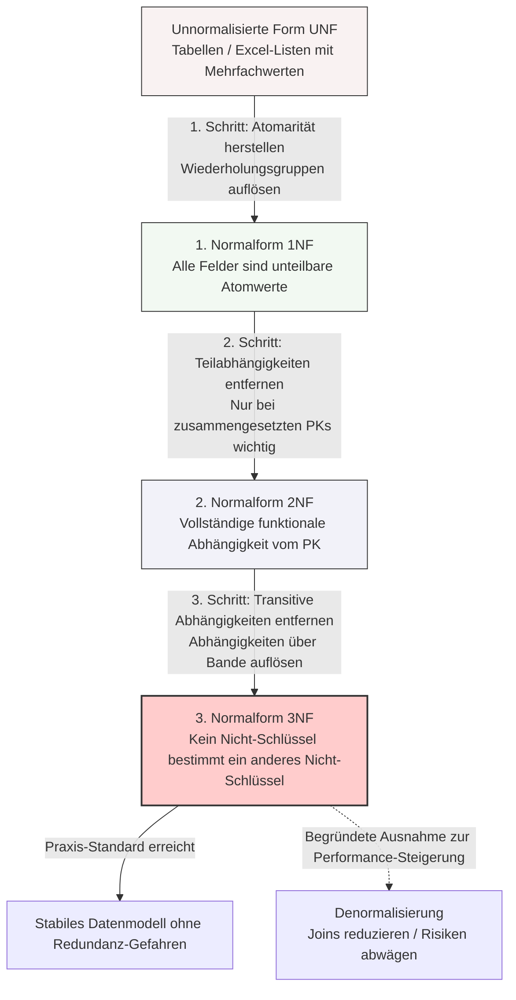

## 🧭 Navigation & Zusammenhänge
- **Vorausgesetztes Thema:** [[02_SQL-Datentypen & Domänen im Detail]]
- **Nächstes Thema:** [[04_ANSI-SPARC 3-Ebenen-Architektur & Chen-Notation]]
- **Verwandte Bausteine:** [[06_Datenbank-Anomalien]], [[05🗄️Datenbanken/07_Schritt-für-Schritt-Normalisierung]]
---

## 🎯 IHK-Prüfungsrelevanz
> [!IMPORTANT] AP01: Einrichten eines IT-gestützten Arbeitsplatzes
> - **Relevanz:** Niedrig bis Mittel
> - **Fokus:** Strukturierung von lokalen Konfigurationsdateien (z. B. CSV-Listen) nach dem Prinzip der Atomarität, um die softwareseitige Verarbeitung zu erleichtern.

> [!WARNING] AP02: Konzeption, Administration & Netzwerke
> - **Relevanz:** Extrem Hoch
> - **Fokus:** Eines der am häufigsten abgefragten Themen im Bereich Anwendungsentwicklung/Datenbanken für Systemintegratoren. Die IHK verlangt regelmäßig die Definition der drei klassischen Anomalie-Typen sowie die schrittweise Überführung einer unstrukturierten Tabelle von der UNF bis in die 3NF. Ein präzises Verständnis funktionaler und transitiver Abhängigkeiten ist hierbei zwingend erforderlich.

---

## 📖 Einfache Erklärung & Praxisbeispiele
Die **Normalisierung** ist die systematische Umwandlung eines Datenmodells in aufeinander aufbauende Stufen (Normalformen). Das primäre Ziel ist die Vermeidung von **Datenredundanz** (mehrfache Speicherung identischer Informationen) und den daraus resultierenden **Anomalien** (Fehlverhalten der Datenbank bei Transaktionen), um die Konsistenz und Effizienz der Datenhaltung zu garantieren.

### Die Gefahren: Datenbank-Anomalien in der Praxis
- **Einfüge-Anomalie (Insert Anomaly):** Daten können nicht in die Datenbank aufgenommen werden, weil ein bestimmter Teil der Information noch fehlt.
  - 💡 **Praxisbeispiel:** Wenn der Primärschlüssel an die `TeilnehmerId` gekoppelt ist, kann ein neu angebotener Kurs ohne Anmeldungen nicht im System hinterlegt werden. Das System blockiert die Transaktion.
- **Änderungs-Anomalie (Update Anomaly):** Führt zu logischen Widersprüchen und inkonsistenten Daten, weil eine Aktualisierung redundanter Daten nicht an allen Speicherorten gleichzeitig durchgeführt wird.
  - 💡 **Praxisbeispiel:** Ein Dozent erhält eine neue Telefonnummer. Der Administrator ändert die Nummer in der Zeile seines SQL-Kurses, vergisst jedoch den Eintrag in der Zeile seines Linux-Kurses.
- **Lösch-Anomalie (Delete Anomaly):** Führt zum unbeabsichtigten Verlust von wichtigen Informationen, die man eigentlich gar nicht entfernen wollte.
  - 💡 **Praxisbeispiel:** Meldet sich der einzige Teilnehmer aus einem seltenen Kurs ab und wird seine Zeile gelöscht, verschwinden im selben Zug alle Stammdaten (Name, Telefon) des Dozenten aus dem System.

### Schritt für Schritt zur 3. Normalform (3NF)
- **1. Normalform (1NF) – Atomarität:** Jedes Attribut muss einen elementaren, unteilbaren Wert enthalten (Atomarität). Es dürfen keine Aufzählungen, Listen oder Wiederholungsgruppen (z. B. Spalten wie `Telefon1`, `Telefon2`) existieren.
  - 💡 **Praxisbeispiel:** Eine Tabellenspalte `Anschrift` enthält den Wert *"Husemannstraße 4, 88991 Bopfingen"*. Für die 1NF wird das Feld in vier separate Spalten zerlegt: `Straße`, `Hausnummer`, `PLZ` und `Ort`.
- **2. Normalform (2NF) – Keine Teilabhängigkeiten:** Die 1NF muss erfüllt sein und jedes Nichtschlüsselattribut muss vom *gesamten* Primärschlüssel voll funktional abhängig sein. Dies ist besonders bei zusammengesetzten Schlüsseln relevant; Attribute, die nur von einem Teil des Schlüssels abhängen, werden in eine neue Tabelle ausgelagert.
  - 💡 **Praxisbeispiel:** Bei einem zusammengesetzten Schlüssel aus `MitarbeiterId` und `ProjektId` hängt das Attribut `Mitarbeiter_Nachname` nur von der `MitarbeiterId` ab. Lösung: Die Mitarbeiter-Stammdaten werden in eine eigene Tabelle ausgelagert.
- **3. Normalform (3NF) – Keine transitiven Abhängigkeiten:** Die 2NF muss erfüllt sein und es dürfen keine transitiven Abhängigkeiten existieren. Ein Nicht-Schlüsselattribut darf also nicht "über Bande" (A → B → C) ein anderes Nicht-Schlüsselattribut bestimmen.
  - 💡 **Praxisbeispiel:** In einer Fahrzeugtabelle bestimmt das `Kennzeichen` (PK) das `Modell` und das `Modell` wiederum den `Hersteller`. Da der Hersteller transitiv vom Kennzeichen abhängt, wird die Zuweisung von `Modell` → `Hersteller` in eine separate Stammdaten-Tabelle überführt.

> [!TIP] Der klassische Merksatz zur 3NF (nach Bill Kent)
> **"The Key, the Whole Key, and Nothing but the Key"**
> - *The Key* = 1NF (Alles hängt an einem eindeutigen Schlüssel)
> - *The Whole Key* = 2NF (Alles hängt vom vollständigen Schlüssel ab, keine Teilbereiche)
> - *Nothing but the Key* = 3NF (Alles hängt direkt und ohne Umwege nur vom Schlüssel ab)

---

## 📊 Visuelle Darstellung (Mermaid.js)

