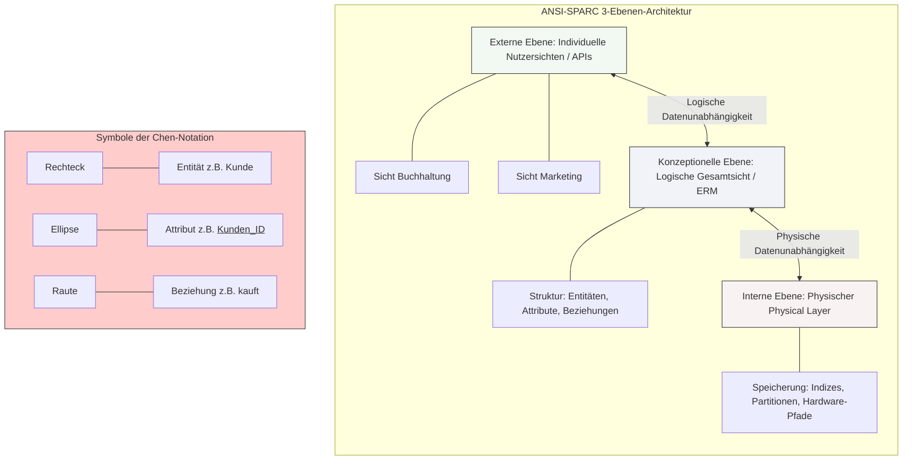

tags: [fisi, ihk, lernsheet]
## 🧭 Navigation & Zusammenhänge
- **Vorausgesetztes Thema:** [[03_Normalisierung von Datenbanken & Anomalien]]
- **Nächstes Thema:** [[05_Relationales Mapping Vom ERM zum Tabellenschema]]
- **Verwandte Bausteine:** [[06_ANSI-SPARC 3-Ebenen-Architektur & ERM (Chen-Notation)]], [[01_Datenbankmodelle & Schichtenmodell der Erkenntnis]]
---

🎯 IHK-Prüfungsrelevanz

> [!IMPORTANT] AP01: Einrichten eines IT-gestützten Arbeitsplatzes
> 
> - **Relevanz:** Niedrig
> - **Fokus:** Verständnis von Benutzersichten (Schnittstellen) beim Client-Zugriff auf zentrale Datenbestände.

> [!WARNING] AP02: Konzeption, Administration & Netzwerke
> 
> - **Relevanz:** Sehr Hoch
> - **Fokus:** Die ANSI-SPARC-Architektur dient als theoretisches Fundament zur Erklärung der Datenunabhängigkeit bei Systemerweiterungen. Die grafische Modellierung nach der klassischen **Peter-Chen-Notation** (inklusive korrekter Kardinalitäten) ist eine IHK-Standardaufgabe. Du musst Geschäftsprozesse fehlerfrei in Entitäten, Attribute und Beziehungen übersetzen können.

---

📖 Einfache Erklärung & Praxisbeispiele

Die ANSI-SPARC 3-Ebenen-Architektur

Die **ANSI-SPARC-Architektur** ist ein internationaler Architekturstandard für Datenbankmanagementsysteme. Ihr Hauptziel ist es, den Anwender von den technischen Details der physischen Speicherung abzuschirmen und **Datenunabhängigkeit** zu gewährleisten. Sie unterteilt sich in drei streng voneinander getrennte Schichten:

- **Externe Ebene (View Layer):** Die individuelle Sicht für verschiedene Benutzergruppen oder Anwendungen (UIs, APIs). Sie sorgt für Datenschutz und Übersichtlichkeit.
    - 💡 **Praxisbeispiel:** In einem HR-System sieht die Buchhaltung das Gehalt und die Bankverbindung eines Mitarbeiters (Sicht A), während die Projektplanung nur den Namen und die Abteilung einsehen darf (Sicht B).
- **Konzeptionelle Ebene (Logical Layer):** Die logische Gesamtsicht aller Daten des Unternehmens. Sie bildet das Herzstück der Modellierung und definiert, _welche_ Entitäten, Attribute und Beziehungen überhaupt existieren. Sie ist völlig unabhängig von der Hardware.
    - 💡 **Praxisbeispiel:** Das gesamte ER-Modell oder Tabellenschema, das die Zusammenhänge zwischen den Entitäten `Dozent`, `Kurs` und `Schüler` abbildet.
- **Interne Ebene (Physical Layer):** Beschreibt die physische Art und Form der Speicherung auf dem eigentlichen Datenträger. Hier werden Speicherpfade, Dateistrukturen und Indizes zur Performance-Optimierung definiert.
    - 💡 **Praxisbeispiel:** Das Festlegen, ob Tabellen auf einer schnellen NVMe-SSD in einem bestimmten Dateisystem abgelegt werden und welche Spalten einen B-Baum-Index zur Beschleunigung erhalten.

> [!TIP] Das Prinzip der Datenunabhängigkeit
> 
> - **Physische Datenunabhängigkeit:** Die interne Ebene kann verändert werden (z. B. SSD-Tausch, Speicherpfad ändern), ohne dass das konzeptionelle Schema angepasst werden muss.
> - **Logische Datenunabhängigkeit:** Das konzeptionelle Schema kann erweitert werden (z. B. neue Tabellenspalte hinzufügen), ohne dass bestehende Anwendungsprogramme oder Benutzersichten der externen Ebene abstürzen.

---

Grafische ER-Modellierung nach Peter Chen

Die **Chen-Notation** ist die klassische Sprache der Datenbankdesigner. Sie nutzt geometrische Symbole zur abstrakten Beschreibung von Realweltszenarien:

- **Entität (Rechteck):** Ein eindeutig identifizierbares Objekt, beschriftet mit einem Substantiv im Singular.
    - _Best Practice:_ Nutze konkrete, klare Begriffe (z. B. `Kunde` statt `Menschen`) und vermeide kryptische Abkürzungen.
- **Attribut (Ellipse):** Eine beschreibende Eigenschaft, die über eine Linie an der Entität hängt. Der Primärschlüssel wird zwingend **unterstrichen**.
    - _Fehlerquelle:_ Achte auf Atomarität! Ein Feld `Anschrift` (Straße, PLZ, Ort in einem) oder ein mehrwertiges Feld `Hobby` sind im ERD verboten. Zerlege sie in `Vorname`, `PLZ` etc.
- **Beziehung (Raute / Diamant):** Verbindet Entitäten logisch miteinander und wird meist mit einem Verb deklariert.
    - _Fehlerquelle:_ Vermeide nichtsagende Füllwörter wie "hat" oder "besitzt" als Beziehungsnamen. Nutze präzise Tätigkeitswörter (z. B. Kunde `leiht_aus` Film).

Bestimmung von Kardinalitäten

Sie quantifizieren die logischen Beziehungen und beantworten die Frage: _„Wie viele Instanzen von A gehören zu wie vielen von B?“_

- **1:1 (Eins-zu-Eins):** Jedes Objekt aus A gehört zu genau einem Objekt aus B.
    - 💡 _Beispiel:_ Eine `Person` besitzt genau einen `Personalausweis`.
- **1:n (Eins-zu-Viele):** Ein Objekt aus A kann mit vielen aus B verknüpft sein, aber ein Objekt aus B gehört zu genau einem aus A.
    - 💡 _Beispiel:_ Eine `Abteilung` beschäftigt viele `Mitarbeiter`.
- **m:n (Viele-zu-Viele):** Viele Objekte aus A sind mit vielen aus B verknüpft. Dies ist die komplexeste Beziehungsart und erfordert beim physischen Tabellendesign später eine Hilfskoppeltabelle.
    - 💡 _Beispiel:_ Ein `Student` besucht viele `Kurse` und ein `Kurs` hat viele `Studenten`.

