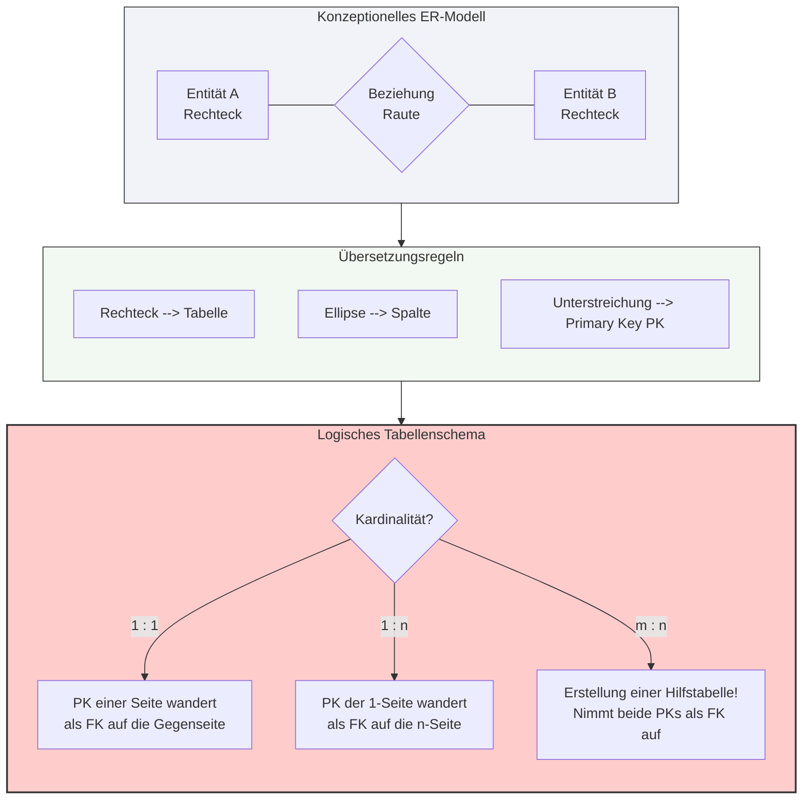

tags: [fisi, ihk, lernsheet]

## 🧭 Navigation & Zusammenhänge
- **Vorausgesetztes Thema:** [[04_ANSI-SPARC 3-Ebenen-Architektur & Chen-Notation]]
- **Nächstes Thema:** [[06_Datenbank-Anomalien]]
- **Verwandte Bausteine:** [[01_Grundlagen relationaler Datenbanken & ER-Modellierung]], [[18_Tabellenstrukturen mit Datentypen & Constraints physisch anlegen]]
---

🎯 IHK-Prüfungsrelevanz

> [!IMPORTANT] AP01: Einrichten eines IT-gestützten Arbeitsplatzes
> 
> - **Relevanz:** Niedrig
> - **Fokus:** Strukturierung lokaler Datenexporte (z. B. CSV) unter Zuweisung eindeutiger Spaltenköpfe zur Vermeidung von Verarbeitungsfehlern.

> [!WARNING] AP02: Konzeption, Administration & Netzwerke
> 
> - **Relevanz:** Extrem Hoch
> - **Fokus:** Der logische Entwurf (die Ableitung des Tabellenschemas aus einem gegebenen ER-Diagramm) ist ein absoluter IHK-Klassiker. Fehler beim Schlüssel-Mapping (z. B. Fremdschlüssel auf die falsche Tabellenseite gesetzt oder das Vergessen einer Hilfstabelle bei m:n) führen zu massivem Punktabzug und verletzen die referenzielle Integrität.

---

📖 Einfache Erklärung & Praxisbeispiele

Der **Mapping-Prozess** beschreibt den Übergang von der konzeptionellen Ebene (ERM) zur logischen Ebene (relationales Tabellenschema). Dabei werden die theoretischen grafischen Objekte in eine physische Tabellenstruktur transformiert, welche die Grundlage für die spätere SQL-Implementierung bildet.

Die vier Grundregeln des Mappings

- **Grundregel 1 – Entitäten werden zu Tabellen:** Jedes Rechteck im ERD wird zu einer eigenständigen Tabelle. Als Namenskonvention gilt die Verwendung von Substantiven im Singular.
    - 💡 **Praxisbeispiel:** Aus der Entität `Kunde` wird die Tabelle `Kunde`.
- **Grundregel 2 – Attribute werden zu Spalten:** Die Ellipsen definieren die Spaltenköpfe der jeweiligen Tabelle. Hierbei gilt das strikte Gebot der **Atomarität** (keine Listen oder mehrwertige Attribute innerhalb einer Zelle). Für jedes Attribut muss ein passender Datentyp definiert werden.
- **Grundregel 3 – Primärschlüssel (PK):** Unterstrichene Attribute werden als eindeutige Identifikatoren (`Primary Keys`) der Tabelle festgelegt. Für PK-Spalten gilt ein striktes Verbot von Leerwerten (`NOT NULL`).
- **Grundregel 4 – Fremdschlüssel (FK) für Beziehungen:** Eine Raute (Beziehung) wird im Tabellenschema technisch über einen Fremdschlüssel (`Foreign Key`) realisiert. Ein FK ist ein Attribut in einer Tabelle, das auf den Primärschlüssel einer anderen Tabelle verweist, um die **referenzielle Integrität** abzusichern und Waisen-Datensätze zu verhindern.

Auflösung der Beziehungstypen (Kardinalitäten)

Die Art und Weise, wie Schlüssel wandern, hängt vollständig von der Kardinalität der Beziehung ab:

- **1:1 Beziehung:** Der Primärschlüssel einer Seite wandert als Fremdschlüssel in die Tabelle der anderen Seite. Bei einer sehr hohen logischen Abhängigkeit können die Tabellen alternativ zu einer einzigen zusammengeführt werden.
    - 💡 **Praxisbeispiel:** Tabelle `Mitarbeiter` erhält das Attribut `Fk_Notebook_ID` (oder umgekehrt).
- **1:n Beziehung (Der IHK-Standard):** Der Primärschlüssel der **1-Seite** wandert als Fremdschlüssel in die Tabelle der **n-Seite**.
    - 💡 **Praxisbeispiel:** Eine `Abteilung` (1) beschäftigt viele `Mitarbeiter` (n). Der PK `Abteilungs_ID` wandert als FK in die Tabelle `Mitarbeiter`.
- **m:n Beziehung:** Viele-zu-Viele Beziehungen können in relationalen Datenbanksystemen **nicht direkt gespeichert werden**, da dies die Atomarität verletzen würde. Sie müssen zwingend durch eine **Hilfstabelle (Junction Table)** in zwei 1:n-Beziehungen aufgelöst werden. Diese Hilfstabelle nimmt die Primärschlüssel beider Haupttabellen als Fremdschlüssel auf. Die Kombination dieser beiden IDs bildet gleichzeitig den zusammengesetzten Primärschlüssel der Hilfstabelle.

> [!TIP] Wohin mit Rauten-Attributen (Attributen an Beziehungen)?
> 
> - Bei **m:n Beziehungen** landen Attribute der Raute (z. B. `Menge` oder `Datum`) immer direkt in der neu erstellten **Hilfstabelle**.
> - Bei **1:n Beziehungen** werden Attribute der Raute direkt in die Tabelle der **n-Seite** integriert.

---

Das Tabellenschema in Textform (IHK-Notation)

In der Prüfung wird das Ergebnis meist in einer standardisierten Textschreibweise verlangt:

- **Syntax:** `Tabellenname(<u>Primärschlüssel</u>, Attribut1, Attribut2, ↑Fremdschlüssel)`
- _Hinweis:_ Primärschlüssel werden **unterstrichen**, Fremdschlüssel mit einem **Pfeil (↑)** oder dem Präfix/Suffix **`Fk`** gekennzeichnet.

**Beispiel-Szenario:** Ein Kunde kauft Produkte (m:n-Beziehung mit Kaufdatum):

- `Kunde(<u>Kunden_ID</u>, Vorname, Nachname, E-Mail)`
- `Produkt(<u>Produkt_ID</u>, Bezeichnung, Netto_Preis)`
- `Kunde_kauft_Produkt(<u><u>Fk_Kunden_ID</u>, <u>Fk_Produkt_ID</u></u>, Kaufdatum)

