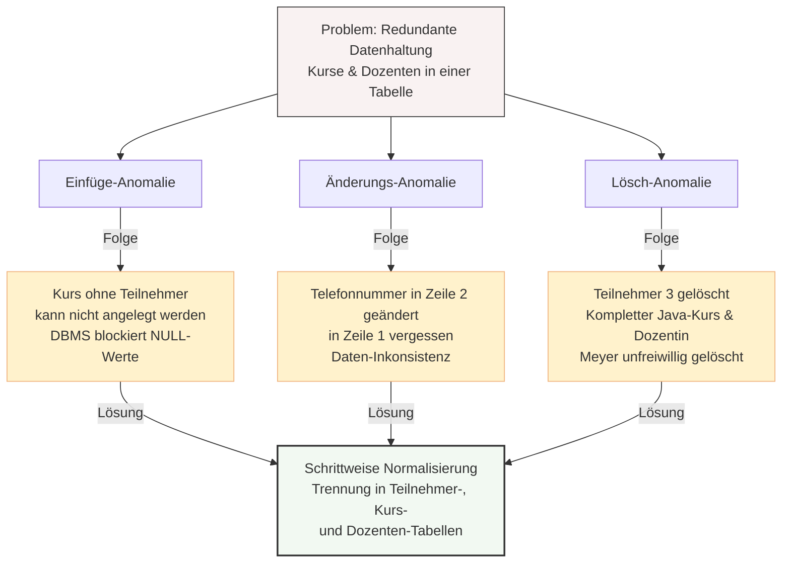

## 🧭 Navigation & Zusammenhänge
- **Vorausgesetztes Thema:** [[05_Relationales Mapping Vom ERM zum Tabellenschema]]
- **Nächstes Thema:** [[05🗄️Datenbanken/07_Schritt-für-Schritt-Normalisierung]]
- **Verwandte Bausteine:** [[03_Normalisierung von Datenbanken & Anomalien]], [[09_Bestimmung von Normalformen]]
---

## 🎯 IHK-Prüfungsrelevanz
> [!IMPORTANT] AP01: Einrichten eines IT-gestützten Arbeitsplatzes
> - **Relevanz:** Niedrig
> - **Fokus:** Erkennen von Fehlern in einfachen Datenlisten (z. B. Excel), um fehlerhafte Importe in Drittsysteme zu vermeiden.

> [!WARNING] AP02: Konzeption, Administration & Netzwerke
> - **Relevanz:** Extrem Hoch
> - **Fokus:** In der IHK-Prüfung wird nahezu in jedem Durchlauf das Kernwissen über relationale Datenbanken geprüft. Häufig liegt eine unnormalisierte Beispieltabelle vor. Deine Aufgabe ist es dann, konkrete Datensätze zu benennen, an denen eine **Einfüge-**, **Änderungs-** oder **Lösch-Anomalie** auftreten kann, und diese Fehler mathematisch-logisch zu begründen. Dieses Sheet bereitet dich gezielt auf diese Fragestellungen vor.

---

## 📖 Einfache Erklärung & Praxisbeispiele
Um in der Prüfung die vollen Punkte zu kassieren, musst du die Anomalien nicht nur abstrakt definieren können, sondern sie präzise am gegebenen Tabellenausschnitt nachweisen. Betrachten wir dazu die unnormalisierte Kurstabelle aus den IHK-Unterlagen:

### Analyse-Tabelle (Ausgangslage)

| TeilnehmerId (PK) | Kurs | Dozent | Dozent_Telefon |
| :--- | :--- | :--- | :--- |
| 1 | SQL-Basis | Herr Schmidt | 0123-4455 |
| 2 | SQL-Basis | Herr Schmidt | 0123-4455 |
| 3 | Java-Intro | Frau Meyer | 0987-1122 |

---

### Fallstudie 1: Die Einfüge-Anomalie (Insert Anomaly)
- **Das IHK-Prüfungsproblem:** Du sollst ein neues Objekt (z. B. einen neuen Kurs) anlegen, kannst es aber nicht, weil zwingende Informationen fehlen, die an den Primärschlüssel gekoppelt sind. Da der Primärschlüssel (`TeilnehmerId`) keine Leerwerte erlauben darf (`NOT NULL`), verweigert das DBMS die Speicherung.
- **Konkreter Nachweis am Beispiel:** Die IT-Akademie möchte den neuen Kurs *"TCP/IP"* mit dem Dozenten *"Herr Gökhan"* (Tel: *0123-8899*) anbieten.
- **Ergebnis:** Da sich noch kein Teilnehmer angemeldet hat, bleibt das Feld `TeilnehmerId` leer (`?????`). Das System bricht mit einem Fehler ab. Der Kurs kann nicht im System hinterlegt werden, bis ein Teilnehmer existiert.

### Fallstudie 2: Die Änderungs-Anomalie (Update Anomaly)
- **Das IHK-Prüfungsproblem:** Gleiche Daten sind mehrfach redundant gespeichert. Wird eine Information geändert, muss sie an *allen* Stellen gleichzeitig per SQL-Befehl aktualisiert werden. Geschieht dies durch eine unvollständige Abfrage nicht, entstehen **logische Widersprüche** (Inkonsistenz).
- **Konkreter Nachweis am Beispiel:** Dozent *"Herr Schmidt"* zieht um und erhält die neue Telefonnummer *0123-2233*.
- **Ergebnis:** Der Administrator aktualisiert die Telefonnummer in Zeile 2, vergisst jedoch Zeile 1. Nun besitzt dieselbe Person im System zeitgleich zwei verschiedene Telefonnummern (*0123-4455* und *0123-2233*). Die Datenintegrität ist zerstört.

### Fallstudie 3: Die Lösch-Anomalie (Delete Anomaly)
- **Das IHK-Prüfungsproblem:** Beim Löschen eines bestimmten Datensatzes werden ungewollt und unvorhergesehen andere, wichtige Informationen mitgelöscht, die eigentlich im System verbleiben sollten.
- **Konkreter Nachweis am Beispiel:** Der Teilnehmer mit der `TeilnehmerId` 3 tritt aus der Akademie aus und soll aus der Datenbank entfernt werden.
- **Ergebnis:** Wird die gesamte Zeile 3 gelöscht, um den Teilnehmer zu entfernen, verschwinden automatisch auch die Informationen, dass es einen Kurs *"Java-Intro"* gibt und dass *"Frau Meyer"* unter der Nummer *0987-1122* erreichbar ist. Die Akademie verliert wertvolle Stammdaten.

---

## 📊 Visuelle Darstellung (Mermaid.js)

