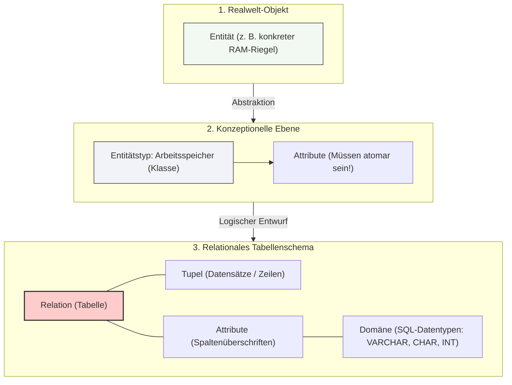

## 🧭 Navigation & Zusammenhänge
- **Vorausgesetztes Thema:** [[05🗄️Datenbanken/07_Schritt-für-Schritt-Normalisierung]]
- **Nächstes Thema:** [[09_Bestimmung von Normalformen]]
- **Verwandte Bausteine:** [[01_Grundlagen relationaler Datenbanken & ER-Modellierung]], [[04_RAM & Massenspeicher Technologien, RAID & Dateisysteme]]
---

## 🎯 IHK-Prüfungsrelevanz
> [!IMPORTANT] AP01: Einrichten eines IT-gestützten Arbeitsplatzes
> - **Relevanz:** Mittel
> - **Fokus:** Zuweisung korrekter Datentypen bei der Hardware-Inventarisierung (z. B. Speicherkapazitäten oder Herstellerbezeichnungen).

> [!WARNING] AP02: Konzeption, Administration & Netzwerke
> - **Relevanz:** Hoch
> - **Fokus:** Die IHK fordert regelmäßig das Abwägen von Vor- und Nachteilen eines DBMS gegenüber klassischen Dateisystemen. Ein absoluter Dauerschwerpunkt in den Prüfungen ist die **Atomisierung von Attributen** im logischen Entwurf sowie die präzise Zuordnung von SQL-Datentypen (z. B. das Absichern führender Nullen bei Postleitzahlen via `CHAR`). Auch die mathematischen Kernbegriffe des relationalen Modells (Relation, Tupel, Attribut) musst du fehlerfrei beherrschen.

---

## 📖 Einfache Erklärung & Praxisbeispiele

### 1. Datenhaltung: Datei vs. Datenbank
In der IT-Infrastruktur wird zwischen unstrukturierter Ablage in klassischen Dateisystemen und der strukturierten Ablage in **Datenbanken** mittels eines **Datenbankmanagementsystems (DBMS)** unterschieden.

| Kriterium | Daten in Dateien / Verzeichnissen | Daten in Datenbanken (DBMS) |
| :--- | :--- | :--- |
| **Struktur** | **Unstrukturiert** | **Strukturiert** |
| **Vorteile (Pros)** | Einfach einzurichten, keine Zusatzsoftware nötig. | **Zentralität:** Alle Daten liegen an einem Ort. **Hygiene-Werkzeuge:** Automatische Mechanismen für Konsistenz und Backup. |
| **Nachteile (Cons)** | Redundanzen, hoher Pflegeaufwand, Inkonsistenzrisiko. | **Komplexität:** Erfordert Fachwissen und verursacht **Kosten**. **Abhängigkeit:** Gesamte Applikation hängt vom DBMS ab. |

> [!NOTE] Gängige relationale Datenbanksysteme am Markt:
> MySQL, MariaDB, PostgreSQL, Oracle, MS SQL, SQLite, SAP HANA, MS Access.

---

### 2. Der Abstraktionsprozess: Von der Realität zur Datenbank
Um ein reales System abzubilden, müssen Objekte der echten Welt abstrahiert werden:
- **Entität (Objekt):** Ein konkretes Einzelobjekt der Realität.
  - 💡 *Beispiel:* Ein spezifischer Riegel Arbeitsspeicher in einem Server.
- **Entitätstyp (Klasse):** Die Zusammenfassung gleichartiger Objekte.
  - 💡 *Beispiel:* Die Klasse `Arbeitsspeicher` mit den Merkmalen *Kapazität, Geschwindigkeit, Hersteller, Modell*.
- **Attribute:** Die konkreten beschreibenden Eigenschaften, deren Inhalte **zwingend atomar** (unteilbar) vorliegen müssen.

> [!CAUTION] IHK-Falle: Nicht-atomare Attribute
> - **Nicht atomar:** `anschrift: Musterstraße 1, 44386 Krefeld` (Mehrere Informationen blockieren das Sortieren/Filtern).
> - **Atomar (Korrekt):** Aufgeteilt in separate Felder: `Straße` | `Hausnummer` | `PLZ` | `Ort`.

---

### 3. Datentypen & Domänen im Tabellendesign
Für jedes Attribut (z. B. beim Entitätstyp `Kunde`) muss der Wertebereich (**Domäne**) über SQL-Datentypen festgenagelt werden:
- **`VARCHAR(n)`:** Variabler Text für Namen, Straßen und Orte (`STRING → varchar`). Belegt nur so viel Speicher, wie der Text lang ist.
- **`CHAR(n)`:** Fixer Text. **Wichtig für die Prüfung:** Die Postleitzahl (`plz`) wird als `STRING → char[5]` deklariert. Da Postleitzahlen keine mathematischen Werte sind, würden bei einem `INTEGER` führende Nullen (z. B. bei *01067 Dresden*) einfach abgeschnitten werden!
- **`INTEGER`:** Für reine Ganzzahlen ohne Nachkommastellen (z. B. IDs oder zählbare Mengen).
- **`DECIMAL(w,s)` / `NUMERIC`:** Für kaufmännische Werte mit exakter Präzision. `DECIMAL(10,2)` bedeutet: Insgesamt 10 Stellen, davon exakt 2 Nachkommastellen.
- **`DATE` / `TIMESTAMP`:** Für reine Kalendertage (`YYYY-MM-DD`) bzw. exakte System-Zeitstempel inklusive Uhrzeit (`YYYY-MM-DD HH:MM:SS`).
- **`BOOLEAN` / `BLOB`:** Für Wahrheitswerte (True/False) bzw. binäre Rohdaten (Bilder/Dateien).

---

### 4. Datenbankmodelle im Kernvergleich
Zur Eindeutigkeit von Datensätzen werden **Identifikationsschlüssel** vergeben, entweder als **natürlicher Schlüssel** aus bestehenden Daten (z. B. MAC-Adresse) oder als generierter **künstlicher Schlüssel** (z. B. fortlaufende ID-Nummer). Die strukturelle Organisation unterscheidet sich je nach Modell:

- **Hierarchisches Datenbankmodell:** Organisiert Daten in einer starren Baumstruktur. Großer Nachteil: Ein Datensatz darf **nur genau einen Vater** besitzen (`1:n`-Struktur). Reine `m:n-Beziehungen` sind hier nicht direkt darstellbar. (Wird heute teilweise noch in Mainframe-Systemen oder Dateisystemen genutzt).
- **Netzwerkmodell:** Erweiterung des hierarchischen Modells um Querbeziehungen; ein Datensatz kann hier **mehrere Vorgänger** besitzen.
- **Relationales Modell:** Der heutige Industrie-Standard, der mathematisch über die **Relationenalgebra** fundiert ist und den Datenzugriff flexibel über **SQL** ermöglicht.

> [!TIP] Die mathematischen Bezeichnungen des relationalen Modells
> In der IHK-Prüfung musst du die Fachbegriffe exakt zuordnen können:
> - **Relation** = Die vollständige **Tabelle**
> - **Tupel** = Ein einzelner **Datensatz** (Zeile)
> - **Attribut** = Die **Spaltenüberschrift** (Feldeigenschaft)

---

## 📊 Visuelle Darstellung (Mermaid.js)

