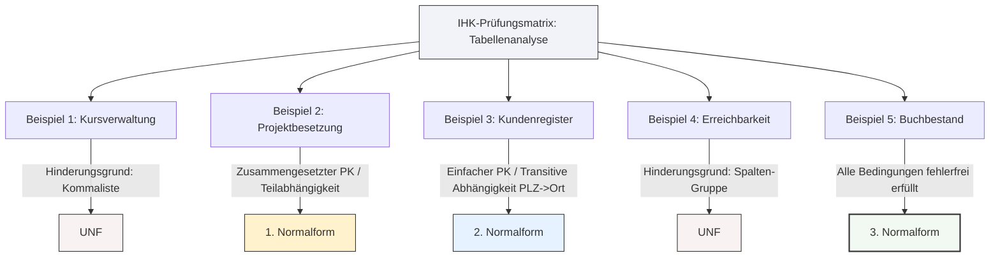

## 🧭 Navigation & Zusammenhänge
- **Vorausgesetztes Thema:** [[08_Grundlagen der persistenten Datenhaltung & Datenmodellierung]]
- **Nächstes Thema:** [[14_SQL-Joins]]
- **Verwandte Bausteine:** [[05🗄️Datenbanken/07_Schritt-für-Schritt-Normalisierung]], [[17_Identifikation & Transformation von Normalformen]]
---

## 🎯 IHK-Prüfungsrelevanz
> [!IMPORTANT] AP01: Einrichten eines IT-gestützten Arbeitsplatzes
> - **Relevanz:** Niedrig
> - **Fokus:** Erkennen von unstrukturierten Tabellen zur Vermeidung von Fehlern bei automatisierten Skript-Importen.

> [!WARNING] AP02: Konzeption, Administration & Netzwerke
> - **Relevanz:** Extrem Hoch
> - **Fokus:** In IHK-Prüfungen musst du vorliegende Tabellenstrukturen blitzschnell auf Verstöße gegen die Normalformen analysieren. Die Prüfer verlangen eine präzise Identifikation der aktuellen Stufe sowie eine stichhaltige Begründung (z. B. Nachweis von mehrwertigen Attributen, Teilabhängigkeiten oder transitiven Abhängigkeiten). Diese Übung spiegelt exakt diesen Aufgabentyp wider.

---

## 📖 Analyse der 5 Tabellenbeispiele

### 📊 Übersicht der Prüfungsbeispiele
Die folgende Tabelle fasst die IHK-Beispiele, ihre aktuelle Normalform und den entscheidenden Hinderungsgrund für die nächste Stufe zusammen:

| Beispiel | Thema | Aktuelle Stufe | IHK-Begründung / Hinderungsgrund |
| :--- | :--- | :---: | :--- |
| **1** | Kursverwaltung | **UNF** | **Mehrwertigkeit:** In der Spalte `Gebuchte_Kurse` stehen Listenwerte durch Komma getrennt (Verstoß gegen die Atomarität). |
| **2** | Projektbesetzung | **1NF** | **Teilabhängigkeit:** Der `Projekt_Name` ist funktional nur von der `ProjektID` abhängig, nicht vom gesamten zusammengesetzten PK (`MitarbeiterID`, `ProjektID`). |
| **3** | Kundenregister | **2NF** | **Transitive Abhängigkeit:** Ein Nicht-Schlüsselattribut bestimmt ein anderes. Die `PLZ` bestimmt eindeutig den `Ort` (`PLZ` → `Ort`), nicht die `KundenID` direkt. |
| **4** | Erreichbarkeit | **UNF** | **Wiederholungsgruppen:** Die Spaltenstruktur `Telefon_Privat`, `Telefon_Mobil` und `Telefon_Buero` bricht die geforderte Atomarität der 1NF. |
| **5** | Buchbestand | **3NF** | **Keine Verstöße:** Alle Spalten sind atomar, hängen voll funktional vom PK (`ISBN`) ab und es gibt keine Abhängigkeiten unter den Nicht-Schlüsseln. |

---

### 🔎 Detail-Analyse mit IHK-Argumentation

#### Beispiel 1: Die Kursverwaltung → **UNF** (Unnormalisierte Form)
- **IHK-Begründung:** Die Tabelle verstößt gegen die **Atomaritätsregel** der 1. Normalform. In der Spalte `Gebuchte_Kurse` sind pro Datensatz mehrere Werte als kommagetrennte Liste hinterlegt (z. B. *"SQL-Basis, Java-Intro"*). Datenwerte müssen unteilbar sein.
- **Weg zur 1NF:** Jeder Kurs muss eine eigene Zeile erhalten, sodass die `TeilnehmerID` mehrfach untereinander auftaucht.

#### Beispiel 2: Die Projektbesetzung → **1NF** (1. Normalform)
- **IHK-Begründung:** Die Tabelle ist zwar atomar, besitzt aber einen **zusammengesetzten Primärschlüssel** aus (`MitarbeiterID`, `ProjektID`). Es liegt eine **Teilabhängigkeit** vor: Das Attribut `Projekt_Name` hängt *nur* von der `ProjektID` ab, nicht aber von der `MitarbeiterID`.
- **Weg zur 2NF:** Der `Projekt_Name` muss zusammen mit der `ProjektID` in eine separate Tabelle `Projekt` ausgelagert werden.

#### Beispiel 3: Das Kundenregister → **2NF** (2. Normalform)
- **IHK-Begründung:** Da der Primärschlüssel einfach ist (`KundenID`), ist die 2NF automatisch erfüllt (keine Teilabhängigkeiten möglich). Die Tabelle verstößt jedoch gegen die 3NF, da eine **transitive Abhängigkeit** vorliegt: Das Nicht-Schlüsselattribut `PLZ` bestimmt das Nicht-Schlüsselattribut `Ort`.
- **Weg zur 3NF:** Die Zuordnung von `PLZ` zu `Ort` muss in eine eigene Stammdatentabelle ausgelagert werden.

#### Beispiel 4: Die Erreichbarkeit → **UNF** (Unnormalisierte Form)
- **IHK-Begründung:** Auch wenn in jeder Zelle nur ein Wert steht, handelt es sich bei den drei Telefonspalten um eine sogenannte **Wiederholungsgruppe** (`Telefon_*`). Das starr vorgehaltene Schema für gleichartige Attribute verletzt die logische Atomarität der 1. Normalform.
- **Weg zur 1NF:** Auflösung der Spaltengruppen in eine Zeilenstruktur, bei der jeder Kontakttyp eine eigene Zeile einnimmt.

#### Beispiel 5: Der Buchbestand → **3NF** (3. Normalform)
- **IHK-Begründung:** Dieses Verzeichnis befindet sich bereits im perfekten Zielzustand. Alle Spalten sind elementar (1NF). Sie hängen voll und ganz von der `ISBN` ab (2NF). Weder `Titel`, `Erscheinungsjahr` noch `Preis_Netto` bestimmen sich gegenseitig (3NF). Hier gibt es für den Administrator *nichts zu tun*.

---

## 📊 Visuelle Darstellung (Mermaid.js)

