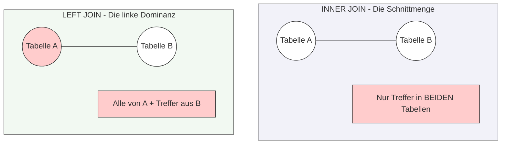

tags: [fisi, ihk, lernsheet]
## 🧭 Navigation & Zusammenhänge
- **Vorausgesetztes Thema:** [[09_Bestimmung von Normalformen]]
- **Nächstes Thema:** [[15_Datenbankstrukturen nachträglich mit ALTER TABLE]]
- **Verwandte Bausteine:** [[02_SQL-Datentypen & Domänen im Detail]], [[16_Datenwerte mit INSERT INTO]]
---

🎯 IHK-Prüfungsrelevanz

> [!WARNING] AP02: Konzeption, Administration & Netzwerke
> 
> - **Relevanz:** Extrem Hoch (Absolutes Kern- und Standardthema)
> - **Fokus:** In fast jeder IHK-Abschlussprüfung musst du Daten über mehrere Tabellen hinweg abfragen. Das fehlerfreie Beherrschen von `INNER JOIN` und `LEFT JOIN` (inklusive der korrekten Zuordnung der `ON`-Bedingung über Primär- und Fremdschlüssel) entscheidet über einen Großteil der Punkte im SQL-Teil. Ein typischer IHK-Schwerpunkt ist zudem das gezielte Finden von "fehlenden" Verknüpfungen (z. B. Kunden ohne Bestellungen) mittels `LEFT JOIN` und `IS NULL`.

---

📖 Die Join-Typen im Detail

Da Daten in relationalen Datenbanken aufgrund der **Normalisierung** auf mehrere Tabellen aufgeteilt werden, müssen sie bei der Abfrage (`SELECT`) über logische Brücken wieder zusammengeführt werden. Diese Brücke wird fast immer zwischen dem **Primärschlüssel (PK)** der einen Tabelle und dem **Fremdschlüssel (FK)** der anderen Tabelle geschlagen.

📊 Die Join-Typen im direkten Vergleich

|Join-Typ|Funktionsweise|Was passiert mit Datensätzen ohne Gegenstück?|Typical IHK-Anwendungsfall|
|---|---|---|---|
|**`INNER JOIN`**|Liefert nur die Zeilen, die in **beiden** Tabellen eine Übereinstimmung finden (Schnittmenge).|Werden komplett aus dem Ergebnis herausgefiltert.|"Zeige alle Mitarbeiter und ihre zugeordneten Abteilungen."|
|**`LEFT (OUTER) JOIN`**|Liefert **alle** Zeilen der linken Tabelle, ergänzt um die passenden Werte der rechten Tabelle.|Werte der rechten Tabelle werden mit `NULL` aufgefüllt.|"Zeige alle Kunden und (falls vorhanden) ihre Bestellungen."|
|**`RIGHT (OUTER) JOIN`**|Liefert **alle** Zeilen der rechten Tabelle, ergänzt um die passenden Werte der linken Tabelle.|Werte der linken Tabelle werden mit `NULL` aufgefüllt.|In der Praxis selten (wird meist als gespiegelter `LEFT JOIN` geschrieben).|
|**`FULL (OUTER) JOIN`**|Liefert alle Zeilen aus beiden Tabellen, unabhängig von Übereinstimmungen.|Fehlende Gegenstücke auf beiden Seiten werden mit `NULL`<br><br>befüllt.|_Hinweis:_ Wird von MariaDB/MySQL nicht direkt unterstützt (muss über `UNION` nachgebaut werden).|

---

💻 Praktische Code-Beispiele (IHK-Syntax)

Ausgangslage für unsere Beispiele sind die zwei normalisierten Tabellen aus deinem Unterricht:

- `Kunden(<u>Kunde_ID</u>, Name)`
- `Standorte(<u>Standort_ID</u>, ↑Kunde_ID, Ort)`

1. Der Standard: `INNER JOIN`

Gibt nur Kunden aus, die auch wirklich mindestens einen Standort hinterlegt haben.

sql

```
SELECT 
    Kunden.Name, 
    Standorte.Ort
FROM Kunden
INNER JOIN Standorte ON Kunden.Kunde_ID = Standorte.Kunde_ID;
```

Verwende Code mit Vorsicht.

_Tipp zur Lesbarkeit (Table Aliases):_ Verwende kurze Tabellenkürzel, um den Code übersichtlich zu halten.

sql

```
SELECT k.Name, s.Ort
FROM Kunden k
INNER JOIN Standorte s ON k.Kunde_ID = s.Kunde_ID;
```

Verwende Code mit Vorsicht.

2. Der Datensicherer: `LEFT JOIN`

Gibt **alle** Kunden aus – auch die brandneuen Kunden, für die in der Tabelle `Standorte` noch gar kein Datensatz existiert. Bei diesen Kunden ist die Spalte `Ort` im Ergebnis einfach leer (`NULL`).

sql

```
SELECT k.Name, s.Ort
FROM Kunden k
LEFT JOIN Standorte s ON k.Kunde_ID = s.Kunde_ID;
```

Verwende Code mit Vorsicht.

3. Die IHK-Spezialität: "Finde alle..." mittels `IS NULL`

Eine sehr beliebte Prüfungsfrage lautet: _"Finden Sie alle Kunden, die noch keinen Standort zugewiesen haben."_ Hierzu verbindest du die Tabellen per `LEFT JOIN` und filterst im `WHERE`-Bereich gezielt nach den `NULL`-Werten der rechten Tabelle.

sql

```
SELECT k.Name
FROM Kunden k
LEFT JOIN Standorte s ON k.Kunde_ID = s.Kunde_ID
WHERE s.Standort_ID IS NULL;
```

🚨 Die 3 kritischen IHK-Stolperfallen bei Joins

- **Verwechseln von `LEFT` und `RIGHT`:** Welches die "linke" Tabelle ist, bestimmt rein die Reihenfolge im Code! Die Tabelle, die hinter dem Wort `FROM` steht, ist **immer links**. Die Tabelle, die hinter dem Wort `JOIN` steht, ist **immer rechts**.
- **Vergessen der `ON`-Bedingung:** Lässt du die `ON`-Einschränkung weg, produziert die Datenbank ein sogenanntes **Kartesisches Produkt (CROSS JOIN)**. Dabei wird jede Zeile der Tabelle A blind mit jeder Zeile der Tabelle B multipliziert (bei 100 Kunden und 100 Standorten entstehen 10.000 unbrauchbare Zeilen). In der Prüfung führt das zu partiellem Punktabzug.
- **Fehlende Eindeutigkeit bei gleichen Spaltennamen:** Wenn die ID-Spalte in beiden Tabellen exakt gleich heißt (z. B. `Kunde_ID`), musst du im `SELECT` und im `ON` zwingend den Tabellennamen oder das Kürzel voranstellen (`k.Kunde_ID`), da das DBMS sonst mit dem Fehler `Column ambiguities` abbricht.


