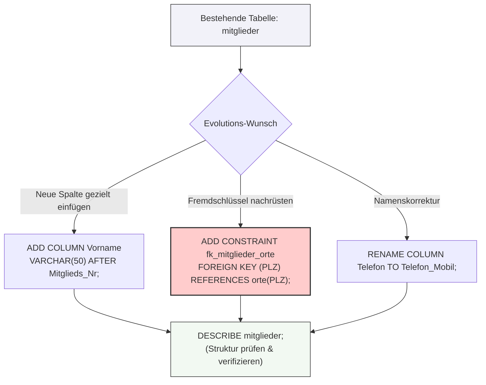

tags: [fisi, ihk, lernsheet]

## 🧭 Navigation & Zusammenhänge
- **Vorausgesetztes Thema:** [[14_SQL-Joins]]
- **Nächstes Thema:** [[16_Datenwerte mit INSERT INTO]]
- **Verwandte Bausteine:** [[18_Tabellenstrukturen mit Datentypen & Constraints physisch anlegen]], [[02_SQL-Datentypen & Domänen im Detail]]
---

🎯 IHK-Prüfungsrelevanz

> [!WARNING] AP02: Konzeption, Administration & Netzwerke
> 
> - **Relevanz:** Hoch
> - **Fokus:** In IHK-Prüfungen musst du Datenbankstrukturen nicht nur von Grund auf neu erstellen, sondern bestehende Schemata flexibel erweitern können. Typische Aufgaben verlangen das nachträgliche Hinzufügen einer Spalte (oft mit Positionsvorgaben wie `AFTER` oder `FIRST`), das Ändern eines Datentyps oder das Setzen von Fremdschlüssel-Constraints auf Tabellenebene. Da `ALTER TABLE` zur **Data Definition Language (DDL)** gehört, verändert es das Tabellengerüst, ohne bereits bestehende Datensätze zu zerstören.

---

📖 Befehle & Mechanismen im Überblick

1. Spaltenoperationen (Hinzufügen, Ändern, Entfernen)

Bestehende Tabellenstrukturen können über verschiedene Aktionen manipuliert werden. Mehrere Anpassungen lassen sich in einem einzigen Statement per Komma getrennt bündeln.

|Aktion|SQL-Befehl (Beispiel)|Auswirkung auf die Daten|
|---|---|---|
|**Spalte hinzufügen**|`ALTER TABLE mitglieder ADD COLUMN Telefon VARCHAR(30);`|Bereits vorhandene Zeilen erhalten in dieser Spalte den Wert `NULL` oder den `DEFAULT`-Wert.|
|**Datentyp / Regel ändern**|`ALTER TABLE mitglieder MODIFY COLUMN Name VARCHAR(150) NOT NULL;`|Die Daten bleiben erhalten, sofern sie verlustfrei in den neuen Wertebereich/Typ passen.|
|**Spalte umbenennen**|`ALTER TABLE mitglieder RENAME COLUMN Telefon TO Mobil;`|Der Spaltenname ändert sich, alle enthaltenen Datenwerte bleiben unberührt.|
|**Name + Typ ändern**|`ALTER TABLE mitglieder CHANGE COLUMN Telefon Mobil VARCHAR(40);`|Kombiniert Umbenennung und Typtransformation. Der Datentyp muss zwingend mit angegeben werden.|
|**Spalte löschen**|`ALTER TABLE mitglieder DROP COLUMN Mobil;`|**Unwiderruflich!** Die Spalte und alle darin enthaltenen Datenwerte werden dauerhaft entfernt.|

> [!TIP] Positionierung neuer Spalten in MariaDB  
> Standardmäßig werden neue Spalten ganz am Ende der Tabelle angehängt. Über Positions-Keywords steuerst du dies exakt:
> 
> - **An den Tabellenanfang setzen:** `... ADD COLUMN Intern_Nr INT FIRST;`
> - **Hinter eine bestimmte Spalte setzen:** `... ADD COLUMN Vorname VARCHAR(50) AFTER Mitglieds_Nr;`

---

2. Schlüssel und Constraints nachträglich definieren

Wenn Tabellen bereits mit Rohdaten befüllt sind oder Beziehungen nachträglich abgebildet werden sollen, greift man zu Constraints auf Tabellenebene:

- **Einfachen Fremdschlüssel anlegen:**
    
    sql
    
    ```
    ALTER TABLE mitglieder ADD FOREIGN KEY (PLZ) REFERENCES orte (PLZ);
    ```
    
    Verwende Code mit Vorsicht.
    
- **Fremdschlüssel mit eigenem Namen deklariert (IHK-Best-Practice):**  
    _Vorteil:_ Über den definierten Constraint-Namen lässt sich die Beziehung später viel einfacher wieder gezielt auflösen.
    
    sql
    
    ```
    ALTER TABLE sparten ADD CONSTRAINT fk_sparte_trainer FOREIGN KEY (Trainer_ID) REFERENCES trainer (Trainer_ID);
    ```
    
    Verwende Code mit Vorsicht.
    
- **Constraints nachträglich entfernen:**
    
    sql
    
    ```
    ALTER TABLE sparten DROP FOREIGN KEY fk_sparte_trainer;
    ```
    
    Verwende Code mit Vorsicht.
    
- **Eindeutigkeit (`UNIQUE`) oder Primärschlüssel (`PRIMARY KEY`) setzen:**
    
    sql
    
    ```
    ALTER TABLE sparten ADD UNIQUE (Sparte_Name);
    ALTER TABLE orte ADD PRIMARY KEY (PLZ);
    ```
    
    Verwende Code mit Vorsicht.
    

---

3. Tabellen umbenennen und Struktur prüfen

- **Tabelle umbenennen:** Beide Varianten sind funktionell identisch. Zeigen Fremdschlüssel anderer Tabellen auf die betroffene Tabelle, zieht das DBMS die Verweise automatisch auf den neuen Namen mit um.
    
    sql
    
    ```
    RENAME TABLE mitgliedschaften TO mitglieder;
    -- Alternativ:
    ALTER TABLE mitgliedschaften RENAME TO mitglieder;
    ```
    
    Verwende Code mit Vorsicht.
    
- **Struktur abfragen (Diagnosebefehle):**
    
    sql
    
    ```
    SHOW TABLES;                  -- Listet alle Tabellen der aktiven Datenbank auf
    DESCRIBE mitglieder;          -- Zeigt Spaltennamen, Datentypen und Primärschlüssel (Kurzform: DESC mitglieder)
    SHOW CREATE TABLE mitglieder; -- Gibt das vollständige, physische Erstellungsskript inklusive Constraint-Namen aus
    ```
    
    Verwende Code mit Vorsicht.
    

---

🚨 Die 4 kritischen IHK-Stolperfallen (⚠️ Unbedingt beachten!)

- **Fremdschlüssel blockiert Spaltenlöschung (ERROR 1553):** Du kannst eine Tabellenspalte nicht löschen, auf der ein aktiver Fremdschlüssel liegt. Das Skript bricht ab. **Lösung:** Zuerst die Verknüpfung per `DROP FOREIGN KEY constraint_name` auflösen, danach die Spalte via `DROP COLUMN` entfernen.
- **`NOT NULL`-Konflikt bei befüllten Tabellen:** Fügst du einer bereits produktiv befüllten Tabelle eine neue Spalte mit dem Constraint `NOT NULL` hinzu, erzwingt MariaDB die Typ-Standardwerte (z. B. leere Texte bei `VARCHAR` oder `0` bei `INT`). **Sauberes Vorgehen:** Spalte erst als optional anlegen, die Werte per `UPDATE` einpflegen und die Spalte danach mittels `MODIFY COLUMN` auf `NOT NULL` setzen.
- **Fehlende Werte in der Zieltabelle:** Ein nachträgliches `ADD FOREIGN KEY` scheitert sofort, wenn in der Spalte bereits Werte stehen, die in der übergeordneten Vatertabelle gar nicht existieren. Die Daten müssen vorab bereinigt werden, um die referenzielle Integrität zu wahren.
    
- **Datenverlust bei Typverkleinerung:** Verkleinerst du einen Datentyp (z. B. von `VARCHAR(100)` auf `VARCHAR(10)` mittels `MODIFY`), bricht der Befehl sofort ab, sobald auch nur ein einziger Datensatz in der Tabelle die neue Grenze überschreitet.


