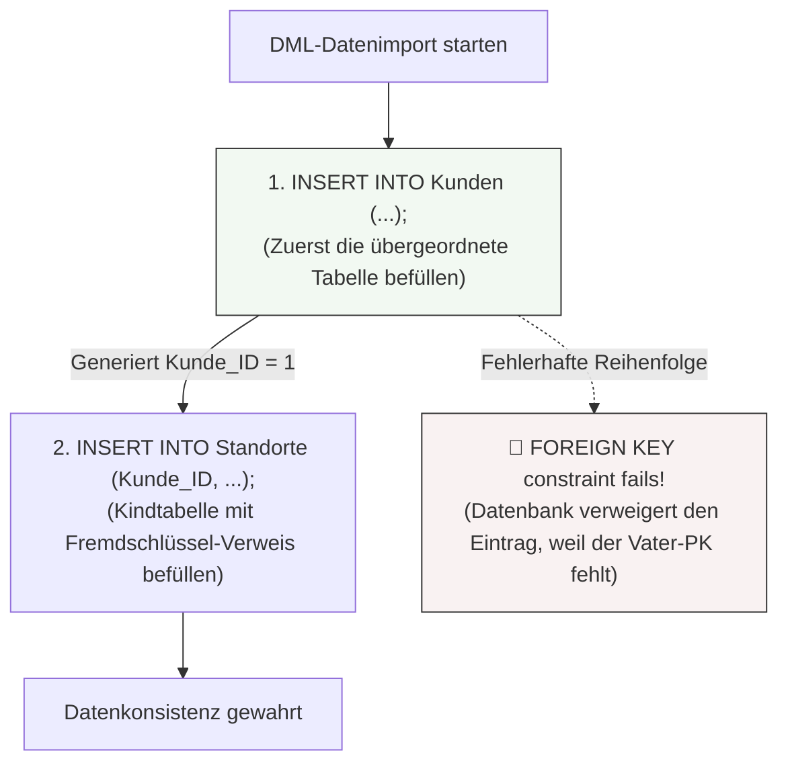

tags: [fisi, ihk, lernsheet]
## 🧭 Navigation & Zusammenhänge
- **Vorausgesetztes Thema:** [[15_Datenbankstrukturen nachträglich mit ALTER TABLE]]
- **Nächstes Thema:** [[17_Identifikation & Transformation von Normalformen]]
- **Verwandte Bausteine:** [[14_SQL-Joins]], [[18_Tabellenstrukturen mit Datentypen & Constraints physisch anlegen]]
---

🎯 IHK-Prüfungsrelevanz

> [!WARNING] AP02: Konzeption, Administration & Netzwerke
> 
> - **Relevanz:** Hoch
> - **Fokus:** Sobald Strukturen über DDL (`CREATE TABLE`) existieren, verlangt die IHK in praktischen SQL-Aufgaben das Befüllen der Tabellen über die **Data Manipulation Language (DML)**. Du musst syntaktisch korrekte `INSERT INTO`-Statements schreiben können. Ein wiederkehrender IHK-Schwerpunkt liegt dabei auf der korrekten Behandlung von Sonderfällen (z. B. das Auslassen von `AUTO_INCREMENT`-Spalten, das bewusste Setzen von `NULL`-Wertebereichen sowie das Einhalten der logischen Einfügereihenfolge zur Vermeidung von Fremdschlüssel-Fehlern).

---

📖 DML-Grundlagen & Befehlsvarianten

> [!TIP] Der IHK-Merksatz zur Unterscheidung  
> **`CREATE TABLE` baut das Regal (Struktur), `INSERT INTO` stellt die Dinge hinein (Daten values)!**

1. Die Standard-Varianten im Code-Vergleich

Variante A: Mit expliziter Spaltenliste (🚨 Dringend empfohlen!)

Es werden gezielt Werte in die definierten Spalten eingetragen. Nicht genannte Spalten werden automatisch mit ihrem `DEFAULT`-Wert oder `NULL` befüllt.

sql

```
INSERT INTO Kunden (Name, Branche)
VALUES ('Bäckerei Sonnenkorn', 'Lebensmittelhandwerk');
```

Verwende Code mit Vorsicht.

_IHK-Vorteil:_ `AUTO_INCREMENT`-Spalten (wie `Kunde_ID`) werden hier einfach weggelassen, da das Datenbankmanagementsystem (DBMS) die ID selbstständig fortlaufend vergibt.

Variante B: Ohne Spaltenliste (Vorsicht in der Prüfung!)

Hierbei müssen die Werte für **alle** Spalten in exakt der Reihenfolge übergeben werden, in der sie beim Tabellendesign angelegt wurden.

sql

```
INSERT INTO VLANs 
VALUES (10, 'Management');
```

Verwende Code mit Vorsicht.

_Gefahr:_ Sobald die Tabelle später per `ALTER TABLE` um eine Spalte erweitert wird, bricht dieses Statement sofort ab (`Column count doesn't match`). Schreibe in der Prüfung daher **immer** die Spaltenliste mit auf.

Variante C: Mehrere Datensätze in einem einzigen Statement

Um Overhead zu reduzieren und eine performante Transaktion zu gewährleisten, können mehrere Zeilen durch Kommata getrennt übergeben werden.

sql

```
INSERT INTO VLANs (VLAN_ID, Name) 
VALUES (10, 'Management'),
       (20, 'Client-Netz'),
       (30, 'Gaeste-WLAN');
```

Verwende Code mit Vorsicht.

---

2. Fortgeschrittene Migrations- und Spezialbefehle

Massenimport über Abfragen (`INSERT INTO ... SELECT`)

Wird genutzt, um unstrukturierte Rohdaten aus Altsystemen oder temporären Tabellen strukturiert in das neue, normalisierte Zielschema zu überführen. Es wird kein `VALUES`-Block benötigt.

sql

```
INSERT INTO Kunden (Name, Branche)
SELECT DISTINCT Kunde_Name, Kunde_Branche
FROM roh_netzwerkerfassung;
```

Verwende Code mit Vorsicht.

_Regel:_ Die Anzahl und die Datentypen der im `SELECT` abgefragten Felder müssen absolut exakt zur Spaltenliste des `INSERT` passen.

Fehlerbehandlung mit `INSERT IGNORE`

Sollte ein Datensatz gegen eine Eindeutigkeitsregel verstoßen (z. B. eine bereits existierende `VLAN_ID`), blockiert das DBMS nicht das gesamte Skript, sondern überspringt die betroffene Zeile unbemerkt.

sql

```
INSERT IGNORE INTO VLANs (VLAN_ID, Name) 
VALUES (10, 'Management');
```

Verwende Code mit Vorsicht.

Der "Upsert" (`ON DUPLICATE KEY UPDATE`)

Existiert der eindeutige Schlüssel bereits in der Tabelle, schlägt der Einfügeversuch fehl und das System führt stattdessen automatisch eine Aktualisierung (`UPDATE`) des Datensatzes durch.

sql

```
INSERT INTO VLANs (VLAN_ID, Name)
VALUES (10, 'Management-Netz')
ON DUPLICATE KEY UPDATE Name = VALUES(Name);
```

Verwende Code mit Vorsicht.

---

3. Umgang mit systemgesteuerten Zustandswerten

In der Prüfung musst du Wertebereiche präzise deklarieren:

- **Explizite Leerwerte (`NULL`):** Das Wort `NULL` ist ein geschütztes SQL-Schlüsselwort. Es wird direkt ohne Gleichheitszeichen und **niemals** in Anführungszeichen geschrieben (sonst wird es als Textkette `'NULL'` interpretiert).
    
    sql
    
    ```
    INSERT INTO Standorte (Kunde_ID, Techniker_ID, Ort) VALUES (1, NULL, 'Dortmund');
    ```
    
    Verwende Code mit Vorsicht.
    
- **Standardwerte erzwingen (`DEFAULT`):** Möchtest du gezielt den vordefinierten Standardwert einer Tabellenspalte ansprechen, nutzt du das Schlüsselwort `DEFAULT`.
    
    sql
    
    ```
    INSERT INTO Tickets (Titel, Status) VALUES ('Drucker streikt', DEFAULT);
    ```
    
    Verwende Code mit Vorsicht.
    

🚨 Die 4 kritischen IHK-Stolperfallen beim Datenimport

1. **Fremdschlüssel-Reihenfolge einhalten:** Du musst zwingend zuerst die Tabelle befüllen, auf die verwiesen wird (Vatertabelle, z. B. `Kunden`), bevor du Daten in die abhängige Tabelle (Kindtabelle, z. B. `Standorte`) einspeist. Andernfalls blockiert die referenzielle Integrität den Vorgang.
2. **Datumsformat einhalten:** Datumsangaben müssen zwingend im internationalen ISO-Format als Textkette `'YYYY-MM-DD'` (z. B. `'2026-10-09'`) übergeben werden. Deutsche Formatierungen wie `'09.10.2026'` führen zu Datenbankfehlern.
3. **Hochkomma-Maskierung:** Da Texte in einfache Anführungszeichen gefasst werden (z. B. `'Bäckerei Sonnenkorn'`), müssen im Text vorkommende Apostrophe durch Verdoppelung maskiert werden. Der Name _O'Reilly_ muss im SQL-Code als `'O''Reilly'` geschrieben werden.
4. **Spaltenanzahl bei Migrationen:** Wenn du ein `INSERT INTO ... SELECT` ausführst, muss die Anzahl der abgefragten Felder exakt mit der Anzahl der Zielspalten übereinstimmen. Jede Abweichung führt zum Abbruch.


