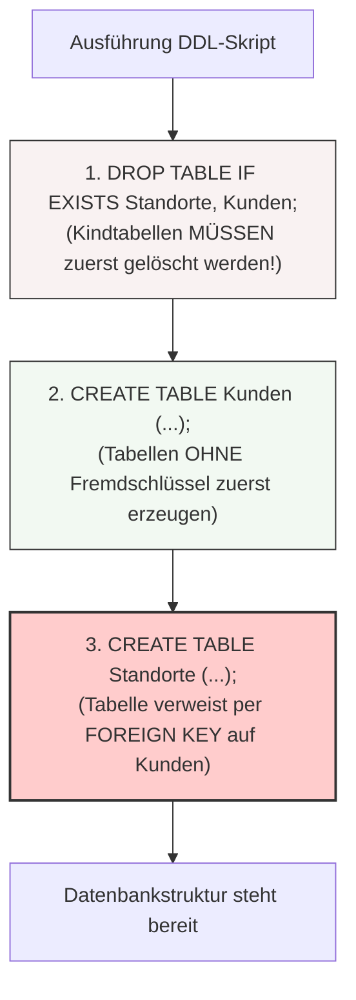

tags: [fisi, ihk, lernsheet]
## 🧭 Navigation & Zusammenhänge
- **Vorausgesetztes Thema:** [[17_Identifikation & Transformation von Normalformen]]
- **Nächstes Thema:** [[01_Internet-Infrastruktur, Normen & Ressourcenverwaltung]] *(Übergang zu Modul 06)*
- **Verwandte Bausteine:** [[02_SQL-Datentypen & Domänen im Detail]], [[15_Datenbankstrukturen nachträglich mit ALTER TABLE]]
---

🎯 IHK-Prüfungsrelevanz

> [!WARNING] AP02: Konzeption, Administration & Netzwerke
> 
> - **Relevanz:** Extrem Hoch (Kernelement der praktischen IT-Systemintegrationsaufgaben)
> - **Fokus:** Nach dem theoretischen Entwurf fordert die IHK fast immer die physische Umsetzung mittels der **Data Definition Language (DDL)**. Du musst fehlerfreie `CREATE TABLE`-Statements verfassen können. Die Prüfer achten penibel auf die korrekte Definition von **surrogaten (künstlichen)** vs. **zusammengesetzten Primärschlüsseln**, die syntaktisch saubere Deklaration von **Fremdschlüsseln (FOREIGN KEY)** sowie das präzise Steuern des Kaskadierungsverhaltens (`ON DELETE CASCADE / RESTRICT`).

---

📖 DDL-Grundlagen & Syntax-Regeln

Der Befehl `CREATE TABLE` legt ausschließlich das logische Gerüst (die Tabellenstruktur, Spaltennamen, Datentypen und Integritätsregeln) fest – er fügt **noch keine Datenwerte** ein.

1. Die IHK-Integritätsregeln (Constraints)

Constraints sichern die Datenqualität direkt auf Datenbankebene ab:

- **`PRIMARY KEY` (PK):** Identifiziert jede Zeile eindeutig, darf niemals doppelt vorkommen und verbietet Leerwerte (`NOT NULL` ist implizit enthalten).
- **`AUTO_INCREMENT`:** Weist dem Primärschlüssel automatisch eine fortlaufende Ganzzahl zu. **Stolperfalle:** Funktioniert in MariaDB nur auf einer Spalte, die gleichzeitig als Schlüssel deklariert ist.
- **`NOT NULL` / `UNIQUE`:** Bestimmt, dass ein Feld zwingend ausgefüllt sein muss bzw. dass Werte in dieser Spalte (z. B. `E_Mail`) eindeutig sein müssen (erlaubt im Gegensatz zum PK aber mehrfach `NULL`-Werte).
- **`DEFAULT`:** Definiert einen automatischen Standardwert (z. B. `Status DEFAULT 'offen'`), falls beim Einfügen kein Wert explizit übergeben wird.
- **`CHECK`:** Validiert logische Bedingungen direkt beim Schreibzugriff (z. B. `CHECK (Menge > 0)`).

---

2. Primärschlüssel-Typen im Code-Vergleich

Ansatz A: Einfacher (surrogater/künstlicher) Primärschlüssel

Wird direkt auf Spaltenebene definiert und empfiehlt sich standardmäßig für Entitätstabellen.

sql

```
CREATE TABLE IF NOT EXISTS Kunden (
    Kunde_ID INT AUTO_INCREMENT PRIMARY KEY,
    Name VARCHAR(100) NOT NULL,
    E_Mail VARCHAR(100) UNIQUE
);
```

Verwende Code mit Vorsicht.

Ansatz B: Zusammengesetzter Primärschlüssel

Muss zwingend am Ende des Statements auf Tabellenebene deklariert werden. Typisch für Hilfstabellen (`m:n`) oder Ports.

sql

```
CREATE TABLE IF NOT EXISTS Ports (
    Switch_ID INT NOT NULL,
    Port_Nr INT NOT NULL,
    VLAN_ID INT,
    PRIMARY KEY (Switch_ID, Port_Nr)
);
```

Verwende Code mit Vorsicht.

---

3. Fremdschlüssel & Kaskadierungsverhalten (Referenzielle Integrität)

> [!CRITICAL] Die goldene Reihenfolge-Regel der IHK  
> **Tabellen ohne Fremdschlüssel (Vatertabellen) müssen immer zuerst angelegt werden!** Erst danach dürfen Tabellen erzeugt werden, die per `FOREIGN KEY` auf sie verweisen. Andernfalls bricht das Skript mit einem Fehler ab.

Bei der Löschung oder Aktualisierung von Datensätzen in einer Vatertabelle steuern Optionen das automatische Verhalten der verknüpften Kindtabellen:

- **`CASCADE`:** Änderungen/Löschungen werden blind durchgereicht. Wird ein Kunde gelöscht, verschwinden automatisch alle seine Standorte.
- **`RESTRICT` (IHK-Standard):** Das DBMS blockiert die Löschung des Kunden strikt, solange noch verknüpfte Standorte auf ihn verweisen.
- **`SET NULL`:** Der Fremdschlüssel in der Kindtabelle wird auf `NULL` gesetzt (Voraussetzung: Die FK-Spalte darf nicht als `NOT NULL` deklariert sein).

🚨 Häufige IHK-Stolperfallen (⚠️ Unbedingt vermeiden!)

- **VARCHAR ohne Längenangabe:** Ein blankes `VARCHAR` führt unter MariaDB sofort zum Syntaxfehler – immer eine feste Maximallänge angeben (z. B. `VARCHAR(255)`).
- **Falsche Gelddatentypen:** Nutze für Währungen/Preise **niemals** `FLOAT` oder `DOUBLE` (wegen unpräziser Gleitkomma-Rundungsfehler), sondern immer `DECIMAL(p,s)`.
- **Falsche Lösch-Reihenfolge:** Wenn du ein Bereinigungsskript schreibst, muss `DROP TABLE Kindtabelle` **vor** `DROP TABLE Vatertabelle` stehen, da das DBMS das Löschen einer Tabelle, auf die noch aktive Fremdschlüssel-Verweise zeigen, unterbindet.