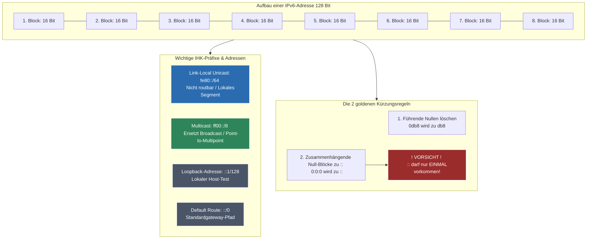

## 🧭 Navigation & Zusammenhänge
- **Vorausgesetztes Thema:** [[03_IPv6-Grundlagen & Adressierung]]
- **Nächstes Thema:** [[05_IPv4-Grundlagen, Subnetting & Adressbereiche]]
- **Verwandte Bausteine:** [[04_Hexadezimalsystem, MAC-Adressen & Nibbles]], [[07_ARP-Auflösung & Datentransformation über Netzgrenzen hinweg]]
---

## 🎯 IHK-Prüfungsrelevanz
> [!IMPORTANT] AP01: Einrichten eines IT-gestützten Arbeitsplatzes
> - **Relevanz:** Mittel
> - **Fokus:** Grundkonfiguration von Client-Betriebssystemen. Verständnis darüber, warum sich ein Client per Link-Local-Adresse (fe80::/64) im Netz direkt selbst anspricht und wie IPv6-Adressen korrekt in Webbrowsern eingetippt werden.

> [!WARNING] AP02: Konzeption, Administration & Netzwerke
> - **Relevanz:** Extrem Hoch
> - **Fokus:** Ein absoluter Dauerbrenner in der IHK-Prüfung! Du musst unverkürzte IPv6-Adressen nach den offiziellen Kürzungsregeln fehlerfrei komprimieren (und umgekehrt expandieren). Zudem verlangt die IHK die exakte Kenntnis besonderer Adressbereiche (Link-Local, Multicast, Loopback) sowie des Protokoll-Ersatzes NDP, da klassisches ARP und Broadcasts unter IPv6 nicht mehr existieren.

---

## 📖 Einfache Erklärung & Praxisbeispiele
**Internet Protocol Version 6 (IPv6)** ist der offizielle Nachfolger von IPv4. Um den weltweiten Adressmangel zu beheben, nutzt IPv6 **128-Bit-Adressen** (statt der 32 Bit bei IPv4), was zu einer unvorstellbaren Summe von rund 3,4 × 10³⁸ Adressen führt. Dadurch wird Network Address Translation (NAT) überflüssig und jedes Gerät kann wieder eine global eindeutige IP erhalten.

### Unterthemen & Anschauliche Beispiele:

- **Adressnotation & Kürzungsregeln:**
  IPv6-Adressen werden in **acht hexadezimalen Blöcken** zu je 16 Bit dargestellt, getrennt durch Doppelpunkte. Zur besseren Lesbarkeit gelten zwei strikte Kürzungsregeln:
  1. *Führende Nullen* innerhalb eines Blocks dürfen weggelassen werden.
  2. *Aufeinanderfolgende Null-Blöcke* können durch einen **Doppel-Doppelpunkt (`::`)** ersetzt werden. **Achtung:** Dies darf pro Adresse exakt **nur ein einziges Mal** geschehen, da die Adresse sonst nicht mehr eindeutig expandiert werden kann!
  - 💡 **Praxisbeispiel:** Die Adresse `2001:0db8:0000:0000:0000:0000:0370:7344` wird schrittweise gekürzt:
    - Führende Nullen weg: `2001:db8:0:0:0:0:370:7344`
    - Nullblöcke zusammenfassen: `2001:db8::370:7344`

- **URI-Notation im Browser:**
  Da der Doppelpunkt bei IPv6 als Blocktrenner dient, kollidiert er in Web-URLs mit der Portangabe (z. B. `:8080`). Daher müssen IPv6-Adressen in URIs zwingend in **eckige Klammern** gesetzt werden.
  - 💡 **Praxisbeispiel:** Um die Weboberfläche eines Switches direkt über seine IPv6-Adresse auf Port 8080 aufzurufen, tippst du ein: `http://2001:db8:85a3:8d3::370:7344`.

- **Besondere Adressbereiche & Protokolle:**
  - **Loopback (`::1/128`):** Entspricht dem IPv4-Bereich `127.0.0.1` zur internen Prüfung des IP-Stacks, ist jedoch nur noch eine einzige, feste Adresse.
  - **Link-Local-Unicast (`fe80::/64`):** Nicht-routbare Adressen, die nur im eigenen Netzwerksegment (bis zum ersten Router) gültig sind. Jede moderne Netzwerkkarte generiert sich diese automatisch.
  - **Multicast (`ff00::/8`):** Ersetzt den klassischen IPv4-Broadcast (Point-to-Multipoint). `ff02::1` spricht alle Teilnehmer im Segment an, `ff02::2` steuert gezielt alle Router an.
  - **NDP (Neighbor Discovery Protocol):** Da es unter IPv6 keinen Broadcast mehr gibt, übernimmt das NDP über gezielte Multicasts die Aufgaben des alten Address Resolution Protocols (ARP) zur MAC-Adressauflösung.
  - 💡 **Praxisbeispiel:** Wenn ein neuer Client bootet, nutzt er seine automatisch generierte `fe80::`-Adresse, um per NDP-Multicast nach Routern im Netz zu suchen, ohne das gesamte Netzwerk mit ungerichteten Broadcast-Anfragen zu belasten.

---

## 📊 Visuelle Darstellung (Mermaid.js)

---

## 🚨 Die 3 kritischen IHK-Stolperfallen

- **Doppelter Einsatz von `::` beim Kürzen:** Der absolute Standardfehler in der IHK-Prüfung! Wenn eine Adresse an zwei Stellen Null-Blöcke aufweist (z. B. `2001:0:0:11:0:0:2:2`), darfst du nur eine davon mit `::` zusammenfassen (Ergebnis: `2001::11:0:0:2:2` oder `2001:0:0:11::2:2`). Schreibst du `2001::11::2:2`, gibt es **null Punkte** für die Aufgabe, da der Computer nicht weiß, wie viele Nullen in welche Lücke gehören.
- **Vergessen der eckigen Klammern in URIs:** Fragt die IHK nach der Syntax, wie ein Techniker eine IPv6-Adresse zwecks Konfiguration im Browser aufruft, scheitern viele an der Formatierung. Ohne die eckigen Klammern `[...]` interpretieren Web-Clients die Adresse aufgrund der Doppelpunkte als fehlerhaften Port-Aufruf.
- **Suchen nach ARP oder Broadcast im IPv6-Kontext:** In strukturellen Fragen oder Fehlersuchen versucht die IHK oft, Prüflinge in die Falle zu locken (z. B. *"Analysieren Sie den ARP-Broadcast im IPv6-Netz"*). **Merke:** Unter IPv6 gibt es weder das Protokoll ARP noch den Medientyp Broadcast! Wer das in der Antwort nennt, zeigt den Prüfern mangelndes Grundlagenwissen. Die korrekten Begriffe lauten **NDP** und **Multicast**.
