## 🧭 Navigation & Zusammenhänge
- **Vorausgesetztes Thema:** [[03_IPv6-Grundlagen & Adressierung]]
- **Nächstes Thema:** [[05_IPv4-Grundlagen, Subnetting & Adressbereiche]]
- **Verwandte Bausteine:** [[04_Hexadezimalsystem, MAC-Adressen & Nibbles]], [[07_ARP-Auflösung & Datentransformation über Netzgrenzen hinweg]]
---

## 🎯 IHK-Prüfungsrelevanz
> [!IMPORTANT] AP01: Einrichten eines IT-gestützten Arbeitsplatzes
> - **Relevanz:** Hoch
> - **Fokus:** Identifikation von Netzwerkkomponenten über ihre physische Adresse. Auslesen von MAC-Adressen auf Client-Betriebssystemen (`ipconfig /all` bzw. `ip a`) und Verständnis über die Funktionsweise von Ethernet-Medienkonvertern und Bridges.

> [!WARNING] AP02: Konzeption, Administration & Netzwerke
> - **Relevanz:** Extrem Hoch (IHK-Kernwissen)
> - **Fokus:** Du musst den Aufbau eines Ethernet-Rahmens (inklusive MTU, Padding und CRC-Prüfsumme) fehlerfrei wiedergeben können. Ein absoluter Schwerpunkt sind Berechnungen und Analysen auf Layer 2, die Identifikation von Broadcast-Rahmen (`FF:FF:FF:FF:FF:FF`) sowie die Bit-Analyse von MAC-Adressen (Unterscheidung Individual vs. Group und Universal vs. Local). Auch das historische Verständnis von Kollisionsdomänen (CSMA/CD) wird vorausgesetzt.

---

## 📖 Einfache Erklärung & Praxisbeispiele
**Ethernet** ist eine standardisierte Protokollfamilie, die die Datenübertragung auf **Schicht 1 und Schicht 2** des OSI-Referenzmodells regelt. Unabhängig vom physikalischen Medium (Kupfer oder LWL) verpackt Ethernet die digitalen Nutzdaten in standardisierte **Ethernet-Rahmen (Frames)**. Die physische Adressierung erfolgt über eine weltweit eindeutige **MAC-Adresse**.

### Unterthemen & Anschauliche Beispiele:

- **Der Aufbau des Ethernet-Rahmens:**
  Ein Standard-Ethernet-Rahmen besitzt eine feste Struktur. Seine Größe beträgt **mindestens 64 Byte und maximal 1518 Byte** (ohne Präambel/SFD) bzw. **1522 Byte mit VLAN-Tag**. Er setzt sich wie folgt zusammen:
  - **Präambel & Start Frame Delimiter (SFD):** 8 Byte (7 Byte Präambel + 1 Byte SFD) zur Bit-Synchronisation. Aus Gründen der Abwärtskompatibilität existieren sie weiter, sind aber in modernen, kollisionsfreien Sterntopologien technisch nicht mehr zwingend nötig.
  - **Ziel- & Quell-MAC-Adresse:** Je 6 Byte lange physikalische Adressen.
  - **VLAN-Tag (optional):** 4 Byte nach IEEE 802.1Q zur logischen Netztrennung.
  - **Typ-Feld (EtherType):** 2 Byte. Gibt an, welches Protokoll der nächsthöhere Layer nutzt (z. B. `0x0800` für IPv4 oder `0x86DD` for IPv6).
  - **Nutzdaten (Payload) & PAD:** 46 bis 1500 Byte. Sind die Daten kürzer als 46 Byte, wird der Rahmen über ein **PAD (Padding)** künstlich aufgefüllt, um die Mindestgröße von 64 Byte zu erreichen.
  - **FCS / CRC-Prüfsumme:** 4 Byte am Ende des Rahmens zur Erkennung von Übertragungsfehlern.
  - 💡 **Praxisbeispiel:** Sendet ein Client ein winziges TCP-Bestätigungspaket (Ack) ohne Payload, greift das Padding (PAD). Der Switch stellt so sicher, dass der Rahmen exakt die Ethernet-Mindestgröße von 64 Byte erreicht, um nicht als ungültiges "Runt-Frame" verworfen zu werden.

- **Die MAC-Adresse und ihre Control-Bits:**
  Eine MAC-Adresse ist 48 Bit (6 Byte) lang und wird meist hexadezimal notiert. Das **erste Byte** (die ersten 8 Bit von links) enthält zwei hochrelevante Kontrollbits an den niederwertigsten Positionen (LSb - Least Significant Bit):
  - **1. Bit (I/G-Bit):** Legt fest, ob es eine Einzeladresse (**Individual** = `0`) oder eine Gruppenadresse (**Group** = `1`, z. B. für Multicast/Broadcast) ist.
  - **2. Bit (U/L-Bit):** Bestimmt, ob die Adresse herstellerseitig weltweit eindeutig ist (**Universal** = `0`) oder administrativ lokal vergeben wurde (**Local** = `1`).
  - 💡 **Praxisbeispiel:** Aktiviert ein Mitarbeiter am Smartphone die Funktion "Zufällige MAC-Adresse", generiert das OS Adressen mit gesetztem Local-Bit (z. B. beginnend mit `x2`, `x6`, `xA` oder `xE`). RZ-Filter erkennen sofort, dass es sich um eine lokal administrierte, temporäre Kennung handelt.

- **Kollisionsvermeidung (CSMA/CD vs. Sterntopologie):**
  Historisch nutzten Bus- oder Ringnetze das **CSMA/CD-Verfahren** (Carrier Sense Multiple Access / Collision Detection), um Leitungsfreiheit zu prüfen und Kollisionen mittels eines *Jam-Signals* abzufangen.
  - 💡 **Praxisbeispiel:** In heutigen modernen Netzen wird ausschließlich eine **Sternverkabelung über Switches** genutzt. Da hier jeder Client eine dedizierte Punkt-zu-Punkt-Verbindung zum Switch besitzt (Full-Duplex), kann es prinzipbedingt **keine Kollisionen** mehr geben – CSMA/CD ist inaktiv.

---

## 📊 Visuelle Darstellung (Mermaid.js)

```mermaid
flowchart TD
    %% Struktur des Ethernet-Frames
    subgraph Frame [Struktur eines Ethernet-Rahmens nach IEEE 802.3]
        direction LR
        F1[Präambel & SFD <br> 8 Byte <br> Synchronisation]:::passiv
        F2[Ziel-MAC <br> 6 Byte <br> Destination]:::aktiv
        F3[Quell-MAC <br> 6 Byte <br> Source]:::aktiv
        F4[VLAN-Tag <br> 4 Byte <br> optional]:::aktiv
        F5[Typ-Feld <br> 2 Byte <br> z.B. IPv4/IPv6]:::aktiv
        F6[Nutzdaten <br> 46 - 1500 Byte <br> Payload + PAD]:::data
        F7[CRC-Prüfsumme <br> 4 Byte <br> Fehlerprüfung]:::aktiv
        
        F1 --- F2 --- F3 --- F4 --- F5 --- F6 --- F7
    end

    %% MAC-Adress-Bits aufgeschlüsselt
    subgraph MAC_Bits [Das 1. Byte einer MAC-Adresse]
        direction TB
        B_Byte[Beispiel-Byte hexadezimal: 02 --> binär: 00000010]
        
        B_Bit2[2. niedrigstes Bit: U/L-Bit]
        B_Bit1[1. niedrigstes Bit: I/G-Bit]
        
        L_U0[0 = Universal <br> Weltweit eindeutig]
        L_L1[1 = Local <br> Randomisiert / Temporär]
        
        L_I0[0 = Individual <br> Eindeutiger Host / Unicast]
        L_G1[1 = Group <br> Multicast / Broadcast]

        B_Byte --> B_Bit2
        B_Byte --> B_Bit1
        
        B_Bit2 --> L_U0
        B_Bit2 --> L_L1
        B_Bit1 --> L_I0
        B_Bit1 --> L_G1
    end

    %% Zuweisung Rahmen-Größen
    style F1 fill:#edf2f7,stroke:#718096,color:#000
    style F6 fill:#feffff,stroke:#2b6cb0,stroke-width:2px,color:#000
    style L_L1 fill:#fff5f5,stroke:#9b2c2c,color:#9b2c2c
    style L_G1 fill:#fff5f5,stroke:#9b2c2c,color:#9b2c2c
    
    classDef passiv fill:#edf2f7,stroke:#718096,color:#000;
    classDef aktiv fill:#2b6cb0,stroke:#fff,color:#fff;
    classDef data fill:#2f855a,stroke:#fff,color:#fff;
```

---

## 🚨 Die 3 kritischen IHK-Stolperfallen

- **Falsche Berechnung der Rahmen-Größen:** Die IHK fragt extrem penibel nach der Frame-Größe auf Layer 2. Die Falle: Die **Präambel und der Start Frame Delimiter (SFD) gehören NICHT zur offiziellen Rahmenlänge** (64 bis 1518/1522 Byte), da sie auf Layer 1 vor dem eigentlichen Frame übertragen werden. Musst du die Gesamtlänge eines Rahmens auf der Leitung berechnen, musst du die 8 Byte der Präambel/SFD sowie den Interpacket Gap (IPG) jedoch temporär hinzuzählen.
- **Fehlplatzierung von Gruppenadressen:** In strukturellen Fragen versucht die IHK oft Verwirrung zu stiften. **Merke glasklar:** Eine Gruppenadresse (Multicast oder der Broadcast `FF:FF:FF:FF:FF:FF`) darf **ausschließlich im Feld für die Destination-MAC (Zieladresse) stehen**. Ein Paket kann niemals von einer Gruppe gesendet werden, weshalb im Feld für die Source-MAC (Quelladresse) zwingend immer eine Individual-Adresse (`0` am ersten LSb-Bit) stehen muss.
- **Bit-Reihenfolge (Endianness) beim Aufschlüsseln:** Wenn die IHK dir eine MAC-Adresse vorgibt (z. B. `02:F8:...`) und du bestimmen musst, ob das Universal- oder Group-Bit gesetzt ist, musst du auf die **Little-Endian-Schreibweise (LSb-first)** achten. Das erste Byte `02` wird binär als `00000010` dargestellt. Das Bit ganz rechts (letzte Position) ist das 1. Bit (I/G). Das Bit links daneben (vorletzte Position von rechts) ist das 2. Bit (U/L). Vertauschst du die Leserichtung (Big Endian), wertest du die Kontrollbits komplett falsch aus.
