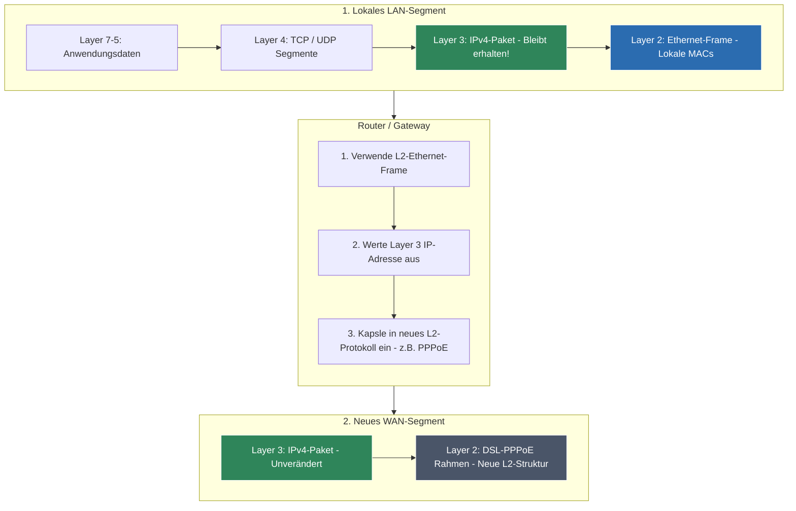

## 🧭 Navigation & Zusammenhänge
- **Vorausgesetztes Thema:** [[04_Ethernet-Grundlagen, MAC-Adressen & Rahmenstrukturen]]
- **Nächstes Thema:** [[06_ IP-Adressinformationen & Logische Bit-Verknüpfung]]
- **Verwandte Bausteine:** [[08_CIDR-Notation & Maskierungs-Grundlagen]], [[09_IP-Adressierung & Subnetting (VLSM & CIDR)]]
---

## 🎯 IHK-Prüfungsrelevanz
> [!IMPORTANT] AP01: Einrichten eines IT-gestützten Arbeitsplatzes
> - **Relevanz:** Hoch
> - **Fokus:** Grundkonfiguration von IPv4-Parametern (IP, Subnetzmaske, Standardgateway) auf Clientsystemen. Abgrenzung privater Adressräume in Firmennetzen beim Aufbau lokaler Arbeitsplätze.

> [!WARNING] AP02: Konzeption, Administration & Netzwerke
> - **Relevanz:** Absolut kritisch (100% prüfungsrelevant)
> - **Fokus:** Das mathematische Zerlegen von IPv4-Adressen in Netz- und Hostanteil mittels Subnetzmasken ist IHK-Kernkompetenz! Du musst in jeder Prüfung Netzadressen, nutzbare Hostbereiche und Broadcastadressen berechnen können (Formel: \(2^{\text{Hostbits}} - 2\)). Ebenfalls wichtig ist das Verständnis von CIDR, der historische Bezug zu Netzklassen sowie das Zusammenspiel mit ARP zur MAC-Adressauflösung auf Layer 2.

---

## 📖 Einfache Erklärung & Praxisbeispiele
Während Ethernet (Layer 2) die Kommunikation mit MAC-Adressen nur innerhalb *eines* lokalen Netzwerksegments erlaubt, ermöglicht das **Internet Protocol Version 4 (IPv4)** nach **RFC 791** die weltweite, verbindungslose Zustellung von Datenpaketen über Netzwerkgrenzen hinweg (**Layer 3 - Network Layer**). Eine IPv4-Adresse ist eine **32-Bit-Adresse**, die in vier Byte-Segmente (Oktette) unterteilt und dezimal notiert wird (z.B. `192.168.135.78`).

### Unterthemen & Anschauliche Beispiele:

- **Aufbau einer IP-Adresse (Netz- und Hostanteil):**
  Jede IPv4-Adresse besteht aus einem **Netzanteil** (welches Subnetz?) und einem **Hostanteil** (welches Gerät in diesem Subnetz?). Wo genau die Trennung liegt, bestimmt die **Subnetzmaske** durch gesetzte 1-Bits.
  - **Netzadresse:** Die erste Adresse eines Netzes (Hostbits alle `0`). Sie benennt das Netz und darf nicht an Endgeräte vergeben werden.
  - **Broadcastadresse:** Die letzte Adresse eines Netzes (Hostbits alle `1`). Sie dient dazu, alle Hosts im Subnetz gleichzeitig zu adressieren.
  - 💡 **Praxisbeispiel:** IP `192.168.110.5` mit Maske `255.255.255.0` (binär 24 Einsen).
    - Alle Hostbits genullt ergibt die Netzadresse: `192.168.110.0`
    - Alle Hostbits eingeschaltet ergibt die Broadcastadresse: `192.168.110.255`

- **CIDR-Notation (Classless Interdomain Routing):**
  1993 wurden die alten, starren **historischen Netzklassen** (Class A, B, C mit festen Präfix-Bits) abgeschafft. **CIDR** erlaubt eine völlig flexible Aufteilung. Dabei wird die Anzahl der festen Netz-Bits einfach mit einem Schrägstrich hinter die IP geschrieben (Suffix).
  - 💡 **Praxisbeispiel:** Statt `IP: 192.168.110.0, Maske: 255.255.255.0` schreibt ein FISI kurz und flexibel **`192.168.110.0/24`** (oder verkürzt `192.168.110/24`).

- **Private Adressbereiche (RFC 1918) vs. Loopback:**
  Um Adressen zu sparen, wurden für private Heim- und Firmennetze (LANs) Adressbereiche reserviert, die im weltweiten Internet **nicht öffentlich geroutet** werden dürfen:
  - **`10.0.0.0/8`** (10.0.0.0 – 10.255.255.255)
  - **`172.16.0.0/12`** (172.16.0.0 – 172.31.255.255)
  - **`192.168.0.0/16`** (192.168.0.0 – 192.168.255.255)
  - **Loopback-Bereich (`127.0.0.0/8`):** Reserviert für den lokalen Host (z.B. `127.0.0.1`). Aufrufe hierauf bilden keine echten Netzwerkpakete; der OS-Kernel fängt die Nachricht ab, bevor sie Layer 3 erreicht.
  - 💡 **Praxisbeispiel:** Dein Firmen-PC hat die private IP `10.30.105.8`. Um ins Internet zu gelangen, muss ein Router diese Adresse mittels NAT in eine von der IANA zugewiesene, öffentliche IP übersetzen.

- **Die Brücke zu Layer 2: Das Protokoll ARP:**
  Kennt Computer 1 im LAN zwar die Ziel-IP (`10.30.105.20`) von Computer 2, kann er den Ethernet-Rahmen dennoch nicht bauen, weil ihm die **Destination-MAC-Adresse** fehlt. Hier greift das **Address Resolution Protocol (ARP)**:
  1. Sender schickt einen **ARP-Request** als Layer-2-Broadcast (`FF:FF:FF:FF:FF:FF`) ins Netz: *"Wer hat die IP 10.30.105.20?"*
  2. Der gesuchte Host antwortet mit einem gezielten **ARP-Reply** (Unicast) und nennt seine MAC.
  3. Der Sender speichert diese Zuordnung im **ARP-Cache (ARP Table)** für zukünftige Pakete, bis der Timeout abläuft.

- **Daten-Transformation an Netzgrenzen:**
  Verlässt eine Nachricht ein lokales Netzwerksegment (LAN) über ein Gateway (z.B. ein Modem/Router Richtung DSL), werden die **Layer-1- und Layer-2-Informationen komplett verworfen**. Beim Eintritt in das neue Segment werden völlig neue Layer-2-Rahmen (z.B. DSL-PPPoE) an den Protokollstapel angefügt. Die Layer-3-Informationen (IP-Adressen) und die eigentlichen Nutzdaten bleiben dabei **unmanipuliert**.

---

## 📊 Visuelle Darstellung (Mermaid.js)

---

## 🚨 Die 3 kritischen IHK-Stolperfallen

- **Vergessen des Adressabzugs (-2) bei der Hostberechnung:** Ein fundamentaler Fehler in Subnetting-Prüfungsaufgaben. Fragt die IHK nach der Anzahl der **nutzbaren** IP-Adressen in einem Subnetz, lautet die Formel zwingend \(2^{n} - 2\) (n = Anzahl der Hostbits). Du musst immer **zwei Adressen abziehen**, da die allererste IP die Netzadresse und die allerletzte IP die Broadcastadresse repräsentiert. Beide dürfen niemals an Endgeräte vergeben werden.
- **Nennung veralteter "Netzklassen" als aktuellen Standard:** Die IHK testet in Freitextfragen gerne dein historisches Wissen zu Class A-, B- und C-Netzen (erkennbar an festen Präfix-Bits wie `10...` für Class B). Wenn du jedoch bei aktuellen Netzwerkplanungen behauptest, ein Netz sei "aufgrund der IP eine feste Class C", verlierst du Punkte. Seit 1993 ist **CIDR** der gültige, klassenlose Standard.
- **Annahme, dass ARP-Pakete über Router hinweg fließen:** Ein extrem beliebter IHK-Prüfungsschwerpunkt bei Netzwerkskizzen (z.B. *"Welche Geräte senden einen ARP-Reply?"*). **Merke:** ARP ist ein reines Schicht-2-Hilfsprotokoll und arbeitet mit Broadcasts (`FF:FF:FF:FF:FF:FF`). Da Router Broadcastdomänen strikt trennen, wird ein ARP-Request **niemals** von einem Router in ein anderes Netz weitergeleitet. Befindet sich die Ziel-IP in einem fremden Netz, schickt der Quell-Host den ARP-Request ausschließlich an die IP seines lokalen **Standardgateways**.
