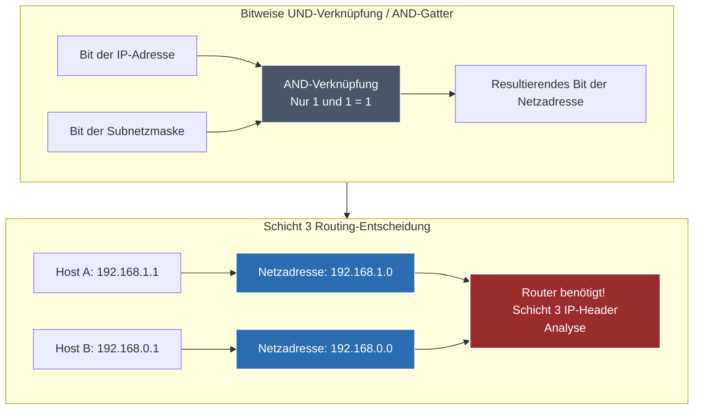

## 🧭 Navigation & Zusammenhänge
- **Vorausgesetztes Thema:** [[05_IPv4-Grundlagen, Subnetting & Adressbereiche]]
- **Nächstes Thema:** [[07_ARP-Auflösung & Datentransformation über Netzgrenzen hinweg]]
- **Verwandte Bausteine:** [[03_Dualsystem & Bit-Logik]], [[05_Logik, Schaltalgebra & Boole'sche Operatoren]]
---

## 🎯 IHK-Prüfungsrelevanz
> [!IMPORTANT] AP01: Einrichten eines IT-gestützten Arbeitsplatzes
> - **Relevanz:** Mittel
> - **Fokus:** Zuweisung korrekter IP-Konfigurationen auf Endgeräten. Erkennen, ob zwei Geräte aufgrund ihrer IP/Subnetzmasken-Kombination logisch im selben Segment liegen, um Konfigurationsfehler beim Arbeitsplatzaufbau auszuschließen.

> [!WARNING] AP02: Konzeption, Administration & Netzwerke
> - **Relevanz:** Extrem Hoch (IHK-Klassiker)
> - **Fokus:** In der Prüfung reicht es nicht, IP-Adressen nur dezimal zu verstehen. Die IHK verlangt oft die binäre Aufschlüsselung von IP-Adressen und Subnetzmasken, um die exakte Netzadresse per bitweiser UND-Verknüpfung (AND-Gatter) zu ermitteln. Das korrekte Bilden von Oktetten (Bytes) und die rechnerische Abgrenzung von Subnetzen auf Bitebene sind essenzielle Grundlagen für Punkte im Netzwerk-Teil.

---

## 📖 Einfache Erklärung & Praxisbeispiele
Eine IPv4-Adresse wird **immer in Kombination mit einer Subnetzmaske vergeben**. Da Netzwerkgeräte (wie Router und Switches) intern rein binär arbeiten, nutzen sie die mathematische **bitweise UND-Verknüpfung**, um aus der IP-Adresse und der Subnetzmaske die zugehörige Netzadresse zu berechnen. Jedes der vier Segmente einer IP-Adresse ist **1 Byte (8 Bit) groß** und wird auch als **Oktett** bezeichnet.

### Das Prinzip der binären UND-Verknüpfung (Logical AND)
Bei der bitweisen UND-Verknüpfung von IP-Adresse und Subnetzmaske wird Bit für Bit verglichen. Ein Bit in der resultierenden Netzadresse wird nur dann `1`, wenn **sowohl** das Bit der IP-Adresse **als auch** das entsprechende Bit der Subnetzmaske eine `1` sind. In allen anderen Fällen (0 und 1, 1 and 0, 0 and 0) ist das Ergebnis `0`.

### Unterthemen & Anschauliche Praxisbeispiele:

- **Die IANA-Zentralverwaltung:**
  Die **IANA (Internet Assigned Numbers Authority)** hält die oberste Autorität über den gesamten, weltweit verfügbaren Adressbereich von `0.0.0.0` bis `255.255.255.255`. Sie definiert die großen Adressblöcke und trennt private, nicht im Internet routingfähige Netze (**RFC 1918**) von den öffentlichen Bereichen.
  - 💡 **Praxisbeispiel:** Ein Unternehmen baut ein internes Testlabor auf. Damit der Traffic nicht mit echten Servern im Internet kollidiert, nutzt der Systemintegrator den privaten Adressbereich `192.168.0.0` bis `192.168.255.255`.

- **Binär-Check: Befinden sich zwei Hosts im selben Netz?**
  Ob zwei Endgeräte ohne Router direkt miteinander kommunizieren können, hängt davon ab, ob ihre berechneten Netzadressen identisch sind.
  
  **Host A (192.168.1.1 mit Maske 255.255.255.0):**
  ```text
  IP-Adresse:   11000000.10101000.00000001.00000001 (= 192.168.1.1)
  Subnetzmaske: 11111111.11111111.11111111.00000000 (= 255.255.255.0)
  -------------------------------------------------- [Bitweises UND]
  Netzadresse:  11000000.10101000.00000001.00000000 (= 192.168.1.0)
  ```
  
  **Host B (192.168.0.1 mit Maske 255.255.255.0):**
  ```text
  IP-Adresse:   11000000.10101000.00000000.00000001 (= 192.168.0.1)
  Subnetzmaske: 11111111.11111111.11111111.00000000 (= 255.255.255.0)
  -------------------------------------------------- [Bitweises UND]
  Netzadresse:  11000000.10101000.00000000.00000000 (= 192.168.0.0)
  ```
  - 💡 **Praxisbeispiel:** Host A hat die Netzadresse `192.168.1.0`, Host B hat `192.168.0.0`. Da die Ergebnisse der UND-Verknüpfung unterschiedlich sind, befinden sich die Geräte in **verschiedenen Teilnetzen**. Sie können Datenrahmen nicht direkt austauschen, sondern benötigen zwingend einen **Router auf OSI-Schicht 3**, der die IP-Header analysiert und die Pakete weiterleitet.

---

## 📊 Visuelle Darstellung (Mermaid.js)



---

## 🚨 Die 3 kritischen IHK-Stolperfallen

- **Flüchtigkeitsfehler beim binären UND:** Ein klassischer Fehler in Prüfungen unter Zeitdruck. Es wird fälschlicherweise `1 + 0 = 1` gerechnet, weil das Gehirn kurzzeitig in den "ODER"-Modus schaltet. **Präge dir ein:** Subnetzmasken-Bits wirken wie ein Filter. Wo in der Maske eine `0` steht, wird das Bit der IP-Adresse im Ergebnis **immer** zu einer `0`. Wo eine `1` steht, wird das Bit der IP-Adresse **eins zu eins** übernommen.
- **Oktett-Grenzen missachten (Dezimal-Binär-Konvertierung):** Die IHK wählt für fortgeschrittene Aufgaben gerne Subnetzmasken, die nicht auf den vollen Byte-Grenzen enden (z. B. eine `255.255.254.0` statt `255.255.255.0`). Wer hier stur dezimal rät, statt das betroffene 3. Oktett sauber in 8 einzelne Bits zu zerlegen und die UND-Verknüpfung mathematisch durchzuführen, verschenkt wertvolle Teilpunkte.
- **Fehlende Subnetzmaske in der IHK-Antwort:** Wenn die IHK nach einer IP-Konfiguration oder einer Netzadresse fragt, wird eine IP-Adresse *ohne* Angabe der Subnetzmaske (entweder in Dezimalform oder als CIDR-Suffix wie `/24`) oft als **unvollständig und damit falsch** gewertet. Eine IPv4-Adresse ist ohne ihre Subnetzmaske technisch nicht auswertbar, da ihr Netzanteil nicht bestimmt werden kann.
