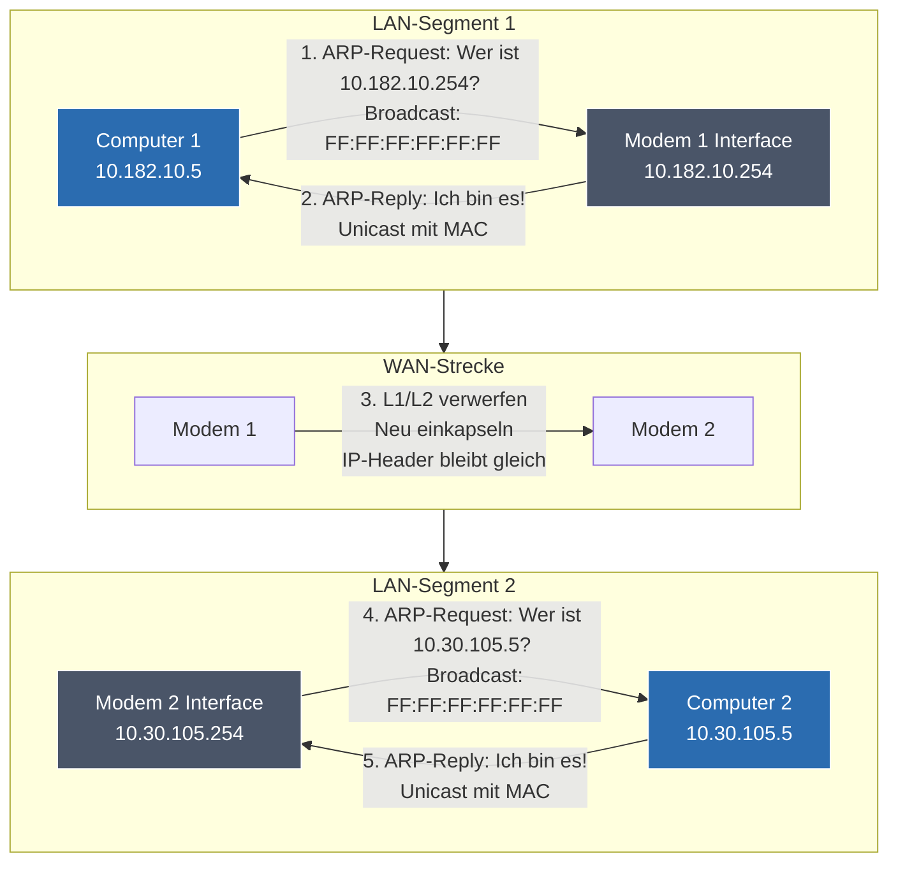

## 🧭 Navigation & Zusammenhänge
- **Vorausgesetztes Thema:** [[06_ IP-Adressinformationen & Logische Bit-Verknüpfung]]
- **Nächstes Thema:** [[08_CIDR-Notation & Maskierungs-Grundlagen]]
- **Verwandte Bausteine:** [[04_Ethernet-Grundlagen, MAC-Adressen & Rahmenstrukturen]], [[14_Routing-Grundlagen Tabellenstruktur, statisches & dynamisches Routing]]
---

## 🎯 IHK-Prüfungsrelevanz
> [!IMPORTANT] AP01: Einrichten eines IT-gestützten Arbeitsplatzes
> - **Relevanz:** Mittel
> - **Fokus:** Fehlerdiagnose bei Verbindungsproblemen. Verifizieren der lokalen ARP-Tabelle (`arp -a`) und des Standardgateways, um festzustellen, ob ein Client physisch Barrieren überwinden kann.

> [!WARNING] AP02: Konzeption, Administration & Netzwerke
> - **Relevanz:** Absolut kritisch (Regelmäßiges IHK-Szenario!)
> - **Fokus:** Das ist eine der beliebtesten Praxisfallen der IHK-Prüfer! Du musst ein Szenario analysieren, bei dem zwei Hosts in unterschiedlichen Subnetzen über Router hinweg kommunizieren. Die IHK fragt detailliert ab: *Wer schickt wann einen ARP-Request?*, *Welche MAC-Adressen stehen im Ethernet-Frame?* und *Welche Layer werden an den Schnittstellen modifiziert?* Hier entscheidet das präzise Trennen von Layer 2 (lokal) und Layer 3 (global) über die volle Punktzahl.

---

## 📖 Das IHK-Praxisszenario (Beispiel 2)
Gegeben ist die Netzwerkinfrastruktur aus deinen Unterrichtsunterlagen:
- **Computer 1:** IP `10.182.10.5` im lokalen LAN-Segment 1.
- **Modem/Router 1 (Standardgateway für LAN 1):** IP `10.182.10.254` am internen Interface.
- **Modem/Router 2 (Gateway für LAN 2):** IP `10.30.105.254` am internen Interface.
- **Computer 2:** IP `10.30.105.5` im entfernten LAN-Segment 2.

**Aufgabenstellung:** Computer 1 möchte eine Nachricht (HTTP-Request) an Computer 2 senden. Die Ziel-IP ist bekannt. Analysiere den genauen Ablauf der ARP-Abfragen und die Transformation des Datenstapels.

---

### 🕵️‍♂️ Schritt 1: Lokaler Netz-Check & Routing-Entscheidung
Computer 1 prüft mittels **bitweiser UND-Verknüpfung**, ob sich die Ziel-IP `10.30.105.5` im eigenen Subnetz befindet. 
- **Ergebnis:** Nein. Die Netze sind unterschiedlich (`10.182.10.0` vs. `10.30.105.0`).
- **Konsequenz:** Computer 1 weiß, dass er das Paket nicht direkt zustellen kann. Er muss es an sein konfiguriertes **Standardgateway (Modem 1)** übergeben.

### 🔄 Schritt 2: Der erste ARP-Ablauf (LAN-Segment 1)
Um das Paket an Modem 1 zu senden, benötigt Computer 1 dessen MAC-Adresse.
1. **ARP-Request von Computer 1:** Er sendet einen Schicht-2-Broadcast (`FF:FF:FF:FF:FF:FF`) in sein lokales LAN: *"Wer hat die IP 10.182.10.254? Bitte antworte mir (10.182.10.5)!"*
2. **ARP-Reply von Modem 1:** Da Modem 1 seine eigene IP erkennt, antwortet es per Unicast direkt an Computer 1 und teilt seine MAC-Adresse mit.
3. **Frame-Bau:** Computer 1 kapselt das IP-Paket in einen Ethernet-Frame.
   - **Source-MAC:** Computer 1
   - **Destination-MAC:** Modem 1
   - **Source-IP:** `10.182.10.5` (Computer 1)
   - **Destination-IP:** `10.30.105.5` (Computer 2)

### ✂️ Schritt 3: Datentransformation am Gateway (Modem 1)
Der Switch leitet den Frame an Modem 1 weiter. Modem 1 nimmt den Frame an und verarbeitet ihn:
- **Verwerfen von Layer 1 & 2:** Da der Frame seine Station erreicht hat, **schneidet das Modem die Ethernet-MAC-Informationen komplett ab und verwirft sie**.
- **Analyse auf Layer 3:** Das Modem prüft den IP-Header. Es sieht: *Destination-IP ist 10.30.105.5*. Es schaut in seine Routingtabelle und leitet das Paket über die WAN-Verbindung (z.B. gekapselt in DSL-PPPoE) an Modem 2 weiter.
- **Wichtig:** Die IP-Adressen im Header und die Nutzdaten (HTTP) werden bei dieser Transformation **nicht manipuliert**!

### 🔄 Schritt 4: Der zweite ARP-Ablauf (LAN-Segment 2)
Das Paket kommt bei Modem 2 an. Dieses stellt fest: Die Ziel-IP `10.30.105.5` liegt direkt an seinem lokalen Interface (LAN 2). Nun benötigt Modem 2 die MAC-Adresse von Computer 2.
1. **ARP-Request von Modem 2:** Es sendet einen neuen Schicht-2-Broadcast (`FF:FF:FF:FF:FF:FF`) in das LAN 2: *"Wer hat die IP 10.30.105.5?"*
2. **ARP-Reply von Computer 2:** Computer 2 antwortet per Unicast mit seiner MAC-Adresse an Modem 2.
3. **Finaler Frame-Bau:** Modem 2 verpackt das unveränderte IP-Paket in einen nagelneuen Ethernet-Frame für das Zielsegment:
   - **Source-MAC:** Modem 2
   - **Destination-MAC:** Computer 2
   - **Source-IP:** `10.182.10.5` (Computer 1 - bleibt immer gleich!)
   - **Destination-IP:** `10.30.105.5` (Computer 2 - bleibt immer gleich!)

---

## 📊 Visuelle Darstellung (Mermaid.js)

---

## 🚨 Die 3 kritischen IHK-Stolperfallen

- **Die "Globale ARP"-Falle:** Ein sehr häufiger Denkfehler in Prüfungsantworten lautet: *"Computer 1 schickt einen ARP-Request an Computer 2"*. **Das ist fundamental falsch!** ARP ist ein reines Layer-2-Protokoll. Broadcasts stoppen strikt am Router (Standardgateway). Computer 1 führt einen ARP-Request **ausschließlich** für die IP seines lokalen Gateways aus. Computer 2 sieht diesen Request niemals.
- **Fehlannahme der IP-Änderung beim Routing:** Viele Prüflinge glauben, dass ein Router die Ziel-IP im Paket auf die IP des Routers ändert. **Falsch!** Die Source-IP (`Computer 1`) und die Destination-IP (`Computer 2`) im Layer-3-Header bleiben über den gesamten Übertragungsweg durch das Netz **völlig unverändert** (sofern kein NAT im Spiel ist). Nur die MAC-Adressen (Layer 2) werden an jeder Netzgrenze komplett ausgetauscht.
- **Verwechslung von Request (Broadcast) und Reply (Unicast):** Die IHK fragt im Detail nach den Adresstypen. Merkregel: Ein *ARP-Request* wird als **Broadcast** an alle gesendet, da man den Empfänger noch sucht. Ein *ARP-Reply* ist ein **Unicast** (Punkt-zu-Punkt), da der Empfänger (der Anfragende) durch den Request bereits namentlich und mit seiner MAC-Adresse bekannt ist.
