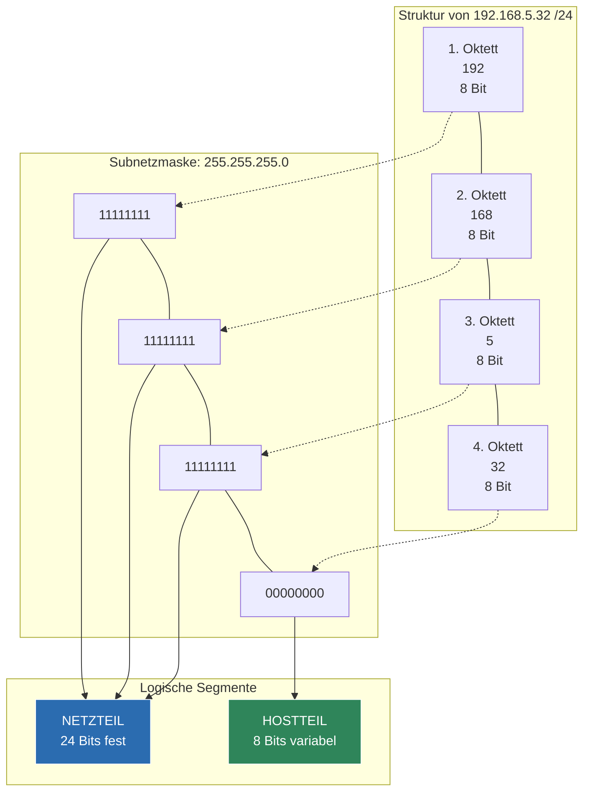

tags: [fisi, ihk, lernsheet]
## 🧭 Navigation & Zusammenhänge
- **Vorausgesetztes Thema:** [[07_ARP-Auflösung & Datentransformation über Netzgrenzen hinweg]]
- **Nächstes Thema:** [[09_IP-Adressierung & Subnetting (VLSM & CIDR)]]
- **Verwandte Bausteine:** [[05_IPv4-Grundlagen, Subnetting & Adressbereiche]], [[09_IP-Adressierung & Subnetting (VLSM & CIDR)]]
---

🎯 IHK-Prüfungsrelevanz

> [!IMPORTANT] AP01: Einrichten eines IT-gestützten Arbeitsplatzes
> 
> - **Relevanz:** Hoch
> - **Fokus:** Eintragen der korrekten IP-Konfiguration an Host-Systemen. Du musst verstehen, wie eine CIDR-Schreibweise (z. B. `/24`) in die vom Betriebssystem geforderte dezimale Subnetzmaske (`255.255.255.0`) übersetzt wird.

> [!WARNING] AP02: Konzeption, Administration & Netzwerke
> 
> - **Relevanz:** Absolut kritisch (Basiswissen für jede Subnetting-Aufgabe)
> - **Fokus:** Die IHK setzt das fehlerfreie und blitzschnelle Wechseln zwischen der CIDR-Notation und der dotted-decimal-Schreibweise voraus. In fast jeder Netzwerkaufgabe wird die Maske als Suffix angegeben. Du musst sofort erkennen, wie viele Bits für den Netzteil reserviert sind und wie viele Bits dem Hostteil zur Verfügung stehen, um Adressbereiche zu berechnen.

---

📖 Einfache Erklärung & Praxisbeispiele

Für eine vollständige **IP-Konfiguration** eines Hosts werden auf Layer 3 immer **zwei grundlegende Informationen** benötigt: Die **IP-Adresse** und die **Subnetzmaske**. Die Subnetzmaske bestimmt, wie die 32 Bits der IPv4-Adresse aufgeteilt werden: in einen **Netzteil** (Identifikation des Netzwerks) und einen **Hostteil** (Identifikation des Endgeräts in diesem Netzwerk).

Oktette und die mathematische Basis

Eine IPv4-Adresse besteht aus 4 Abschnitten, die jeweils **1 Byte (= 8 Bit)** groß sind und als **Oktett** bezeichnet werden.

- 4 Oktette × 8 Bit = **32 Bit Gesamtlänge**.
- Die **CIDR-Notation** (Classless Interdomain Routing) ist eine Kurzschreibweise. Statt die Maske dezimal auszuschreiben, wird die Anzahl der gesetzten Netzwerkbits (die `1`-Bits) einfach mit einem Schrägstrich hinter die IP-Adresse gehängt.

Unterthemen & Anschauliche Praxisbeispiele:

- **Die klassische /24er Netzmaske:**  
    Die in lokalen Netzwerken am häufigsten genutzte Maske ist die `/24`. Das bedeutet, dass exakt **24 Bits für den Netzteil** reserviert sind. Die restlichen 8 Bits (32 - 24 = 8) gehören dem **Hostteil**.
    - Binäre Darstellung der Maske: `11111111.11111111.11111111.00000000`
    - Umrechnung in Dezimal: Da ein voll gesetztes Byte (acht `1`-Bits) den Wert `255` hat, ergibt sich: **`255.255.255.0`**.
    - 💡 **Praxisbeispiel:** Die IP-Konfiguration lautet `192.168.5.32 /24`.
        - Der Netzteil umfasst die ersten drei Oktette: `192.168.5.`
        - Der Hostteil ist das letzte Oktett: `.32`
- **Host-Berechnung bei einer /24er Maske:**  
    Da im Hostteil 8 Bits variabel sind, gibt es mathematisch 2⁸ = 256 mögliche Kombinationen. Da jedoch die erste Adresse (alle Hostbits `0` = Netzadresse) und die letzte Adresse (alle Hostbits `1` = Broadcastadresse) reserviert sind, gilt:
    - Anzahl nutzbarer IPs: \(256 - 2 = \mathbf{254}\) **nutzbare Host-Adressen**.

---

📊 Visuelle Darstellung (Mermaid.js)

Verwende Code mit Vorsicht.

---

🚨 Die 3 kritischen IHK-Stolperfallen

- **Falsches Ablesen der Oktett-Grenzen:** Bei einer Standard-Maske wie `/24` fällt die Grenze exakt auf die Trennung zwischen dem 3. und 4. Oktett. Die IHK nutzt in Prüfungen jedoch gerne "krumme" CIDR-Suffixe wie `/25` oder `/26`. Hier darfst du den Netzteil **nicht** einfach bei den Punkten der Dezimalschreibweise abschneiden, sondern musst das betroffene Oktett binär aufsplitten.
- **Verwechslung von Bit-Anzahl und Dezimalwert:** Ein häufiger Denkfehler: Eine `/16`er Maske wird im Eifer des Gefechts als `16.16.0.0` oder ähnlich übersetzt. **Merke:** Die Zahl hinter dem Slash gibt ausschließlich die _Anzahl der Einsen_ von links nach rechts an. `/16` bedeutet demnach 16 Einsen (`11111111.11111111.00000000.00000000`), was dezimal exakt `255.255.0.0` entspricht.
- **Ungültige Host-Konfigurationen in Prüfungsfragen angeben:** Die IHK stellt oft Fangfragen wie: _"Welche IP-Adresse kann dem Client zugewiesen werden?"_ Wenn du bei einer `/24`er Maske eine IP wählst, die auf `.0` (Netzadresse) oder `.255` (Broadcastadresse) endet, gibt es **Punktabzug**. Endgeräte dürfen ausschließlich IP-Adressen aus dem berechneten Hostteil erhalten.
