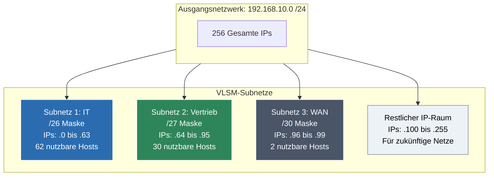

tags: [fisi, ihk, lernsheet]
## 🧭 Navigation & Zusammenhänge
- **Vorausgesetztes Thema:** [[08_CIDR-Notation & Maskierungs-Grundlagen]]
- **Nächstes Thema:** [[10_ IPv4-Header IP-Fragmentation & Flags]]
- **Verwandte Bausteine:** [[05_IPv4-Grundlagen, Subnetting & Adressbereiche]], [[08_CIDR-Notation & Maskierungs-Grundlagen]]
---

🎯 IHK-Prüfungsrelevanz

> [!IMPORTANT] AP01: Einrichten eines IT-gestützten Arbeitsplatzes
> 
> - **Relevanz:** Mittel
> - **Fokus:** Implementierung von Netzwerkmasken in kleineren Projektumgebungen. Du musst den Adressbedarf für Abteilungen richtig zuordnen können, damit Clients nicht aufgrund falsch dimensionierter Masken außerhalb des Gateways landen.

> [!WARNING] AP02: Konzeption, Administration & Netzwerke
> 
> - **Relevanz:** Überlebenswichtig (Bringt fast immer 10–15 fest eingeplante Punkte!)
> - **Fokus:** Die IHK fordert in fast jeder Abschlussprüfung die mathematische Aufteilung eines Basisnetzwerks in mehrere Teilnetze für unterschiedliche Abteilungen. Dabei musst du das **VLSM-Verfahren** (Variable Length Subnet Masking) anwenden: Netze nach der Host-Größe absteigend sortieren, Netzadressen, Broadcasts und die erste/letzte nutzbare IP fehlerfrei berechnen.

---

📖 Einfache Erklärung & Praxisbeispiele

**VLSM (Variable Length Subnet Masking)** erlaubt es, ein IP-Netzwerk in Subnetze mit **unterschiedlich großen Masken** aufzuteilen. Im Gegensatz zum veralteten, starren Classful-Routing (feste Netzklassen A, B, C) wird durch VLSM und **CIDR** der IP-Adressraum exakt an den realen Bedarf der Endgeräte angepasst. Das verhindert die Verschwendung wertvoller IPv4-Adressen.

Der 4-Schritte-Algorithmus für IHK-Subnetting:

1. **Sortieren:** Ordne alle geforderten Teilnetze nach der Anzahl der benötigten Hosts – **absteigend** (vom größten zum kleinsten Netz!).
2. **Bits reservieren:** Ermittle für jedes Netz die Anzahl der benötigten Hostbits (h) mithilfe der Formel: \(2^h - 2 \ge \text{benötigte Hosts}\).
3. **Maske bestimmen:** Berechne die neue CIDR-Maske: 32 - h = Netzbits.
4. **Adressen berechnen:** Bestimme die Netzadresse, die erste/letzte nutzbare IP und die Broadcastadresse. Die nächste Netzadresse beginnt genau 1 Bit nach dem vorherigen Broadcast.

Unterthemen & Anschauliche Praxisbeispiele:

- **Praxis-Szenario: Firmennetzwerk aufteilen**  
    Ein FISI erhält den Auftrag, das Basisnetz **`192.168.10.0/24`** für drei Abteilungen aufzuteilen:
    - Abteilung IT: 60 Hosts
    - Abteilung Vertrieb: 20 Hosts
    - WAN-Strecke zum Router: 2 Hosts
- **Berechnung Subnetz 1 (IT - 60 Hosts):**
    - Formel: \(2^h - 2 \ge 60 \rightarrow h=6\) (da 2⁶ - 2 = 62 ≥ 60). 6 Bits werden für Hosts benötigt.
    - Neue Maske: 32 - 6 = /26 (Dezimal: `255.255.255.192`).
    - **Netzadresse:** `192.168.10.0/26`
    - **Erste nutzbare IP:** `192.168.10.1`
    - **Letzte nutzbare IP:** `192.168.10.62`
    - **Broadcastadresse:** `192.168.10.63`
- **Berechnung Subnetz 2 (Vertrieb - 20 Hosts):**  
    Das Netz schließt direkt an den vorherigen Broadcast (`.63`) an. Die nächste freie IP ist die `.64`.
    - Formel: \(2^h - 2 \ge 20 \rightarrow h=5\) (da 2⁵ - 2 = 30 ≥ 20). 5 Bits für Hosts benötigt.
    - Neue Maske: 32 - 5 = /27 (Dezimal: `255.255.255.224`).
    - **Netzadresse:** `192.168.10.64/27`
    - **Erste nutzbare IP:** `192.168.10.65`
    - **Letzte nutzbare IP:** `192.168.10.94`
    - **Broadcastadresse:** `192.168.10.95`
- **Berechnung Subnetz 3 (WAN-Strecke - 2 Hosts):**  
    Die nächste freie IP ist die `.96`.
    - Formel: \(2^h - 2 \ge 2 \rightarrow h=2\) (da 2² - 2 = 2 ≥ 2). 2 Bits für Hosts benötigt.
    - Neue Maske: 32 - 2 = /30 (Dezimal: `255.255.255.252`).
    - **Netzadresse:** `192.168.10.96/30`
    - **Erste nutzbare IP:** `192.168.10.97`
    - **Letzte nutzbare IP:** `192.168.10.98`
    - **Broadcastadresse:** `192.168.10.99`

🚨 Die 3 kritischen IHK-Stolperfallen

- **Falsche Sortierung der Netze:** Der häufigste mathematische Genickbruch beim Subnetting. Wer die Netze nicht strikt nach ihrer Host-Größe absteigend sortiert (sondern z. B. das kleinste 2-Host-Netz an den Anfang setzt), erzeugt **Adressüberlappungen**. Die IHK bewertet Folgefehler in diesem Fall hart. Merkregel: **Immer mit dem größten Netz beginnen!**
- **Vergessen der Gateway-IP im Hostbedarf:** Oft schreibt die IHK im Text: _"Die Abteilung benötigt 29 Client-Arbeitsplätze und einen Drucker. Zudem ist ein Router als Gateway einzubinden."_ Die Falle: Viele rechnen mit 30 Hosts. Der Router benötigt jedoch ebenfalls eine valide Host-IP im selben Subnetz! Richtig ist: 29 + 1 + 1 = 31 Hosts. Damit reicht eine `/27`er Maske (30 nutzbare IPs) knapp nicht mehr aus und man muss eine `/26`er Maske wählen.
- **Fehlberechnung des Sprungwerts (Subnetz-Inkrement):** Beim Übergang zum nächsten Netz wird oft fälschlicherweise beim vorherigen Broadcast weitergemacht. **Merke:** Die Broadcastadresse schließt das alte Subnetz ab. Die nächste Netzadresse ist mathematisch exakt **Broadcastadresse + 1**. (Im obigen Beispiel: Broadcast 1 endet bei `.63`, Netzadresse 2 startet zwingend bei `.64`).