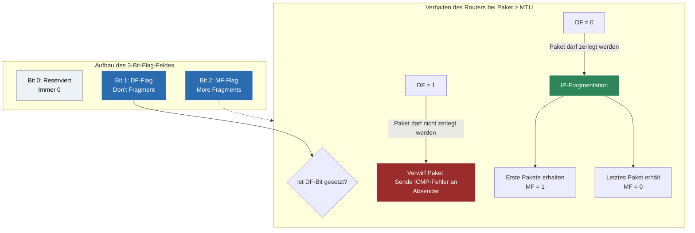

tags: [fisi, ihk, lernsheet]

## 🧭 Navigation & Zusammenhänge
- **Vorausgesetztes Thema:** [[09_IP-Adressierung & Subnetting (VLSM & CIDR)]]
- **Nächstes Thema:** [[11_Netzwerksegmentierung Virtual Local Area Networks (VLANs)]]
- **Verwandte Bausteine:** [[02_Das ISO, OSI-Referenzmodell & TCP, IP-Schichtenmodell]], [[15_Transportschicht im Detail TCP- vs. UDP-Protokolle, Header & Handshakes]]
---

🎯 IHK-Prüfungsrelevanz

> [!IMPORTANT] AP01: Einrichten eines IT-gestützten Arbeitsplatzes
> 
> - **Relevanz:** Gering
> - **Fokus:** Verständnis über Paketgrößen und warum fehlerhafte MTU-Werte auf Endgeräten zu Verbindungsabbrüchen bei bestimmten Webseiten führen können.

> [!WARNING] AP02: Konzeption, Administration & Netzwerke
> 
> - **Relevanz:** Hoch (Beliebtes Thema bei Wireshark- & Header-Analysen)
> - **Fokus:** In tiefergehenden Netzwerk-Aufgaben verlangt die IHK oft die Interpretation von Protokoll-Headern. Du musst die Flags im IPv4-Header (`DF` und `MF`) exakt erklären können. Besonders wichtig ist das Verständnis, wie Router reagieren, wenn ein Paket die Maximum Transmission Unit (MTU) eines Zielnetzwerks überschreitet.

---

📖 Einfache Erklärung & Praxisbeispiele

Wenn ein Router ein IP-Paket weiterleiten möchte, das größer ist als die maximal zulässige Paketgröße des nächsten Netzwerksegments (**MTU – Maximum Transmission Unit**), muss er das Paket in kleinere Teile zerlegen. Diesen Vorgang nennt man **IP-Fragmentation**. Die Steuerung und Koordination dieser Fragmente erfolgt über ein **3 Bit großes Feld** im IPv4-Header: die **Flags**.

Die 3 Bits des Flag-Feldes im Detail:

- **Bit 0 – Reserviert:** Dieses Bit ist nicht definiert und **muss immer 0 sein**.
- **Bit 1 – DF-Flag (Don't Fragment):** Zeigt dieses Bit den Wert **`1`**, darf das IP-Paket auf dem Weg **nicht in Fragmente zerlegt werden**. Ist das Paket zu groß für den nächsten Hop, verwirft der Router es und sendet eine Fehlermeldung (ICMP Destination Unreachable) zurück.
- **Bit 2 – MF-Flag (More Fragments):** Ist dieses Bit auf **`1`** geschaltet, signalisiert es dem Empfänger, dass das aktuelle Paket ein Fragment ist und **noch weitere Fragmente folgen**. Erst das **letzte Paket** einer fragmentierten Übertragung trägt hier den Wert **`0`**, um das Ende der Kette anzuzeigen.

Unterthemen & Anschauliche Praxisbeispiele:

- **Das Zusammenspiel von DF und MF in der Praxis:**
    - 💡 **Praxisbeispiel 1 (DF = 1):** Ein VPN-Client sendet Daten mit gesetztem `DF = 1`. Der Router stellt fest, dass der VPN-Tunnel eine kleinere MTU hat als das lokale LAN. Da er nicht fragmentieren darf, wirft er das Paket weg. Der Administrator muss auf dem Client die _MTU herabsetzen_ (MSS Clamping), damit die Pakete ohne Fragmentation durchpassen.
    - 💡 **Praxisbeispiel 2 (MF = 1):** Ein Host sendet eine 4000 Byte große Datei über eine Standard-Ethernet-Verbindung (MTU 1500 Byte). Der Router zerlegt die Daten in drei Fragmente:
        - Paket 1: Daten-Teil 1, Flag `MF = 1` (Es kommt noch was).
            
        - Paket 2: Daten-Teil 2, Flag `MF = 1` (Es kommt noch was).
        - Paket 3: Daten-Teil 3, Flag `MF = 0` (Das war das letzte Paket).

🚨 Die 3 kritischen IHK-Stolperfallen

- **Verwechslung von MF-Wert beim letzten Paket:** In Analyse-Fragen (z. B. Wireshark-Auszügen) wird gerne gefragt, welches Flag das Ende einer Fragment-Kette anzeigt. Viele Prüflinge raten hier instinktiv, dass das letzte Paket `MF = 1` hat, weil es "wichtig" ist. **Falsch:** `MF = 1` bedeutet übersetzt "Es folgen _mehr_ Fragmente". Das letzte Paket hat logischerweise **keine** nachfolgenden Teile mehr, weshalb hier zwingend **`MF = 0`** stehen muss.
- **Bit-Positionen vertauschen:** Die IHK fragt präzise nach den Bit-Nummern. Bit 0 ist reserviert, Bit 1 ist DF, Bit 2 ist MF. Wer die Reihenfolge von DF und MF vertauscht, interpretiert die Hex- oder Binärwerte im IP-Header falsch und verliert die Punkte für die gesamte Analyse.
    
- **Annahme, Fragmentation sei Aufgabe von Layer 2:** Da die MTU (Größe des Rahmens) durch das physikalische Medium auf Schicht 2 bestimmt wird, neigen Prüflinge dazu, die Fragmentation auch dort anzusiedeln. **Merke:** Ethernet (Layer 2) kann Rahmen nicht teilen – es verwirft sie einfach bei Größenfehlern. Die Fragmentation ist eine **reine Layer-3-Funktion des Internet Protocols**!