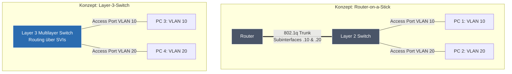

## 🧭 Navigation & Zusammenhänge
- **Vorausgesetztes Thema:** [[10_ IPv4-Header IP-Fragmentation & Flags]]
- **Nächstes Thema:** [[12_Strukturiertes Netzwerkdesign & Hochverfügbarkeit]]
- **Verwandte Bausteine:** [[17_Gerätekonfiguration & Netzwerksicherheit Switches, Router, ACLs & WLAN]], [[18_Netzwerksicherheit & Firewalls Firewall-Typen, DMZ, VPNs & NAC (802.1X)]]
---

## 🎯 IHK-Prüfungsrelevanz
> [!IMPORTANT] AP01: Einrichten eines IT-gestützten Arbeitsplatzes
> - **Relevanz:** Hoch
> - **Fokus:** Portbasierte VLAN-Zuweisung. Du musst verstehen, wie ein Endgerät über einen Access Port (ungetaggter Datenstrom) logisch in ein Firmen- oder Gästenetz eingegliedert wird.

> [!WARNING] AP02: Konzeption, Administration & Netzwerke
> - **Relevanz:** Extrem Hoch (Absoluter IHK-Schwerpunkt!)
> - **Fokus:** Eines der wichtigsten Themen für FISIs überhaupt! Die IHK fordert regelmäßig den Entwurf segmentierter Netzwerke. Du musst den Unterschied zwischen Access Ports (ungetaggt) und Trunk Ports (getaggt nach IEEE 802.1q) fehlerfrei erklären können. Ein weiterer Fokus liegt auf dem **Inter-VLAN-Routing**: Hier musst du die Konzepte **Router-on-a-Stick (RoaS)** und **Layer-3-Switches mit SVIs (Switched Virtual Interfaces)** mitsamt ihren Vor- und Nachteilen gegenüberstellen können.

---

## 📖 Einfache Erklärung & Praxisbeispiele
Ein **VLAN (Virtual Local Area Network)** ermöglicht es, einen einzigen physischen Switch in **mehrere logische Broadcast-Domänen** aufzuteilen. Ohne VLANs würden Broadcasts (wie ARP- oder DHCP-Anfragen) jedes Endgerät erreichen und eine hohe Netzlast erzeugen. VLANs trennen Netzwerke sauber auf **Layer 2 (Sicherungsschicht)**. Geräte in unterschiedlichen VLANs können niemals direkt miteinander kommunizieren – selbst wenn sie am selben Switch hängen. Für den Datenaustausch zwischen VLANs wird zwingend ein **Layer-3-Gerät (Router/L3-Switch)** benötigt.

### Die zwei wichtigsten Port-Modi:
- **Access Ports:** Verbinden Endgeräte (PCs, Drucker) mit dem Switch. Der Port ist fest einem einzigen VLAN zugeordnet. Verlässt der Traffic den Port in Richtung Endgerät, ist er **ungetaggt** (normales Ethernet).
- **Trunk Ports:** Verbinden Switches untereinander oder mit einem Router. Über ein einziges Kabel werden mehrere VLANs transportiert. Der Switch fügt dafür ein **4 Byte großes Tag nach IEEE 802.1q** in den Ethernet-Header ein, welches die **VLAN ID (1–4094)** enthält.

### Wie funktioniert Inter-VLAN-Routing? (Vergleich)

| Merkmal | Router-on-a-Stick (RoaS) | Layer-3-Switch (SVI) |
| :--- | :--- | :--- |
| **Konzept** | Ein externer Router ist über eine physische Trunk-Verbindung an den Switch angeschlossen. | Ein intelligenter Switch übernimmt das Routing intern direkt selbst. |
| **Implementierung** | Der Router teilt seine physische Schnittstelle in logische **Subinterfaces** auf (z. B. `Gi0/0.10`). | Für jedes VLAN wird ein virtuelles Router-Interface (**SVI / Switched Virtual Interface**) erstellt. |
| **Performance** | **Geringer**, da die physische Leitung zum Router bei viel Traffic schnell zum Flaschenhals ("Bottleneck") wird. | **Extrem hoch**, da das Routing direkt über die spezialisierte Hardware (ASICs) des Switches läuft. |
| **Kosten / Topologie** | Kostengünstiger, da günstige L2-Switches reichen; Topologie ist jedoch komplexer. | Teurer in der Anschaffung, vereinfacht aber die Infrastruktur, da kein externer Router nötig ist. |

---

## 📊 Visuelle Darstellung (Mermaid.js)

---

## 🚨 Die 3 kritischen IHK-Stolperfallen

- **Die "Native VLAN"-Mismatch-Falle:** Ein absolut beliebter IHK-Fehler in Troubleshooting-Aufgaben. Das **Native VLAN** (Standard: VLAN 1) transportiert Traffic auf einem 802.1q-Trunk **ohne Tag**. Die Falle: Wenn Switch A das Native VLAN auf `10` konfiguriert hat, Switch B auf der anderen Seite des Kabels jedoch auf `20`, führt dies zu Fehlern und Sicherheitslücken (VLAN-Hopping). **Merke:** Das Native VLAN muss auf beiden Seiten eines Trunks zwingend identisch sein!
- **Vergessen des Kapselungsbefehls am Router:** In Konfigurationsaufgaben (z. B. Cisco IOS) musst du Subinterfaces für RoaS einrichten. Viele Prüflinge weisen dem Subinterface sofort die IP-Adresse zu. Das führt zu null Punkten für die Zeile. **Richtige Reihenfolge:** Erst das Subinterface erstellen, zwingend den Kapselungsbefehl eingeben (`encapsulation dot1q <vlan-id>`) und erst danach die IP-Adresse konfigurierbar machen! Ohne das Protokoll-Tagging versteht das Interface keine getaggten Pakete.
- **Sicherheitsrisiko "VLAN 1" ignorieren:** Die IHK fragt gern nach Best Practices zur RZ-Sicherheit. Wer in der Prüfung vorschlägt, Benutzerdaten im VLAN 1 zu belassen, verliert Punkte. **IHK-Regel:** VLAN 1 ist der Standard für Management-Traffic. Aus Sicherheitsgründen sollten Benutzerdaten strikt getrennt werden, das Native VLAN auf eine ungenutzte ID (z. B. 999) geändert und ungenutzte Switchports administrative abgeschaltet werden.
