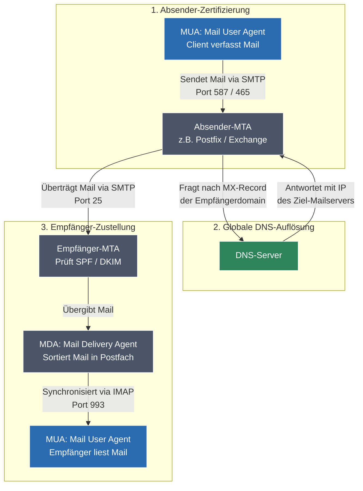

tags: [fisi, ihk, lernsheet]
## 🧭 Navigation & Zusammenhänge
- **Vorausgesetztes Thema:** [[12_Strukturiertes Netzwerkdesign & Hochverfügbarkeit]]
- **Nächstes Thema:** [[14_Routing-Grundlagen Tabellenstruktur, statisches & dynamisches Routing]]
- **Verwandte Bausteine:** [[16_DNS-Strukturen, administrative Steuerung & Security Deep Dive]], [[19_Netzwerkprotokolle, Kern-Dienste & IHK-Portmatrix]]
---

🎯 IHK-Prüfungsrelevanz

> [!IMPORTANT] AP01: Einrichten eines IT-gestützten Arbeitsplatzes
> 
> - **Relevanz:** Extrem Hoch
> - **Fokus:** Du musst die automatische IP-Zuweisung über DHCP verstehen. Das manuelle Einrichten und Prüfen der Netzwerkkonfiguration (IP, Subnetzmaske, Default Gateway, DNS-Server) an Endgeräten sowie die lokale Namensauflösung über die herstellerunabhängige `hosts`-Datei sind elementare Kernaufgaben.

> [!WARNING] AP02: Konzeption, Administration & Netzwerke
> 
> - **Relevanz:** Absolut kritisch (Zentraler Bestandteil jeder Systemintegration!)
> - **Fokus:** Die IHK prüft diese Dienste intensiv auf Protokollebene. Du musst den genauen **DHCP-DORA-Ablauf** (inkl. Broadcast/Unicast-Wechsel und Lease-Verlängerung) fehlerfrei skizzieren können. Beim **DNS** stehen die exakte Resource-Record-Syntax (`A`, `AAAA`, `MX`, `CNAME`, `SOA`, `TXT`) sowie der Unterschied zwischen iterativer und rekursiver Abfrage im Vordergrund. Für die **E-Mail-Infrastruktur** ist die strikte funktionale Trennung der Software-Komponenten (**MUA, MTA, MDA**) sowie die Abgrenzung von **SMTP, IMAP und POP3** (inkl. TCP-Ports) essenzielles Prüfungswissen.

---

📖 Einfache Erklärung & Praxisbeispiele

1. DHCP (Dynamic Host Configuration Protocol)

DHCP dient zur **automatischen Konfiguration** von Hosts in einem Netzwerk. Es weist Endgeräten dynamisch IP-Adressen, Subnetzmasken, Standardgateways und DNS-Server zu, um Adresskonflikte zu vermeiden. Die Zuweisung erfolgt für eine begrenzte Gültigkeitsdauer (**Lease Time**).

Der prozedurale DHCP-Ablauf (Das DORA-Prinzip):

1. **D**iscover (**Broadcast**): Der neue Client sucht im Netzwerk nach verfügbaren DHCP-Servern.
2. **O**ffer (**Unicast**): Ein Server bietet dem Client eine freie IP-Adresse mitsamt Lease-Time an.
3. **R**equest (**Unicast**): Der Client fordert diese angebotene IP-Adresse offiziell beim Server an.
4. **A**cknowledge (**Unicast**): Der Server bestätigt die Zuweisung und übermittelt die finalen Konfigurationsdaten.

- _Hinweis:_ Gibt der Client die IP vor Ablauf der Lease-Time händisch frei, sendet er ein **`DHCPRELEASE`**.

2. DNS (Domain Name System)

Das DNS ist eine **hierarchisch und dezentral aufgebaute Datenbank**, die für die Übersetzung von menschenlesbaren Domainnamen in maschinenlesbare IP-Adressen zuständig ist (**Namensauflösung/Resolving**). Es nutzt primär das verbindunglose **UDP** für schnelle Abfragen.

Die DNS-Serverhierarchie:

- **Wurzelebe (Root-Zone):** Der oberste Einstiegspunkt (notiert als unsichtbarer Punkt am Ende: `://example.com.`).
- **Top-Level-Domain (TLD):** Unterteilt in ccTLDs (länderbezogen wie `.de`) und gTLDs (generisch wie `.com`).
- **Second-Level-Domain:** Der eigentliche Name der Organisation/Registrierung (z. B. `google` oder `example`).
- **Third-Level-Domain (Hostname):** Bestimmt den konkreten Dienst oder Server (z. B. `www` oder `mail`). Die Kombination aus Hostname und Domain bildet den **FQDN** (Fully Qualified Domain Name).

Wichtige Resource Records (RR) auf den Nameservern:

- **`A`:** Verweist auf eine **IPv4-Adresse** (Syntax-Beispiel: `www 86400 IN A 10.66.2.44`).
- **`AAAA`:** Verweist auf eine **IPv6-Adresse**.
- **`CNAME`:** Ein **Alias-Eintrag**, der einen Namen auf einen anderen Namen umleitet.
- **`MX`:** Bestimmt den zuständigen **Mailserver** für die Domain mitsamt einer Prioritätskennzahl.
- **`SOA` (Start of Authority):** Enthält administrative Zonen-Parameter (Seriennummer, Ablaufzeiten, Admin-Mail).
- **`TXT`:** Enthält beliebigen Freitext, heute elementar für Anti-Spam-Maßnahmen wie **SPF, DKIM und DMARC**.
- _Lokale Auflösung:_ Bevor ein Betriebssystem eine DNS-Abfrage ins Netz schickt, prüft der interne Resolver immer zuerst die lokale **`hosts`-Datei** (`/etc/hosts` unter Linux / `...\drivers\etc\hosts` unter Windows).

3. E-Mail-Infrastruktur

Der Mail-Verkehr basiert auf einem klar definierten Zusammenspiel verschiedener Software-Architekturen:

- **MUA (Mail User Agent):** Das E-Mail-Programm des Endanwenders (z. B. Outlook, Thunderbird) zum Verfassen und Lesen.
- **MTA (Mail Transfer Agent):** Der Server-Dienst, der E-Mails über das **SMTP-Protokoll** entgegennimmt und an andere Mailserver weiterleitet (z. B. Postfix, Exchange). Er fragt das DNS nach dem passenden **MX-Record** der Empfängerdomain ab.
- **MDA (Mail Delivery Agent):** Nimmt die E-Mails vom empfangenden MTA entgegen und sortiert sie präzise in die lokalen Postfächer der Benutzer ein (Schnittstelle oft via LMTP).

Protokoll- & Portübersicht für den Mailverkehr:

|Protokoll|Funktion|Standard-Port (unverschlüsselt)|Sicherer Port (SSL/TLS / Aufruf)|
|---|---|---|---|
|**SMTP**|Reiner **Versand** & Transport zwischen MTAs. Textbasiert.|`25`|`465` (SMTPS) / `587` (Submission)|
|**IMAP**|Synchroner **Abruf**. Mails verbleiben auf dem Server; Ordnerstrukturen werden dort verwaltet.|`143`|`993` (IMAPS)|
|**POP3**|Reiner **Abruf**. Lädt Mails standardmäßig lokal herunter und löscht sie vom Server.|`110`|`995` (POP3S)|

🚨 Die 3 kritischen IHK-Stolperfallen

- **Die DHCP-Broadcast-Falle im DORA-Prozess:** In Prüfungen wird penibel nach den Adressierungsarten im DHCP-Ablauf gefragt. Die Falle: Viele glauben, der gesamte DORA-Prozess läuft über Broadcasts, weil der Client noch keine IP hat. **Merke:** Ausschließlich der **`DHCPDISCOVER`** ist zwingend ein **Broadcast**. Sobald der Server antwortet (`DHCPOFFER`), nutzt er im Layer-2-Frame die eindeutige MAC-Adresse des Clients als **Unicast**, weshalb auch Request und Acknowledge in modernen Netzen als Unicast abgewickelt werden.
- **Verwechslung der MX-Record-Prioritäten:** Musst du in einer Prüfungsaufgabe eine DNS-Zonendatei schreiben oder interpretieren, tauchen bei den MX-Records Zahlenwerte auf (z. B. `IN MX 10 mail1` und `IN MX 20 mail2`). Die Falle: Intuitiv wird oft die höhere Zahl für den primären Server gehalten. **IHK-Regel:** Bei MX-Records gilt: **Je niedriger der Prioritätswert, desto höher die Priorität!** Der Mailserver mit der `10` wird immer zuerst angefragt; die `20` ist der reine Backup-Server.
- **MUA, MTA und MDA funktional vermischen:** Bei der Analyse von Mail-Architekturen werfen Prüflinge die Begriffe gern durcheinander. Typischer Fehler: _"Der MTA Outlook ruft die Mails ab"_. Das gibt null Punkte. **Merke glasklar:** Outlook ist ein **MUA**. Ein **MTA** (wie Postfix) transportiert _niemals_ Mails zum Endanwender, sondern reicht sie nur von Server zu Server weiter. Der **MDA** ist der einzige Verwalter des Postfaches auf dem Server.