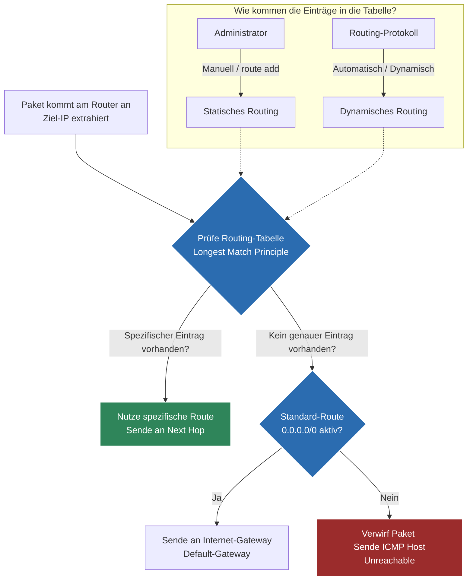

tags: [fisi, ihk, lernsheet]
## 🧭 Navigation & Zusammenhänge
- **Vorausgesetztes Thema:** [[13_Core-Dienste auf Anwendungsebene DHCP, DNS & E-Mail-Infrastruktur]]
- **Nächstes Thema:** [[15_Transportschicht im Detail TCP- vs. UDP-Protokolle, Header & Handshakes]]
- **Verwandte Bausteine:** [[07_ARP-Auflösung & Datentransformation über Netzgrenzen hinweg]], [[17_Gerätekonfiguration & Netzwerksicherheit Switches, Router, ACLs & WLAN]]
---

🎯 IHK-Prüfungsrelevanz

> [!IMPORTANT] AP01: Einrichten eines IT-gestützten Arbeitsplatzes
> 
> - **Relevanz:** Hoch
> - **Fokus:** Du musst Diagnosetools wie `ping` (ICMP Echo Request/Reply) und `traceroute`/`tracert` (basiert auf ICMP Time Exceeded) einsetzen und interpretieren können. Das Verifizieren des lokalen Standardgateways (Default Route `0.0.0.0/0`) am Client gehört zu den wichtigsten Handgriffen beim Arbeitsplatzaufbau.

> [!WARNING] AP02: Konzeption, Administration & Netzwerke
> 
> - **Relevanz:** Extrem Hoch (IHK-Dauerbrenner!)
> - **Fokus:** In fast jeder Netzwerkaufgabe musst du eine **Routing-Tabelle** interpretieren oder selbst Einträge berechnen und eintragen. Die IHK verlangt das präzise Verständnis der Spalten (Zielnetz, Maske, Gateway/Next Hop, Interface, Metrik). Zudem musst du in der Lage sein, die Vor- und Nachteile von **statischem Routing** gegenüber **dynamischen Routing-Verfahren** für ein gegebenes Unternehmensszenario abzuwägen und administrative Befehle aufzuschreiben.

---

📖 Einfache Erklärung & Praxisbeispiele

Sobald ein Datenpaket an eine IP-Adresse **außerhalb des eigenen Subnetzes** gesendet werden soll, kann es nicht mehr direkt zugestellt werden – es muss **geroutet werden**. Routing ist der Prozess, den optimalen Pfad für Datenpakete durch verschiedene Netzwerke zu finden. Router treffen diese Weiterleitungsentscheidungen anhand ihrer **Routing-Tabelle**. Das Internet Protocol (IP) selbst ist dabei rein **verbindungslos** – es garantiert weder die Ankunft noch die korrekte Reihenfolge der Pakete (darum kümmert sich auf Layer 4 erst TCP).

1. Aufbau und Spalten einer Routing-Tabelle

Jeder Router (und auch jeder PC) führt eine Tabelle nach folgendem Muster:

|Zielnetzwerk & Maske|Gateway (Next Hop)|Interface|Metrik|Erklärung|
|---|---|---|---|---|
|`192.168.10.0/24`|`On-Link` (Direkt)|`eth0` (LAN)|`0`|**Direkt verbundenes Netz:** Der Router hält selbst ein Bein in diesem Netzwerk.|
|`10.50.0.0/16`|`192.168.10.254`|`eth0` (LAN)|`20`|**Spezifische Route:** Pakete an dieses Netz werden an den nächsten Router (`.254`) weitergereicht.|
|`0.0.0.0/0`|`198.51.100.1`|`eth1` (WAN)|`100`|**Standard-Route (Default Route):** Gilt als Auffangbecken für alle Ziele, für die kein genauerer Eintrag existiert (z. B. das Internet).|

2. Statisches vs. Dynamisches Routing

Statisches Routing

Hier trägt der Administrator die Routen **manuell** fest in die Tabelle ein.

- 💻 **Befehlsbeispiel:** `route add 10.50.0.0 mask 255.255.0.0 192.168.10.254 metric 20`
- **Vorteile:** Sehr sicher, einfach in kleinen Umgebungen, spart Router-Ressourcen (CPU/RAM).
- **Nachteile:** Nicht skalierbar (hoher Aufwand bei vielen Netzen), **keine automatische Redundanz** (fällt eine Leitung aus, bleibt die Route tot).

Dynamisches Routing

Router tauschen Informationen über erreichbare Netze **automatisch** mithilfe von Routing-Protokollen (wie OSPF oder BGP) untereinander aus. Die Tabelle aktualisiert sich selbstständig.

- **Vorteile:** Extrem skalierbar, **automatische Anpassung bei Ausfällen** (Pakete werden sofort über Backup-Pfade umgeleitet).
    
- **Nachteile:** Höherer Konfigurationsaufwand, benötigt Router-Ressourcen für die Pfadberechnungen.

🚨 Die 3 kritischen IHK-Stolperfallen

- **Die "Longest Match"-Regel missachten:** Ein absoluter Klassiker in Tabellen-Analyseaufgaben. Wenn für ein Paket an die IP `10.50.20.5` zwei Einträge existieren – `10.50.0.0/16` und `10.50.20.0/24` – wählen Prüflinge oft die falsche Route oder glauben, die niedrigere Metrik entscheidet sofort. **IHK-Regel:** Der Router wählt **immer** die Route mit der längsten übereinstimmenden Subnetzmaske (spezifischster Eintrag). Erst bei absolut identischer Maskenlänge wird die Metrik als Kriterium herangezogen!
- **Das "Next Hop"-Verständnis auf Layer 2 vertauschen:** Wenn du in einer Aufgabe den "Next Hop" für eine statische Route eintragen sollst, darfst du dort **niemals** die IP des Ziel-Endgeräts eintragen. **Merke:** Der Next Hop ist zwingend die IP-Adresse des **nächstgelegenen Router-Interfaces im selben Subnetz**, an das das Paket übergeben werden muss. Ein Router kann Layer-3-Pakete nur an Systeme weiterreichen, die er auf Layer 2 physisch direkt erreichen kann.
- **ICMP fälschlicherweise der Transportschicht (Layer 4) zuordnen:** Weil Tools wie `ping` und `traceroute` Anwendungen sind, ordnen Prüflinge das zugrundeliegende Protokoll **ICMP** gerne der Anwendungs- oder Transportschicht zu. **Falsch:** ICMP ist ein reines Hilfsprotokoll der **Internetschicht (Layer 3)** und arbeitet untrennbar mit dem IP-Protokoll zusammen, um Fehlermeldungen (wie _Time Exceeded_ oder _Destination Unreachable_) zu transportieren.