```mermaid
gantt
    title TCP-Header Struktur (32 Bit Gesamtbreite pro Zeile)
    dateFormat X
    axisFormat %L
    tickInterval 1

    section Zeile 1 (Bit 0-31)
    Source Port (16 Bit)          :active, 0, 16
    Destination Port (16 Bit)     : 16, 32
    
    section Zeile 2 (Bit 32-63)
    Sequence Number (32 Bit)      :crit, 0, 32
    
    section Zeile 3 (Bit 64-95)
    Acknowledgment Number (32 Bit):milestone, 0, 32
    
    section Zeile 4 (Bit 96-127)
    Data Offset (4 Bit)           :active, 0, 4
    Reserved (4 Bit)              : 4, 8
    Flags (CWR,ECE,SYN,ACK...) (8 Bit) :crit, 8, 16
    Receive Window (16 Bit)       : 16, 32
    
    section Zeile 5 (Bit 128-159)
    Checksum (16 Bit)             :active, 0, 16
    Urgent Pointer (16 Bit)        : 16, 32

    section Zeile 6 (Optional)
    Options & Padding (0 - 40 Byte): 0, 32

```

```mermaid
gantt
    title UDP-Header Struktur (Immer exakt 8 Byte / 64 Bit groß)
    dateFormat X
    axisFormat %L
    tickInterval 1

    section Zeile 1 (Bit 0-31)
    Source Port (16 Bit)          :active, 0, 16
    Destination Port (16 Bit)     : 16, 32
    
    section Zeile 2 (Bit 32-63)
    Length (16 Bit)               :crit, 0, 16
    Checksum (16 Bit)             : 16, 32

```

tags: [fisi, ihk, lernsheet]
## 🧭 Navigation & Zusammenhänge
- **Vorausgesetztes Thema:** [[15_Transportschicht im Detail TCP- vs. UDP-Protokolle, Header & Handshakes]]
- **Nächstes Thema:** [[17_Gerätekonfiguration & Netzwerksicherheit Switches, Router, ACLs & WLAN]]
- **Verwandte Bausteine:** [[13_Core-Dienste auf Anwendungsebene DHCP, DNS & E-Mail-Infrastruktur]], [[18_Netzwerksicherheit & Firewalls Firewall-Typen, DMZ, VPNs & NAC (802.1X)]]
---

🎯 IHK-Prüfungsrelevanz

> [!IMPORTANT] AP01: Einrichten eines IT-gestützten Arbeitsplatzes
> 
> - **Relevanz:** Hoch
> - **Fokus:** Portbasierte Adressierung von Netzwerkverbindungen. Du musst wissen, welche Anwendung welche Ports belegt, um lokale Firewalls auf Endgeräten richtig zu konfigurieren und Netzwerkverbindungen mit Systemtools (z. B. `netstat` oder `ss`) zu analysieren.

> [!WARNING] AP02: Konzeption, Administration & Netzwerke
> 
> - **Relevanz:** Überlebenswichtig (Absoluter IHK-Kernbereich!)
> - **Fokus:** In Netzwerk- und Wireshark-Analyseaufgaben wird die genaue Struktur von **TCP- und UDP-Headern** regelmäßig abgefragt. Du musst den **3-Wege-Handshake** (Verbindungsaufbau) und den **4-Wege-Handshake** (Verbindungsabbau) inklusive der beteiligten Flags (`SYN`, `ACK`, `FIN`, `RST`) fehlerfrei beschreiben können. Häufige Themen sind zudem Sicherheitsrisiken wie **TCP SYN Flooding** sowie die Protokoll-Garantien (Fluss- und Flusskontrolle).

---

📖 Einfache Erklärung & Praxisbeispiele

Die **Transportschicht (Layer 4)** des OSI-Modells ist für die logische Ende-zu-Ende-Kommunikation zwischen Anwendungen zuständig. Während die Internetschicht (Layer 3) Pakete nur von Host zu Host transportiert, sorgt Layer 4 mithilfe von **Portnummern** (16 Bit groß; Wertebereich von 1 bis 65535) dafür, dass Daten dem exakt passenden Dienst zugeordnet werden.

1. TCP (Transmission Control Protocol) – Die zuverlässige Verbindung

TCP ist ein **verbindungsorientiertes**, zustandsbehaftetes und hochgradig **zuverlässiges** Protokoll. Bevor die eigentliche Datenübertragung startet, wird eine feste logische Verbindung aufgebaut.

- **Der 3-Wege-Handshake (Aufbau):**
    1. Client sendet ein Paket mit gesetztem **`SYN`**-Flag (Synchronize) und einer zufälligen Start-Sequenznummer (`seq=x`).
    2. Server antwortet mit **`SYN-ACK`** (Synchronize-Acknowledge). Er bestätigt den Empfang (`ack=x+1`) und schickt seine eigene Sequenznummer (`seq=y`).
    3. Client bestätigt mit **`ACK`** (Acknowledge) den Empfang (`ack=y+1`). Die Verbindung steht (`ESTABLISHED`).
- **Der 4-Wege-Handshake (Abbau):**  
    Beide Kommunikationspartner müssen das Ende der Übertragung separat mit dem **`FIN`**-Flag (Finish) signalisieren und die Gegenseite quittiert dies jeweils mit einem `ACK`.
- **Garantien & Kontrollmechanismen:**
    - **Sequenznummern (32 Bit):** Jedes Byte im Datenstrom wird nummeriert. Der Empfänger kann so die richtige Reihenfolge wiederherstellen und Duplikate oder Lücken erkennen.
    - **Receive Window (16 Bit):** Steuert die Flusskontrolle. Der Empfänger teilt dem Sender mit, wie viele Bytes dieser ohne Bestätigung senden darf, um den Empfangspuffer nicht zu überlasten.
    - **Prüfsumme (Checksum - 16 Bit):** Wird über Header, Daten und einen _Pseudo-Header_ (enthält u. a. IPs von Layer 3) berechnet. Bei Fehlern wird kein ACK gesendet, was den Sender zum Neuversand zwingt.
- 💡 **Praxis-Anwendungen:** Überall, wo Datenverlust fatal wäre: HTTP/HTTPS (Web), SMTP/IMAP (E-Mail), FTP (Dateitransfer), SSH (Remote-Zugriff).

2. UDP (User Datagram Protocol) – Die schnelle Alternative

UDP ist ein **verbindungsloses**, zustandsloses (_stateless_) und **unzuverlässiges** Protokoll ("Best Effort").

- **Eigenschaften:** Es gibt keinen Handshake vorab, keine Empfangsbestätigungen, keine Flusskontrolle und keine Garantie über Reihenfolge oder Ankunft. Fehlerhafte Pakete werden nach der Checksum-Prüfung einfach wortlos verworfen – weder Sender noch Empfänger fordern sie neu an.
- **Vorteil:** Minimaler Protokoll-Overhead (nur 8 Byte Header) und dadurch **maximale Geschwindigkeit** und niedrige Latenz.
- 💡 **Praxis-Anwendungen:** Echtzeitanwendungen, bei denen minimale Aussetzer verkraftbar sind, aber Verzögerungen stören: VoIP (IP-Telefonie), Video-Streaming, Online-Gaming sowie schnelle Infrastruktur-Abfragen wie DNS und DHCP.

---

---
💡 Tipp für dein Obsidian-Lernsheet:

- Der **TCP-Header** ist variabel aufgebaut, da das Feld _Options_ am Ende bis zu 40 Byte einnehmen kann. Ohne Optionen ist er **20 Byte** groß (Zeile 1 bis 5).
- Der **UDP-Header** ist ein absolutes Leichtgewicht. Er besitzt keine Flags oder Sequenznummern und ist mit seinen 4 Feldern immer **exakt 8 Byte** groß. Das sorgt für minimalen Overhead und maximale Geschwindigkeit!

🚨 Die 3 kritischen IHK-Stolperfallen

- **Die "Halb-Offene" Ressourcenfalle (SYN-Flood):** Die IHK fragt gezielt nach Angriffsvektoren auf Protokollebene. Beim **TCP SYN Flood** überflutet ein Angreifer den Server mit `SYN`-Paketen, antwortet aber nie auf das `SYN-ACK` des Servers. Der Server hält diese Verbindungen im Status `SYN-RECEIVED` ("halb-geöffnet") und reserviert Speicherplatz im Puffer, bis dieser überläuft und legitime Verbindungen blockiert werden. Gegenmaßnahme: _SYN-Cookies_ auf Serverebene aktivieren oder _DHCP-Snooping/Port-Security_ auf Switchen nutzen.
- **Fehlinterpretation des Data-Offset-Werts:** Der Wert im Feld _Data Offset_ (4 Bit) gibt die Länge des TCP-Headers an. Die Falle: Der Wert wird nicht in Bytes, sondern in **32-Bit-Blöcken (Wörtern)** gezählt. Steht dort binär `0101` (dezimal 5), bedeutet das: 5 × 32 Bit = 160 Bit = **20 Byte Header-Länge** (die minimale Standardgröße). Wer hier einfach "5 Byte" in die Prüfung schreibt, verliert wertvolle Punkte.
- **Flags in Wireshark-Dumps falsch zuordnen (`RST` vs. `FIN`):** In Verbindungsanalysen verwechseln Prüflinge oft die Abbruch-Flags. **Merke:** Das `FIN`-Flag leitet einen **geordneten, sauberen Verbindungsabbau** ein (beide Seiten bestätigen, dass keine Daten mehr folgen). Das **`RST`-Flag (Reset)** hingegen bricht eine Verbindung **hart und sofort unangekündigt ab**, weil ein schwerer Übertragungsfehler vorliegt, ein Port geschlossen ist oder eine Firewall die Verbindung aktiv blockiert.