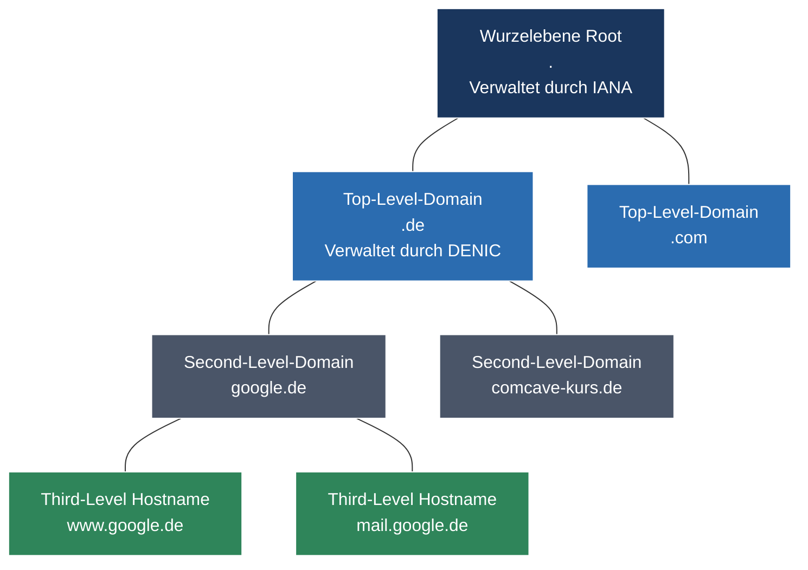

tags: [fisi, ihk, lernsheet]
## 🧭 Navigation & Zusammenhänge
- **Vorausgesetztes Thema:** [[15_Transportschicht im Detail TCP- vs. UDP-Protokolle, Header & Handshakes]]
- **Nächstes Thema:** [[17_Gerätekonfiguration & Netzwerksicherheit Switches, Router, ACLs & WLAN]]
- **Verwandte Bausteine:** [[13_Core-Dienste auf Anwendungsebene DHCP, DNS & E-Mail-Infrastruktur]], [[18_Netzwerksicherheit & Firewalls Firewall-Typen, DMZ, VPNs & NAC (802.1X)]]
---

🎯 IHK-Prüfungsrelevanz

> [!IMPORTANT] AP01: Einrichten eines IT-gestützten Arbeitsplatzes
> 
> - **Relevanz:** Hoch
> - **Fokus:** Verständnis von Server-Diensten und Port-Schnittstellen. Du musst wissen, dass Webdienste (`httpd`-Dämon) standardmäßig auf **Port 80/tcp** (HTTP) und **Port 443/tcp** (HTTPS) lauschen. Der Client initiiert die Verbindung dabei über einen zufälligen, hohen Quellport (z. B. `:35261`) an den Zielport des Servers.

> [!WARNING] AP02: Konzeption, Administration & Netzwerke
> 
> - **Relevanz:** Extrem Hoch (Klassisches IHK-Szenariowissen)
> - **Fokus:** Die IHK fordert oft praxisnahe Migrationskonzepte. Du musst das Verfahren zur **DNS-Migration** erklären können: Wie beschleunigt man den Wechsel von Server-IPs, ohne dass Clients veraltete Einträge nutzen? Zudem steht die globale DNS-Hierarchie mitsamt den zuständigen Registrierungsstellen (**IANA, DENIC**) im Fokus. In Sicherheitsaufgaben musst du Protokollschwächen wie **DNS-Spoofing** analysieren und moderne Schutzmechanismen (**DNSSEC, DoH**) vorschlagen können.

---

📖 Einfache Erklärung & Praxisbeispiele

1. Die globale DNS-Verwaltungsstruktur

Das DNS ist hierarchisch strukturiert und wird von verschiedenen internationalen und nationalen Organisationen koordiniert:

- **IANA (Internet Assigned Numbers Authority):** Verwaltet die **Root-Server** (Wurzelebene `.`). Diese Server enthalten das zentrale Verzeichnis darüber, welche Nameserver für welche Top-Level-Domains (TLDs) zuständig sind.
- **DENIC (Deutsches Network Information Center):** Die Registrierungsstelle für die ccTLD **`.de`**. Sie betreibt die autoritativen Nameserver für alle de-Domains.
- **Provider / Unternehmen:** Verwalten die eigentlichen Nameserver für die Second-Level-Domains (z. B. die Nameserver von Google für `google.de`).
- _Software-Standard:_ Der am weitesten verbreitete DNS-Server-Dienst unter Linux wird über das Paket **`bind`** (Berkeley Internet Name Domain) realisiert.

2. DNS-Migration & die administrative TTL-Steuerung

Bei einem Serverumzug (z. B. Ändern des `A`-Records einer Firmenwebseite von `192.168.10.14` auf `192.168.20.12`) droht die Gefahr, dass Clients den Dienst tagelang nicht erreichen, weil der alte Eintrag noch im lokalen DNS-Cache liegt.

- **Die Stellschraube (TTL - Time to Live):** Die TTL bestimmt, wie viele Sekunden ein Record im Cache von Client-Resolvern überleben darf (z. B. Standard: `86400` Sekunden = 24 Stunden).
- **IHK-Verfahren zur reibungslosen Migration:**
    - **Vor der Migration:** Die TTL wird rechtzeitig (mindestens 24 Stunden vorher) drastisch **herabgesetzt** (z. B. von 86400 auf **900 Sekunden / 15 Minuten**).
    - **Während der Migration:** Nach Ablauf der alten TTL-Frist fragen alle Clients den Nameserver alle 15 Minuten frisch an. Nun wird der IP-Eintrag fehlerfrei auf die neue Adresse umgestellt.
    - **Nach der Migration:** Läuft das neue System stabil, wird die TTL administrativ wieder auf den ressourcensparenden Standardwert angehoben.

3. DNS-Sicherheitsrisiken & moderne Abwehrmaßnahmen

Das klassische DNS-Protokoll ist von Grund auf **unsicher**, da sowohl Anfragen (_Queries_) als auch Antworten (_Responses_) im Netzwerk komplett **unverschlüsselt** übertragen werden.

- **Das Risiko (DNS-Spoofing / Cache Poisoning):** Angreifer fangen die unverschlüsselte Anfrage eines Clients ab und senden eine gefälschte, schnellere Antwort zurück. Der Client wird unbemerkt auf eine illegitime Phishing-Seite umgeleitet.
- **Abwehrmaßnahme 1: DNSSEC (DNS Security Extensions):** Schützt die **Integrität** der Daten. DNS-Records werden mit digitalen Signaturen versehen. Der Client kann kryptografisch prüfen, ob die Antwort unverändert vom echten, autoritativen Nameserver stammt. (Achtung: DNSSEC verschlüsselt den Traffic _nicht_, es signiert ihn nur!)
- **Abwehrmaßnahme 2: DoH (DNS-over-HTTPS):** Schützt die **Vertraulichkeit**. Die DNS-Anfragen werden in einen verschlüsselten HTTPS-Stream (Port 443/tcp) verpackt. Dadurch kann niemand im Netzwerk (z. B. in einem öffentlichen WLAN) mitlesen, welche Domains der Nutzer aufruft.

---

🚨 Die 3 kritischen IHK-Stolperfallen

- **Der Trugschluss "Verschlüsselung durch DNSSEC":** Ein extrem häufiger Fehler in Sicherheitsfragen. Prüflinge schreiben oft: _"Ich setze DNSSEC ein, damit Passwörter und DNS-Anfragen verschlüsselt sind"_. Das gibt null Punkte. **Merke:** DNSSEC bietet **reine Authentizität und Datenintegrität** mittels Signaturen. Jeder kann den DNS-Traffic weiterhin mitlesen. Wer echte Verschlüsselung (Vertraulichkeit) gegen Schnüffler will, muss zwingend **DoH (DNS-over-HTTPS)** oder _DoT (DNS-over-TLS)_ fordern.
- **Den FQDN-Endpunkt vergessen:** Ein FQDN (Fully Qualified Domain Name) ist laut Standard erst dann vollständig, wenn er die absolute Wurzel des DNS-Baums darstellt. In syntaktischen Aufgaben (z. B. beim Schreiben von Zonen-Dateien) muss am Ende der Domain zwingend ein **abschließender Punkt** stehen (z. B. `www.google.de.`). Vergisst du diesen Punkt, interpretiert der DNS-Server die Eingabe als relative Subdomain und hängt die Zonen-Domain fälschlicherweise noch einmal hinten an.
- **Fehlberechnung des Migrations-Zeitpunkts:** Erwartet die IHK einen Ablaufplan für eine IP-Umstellung, scheitern viele an der Zeiteinteilung. Wenn die reguläre TTL auf 24 Stunden steht und du die TTL am Morgen der Migration auf 15 Minuten herabsetzt, ist das Projekt gescheitert. **Merke:** Die TTL-Herabsetzung muss **mindestens so lange vor dem Umstellungsfenster erfolgen, wie der alte TTL-Wert groß war**. Erst wenn alle weltweiten Caches die verkürzte Ablaufzeit adaptiert haben, greift der schnelle IP-Wechsel nahtlos.