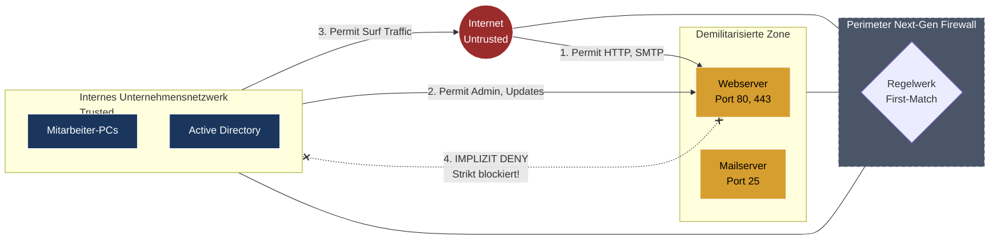

tags: [fisi, ihk, lernsheet]
## 🧭 Navigation & Zusammenhänge
- **Vorausgesetztes Thema:** [[17_Gerätekonfiguration & Netzwerksicherheit Switches, Router, ACLs & WLAN]]
- **Nächstes Thema:** [[19_Netzwerkprotokolle, Kern-Dienste & IHK-Portmatrix]]
- **Verwandte Bausteine:** [[11_Netzwerksegmentierung Virtual Local Area Networks (VLANs)]], [[01_Grundlagen der IT-Sicherheit & Schutzziele]]
---

🎯 IHK-Prüfungsrelevanz

> [!IMPORTANT] AP01: Einrichten eines IT-gestützten Arbeitsplatzes
> 
> - **Relevanz:** Hoch
> - **Fokus:** Sichere Anbindung von Endgeräten. Du musst in der Lage sein, VPN-Clients (**Remote Access VPN**) auf Laptops für Home-Office-Szenarien einzurichten. Ebenso gehört die Konfiguration des **802.1X-Supplicants** unter Windows zur Zuweisung dynamischer VLANs am Arbeitsplatz zum praktischen Basiswissen.

> [!WARNING] AP02: Konzeption, Administration & Netzwerke
> 
> - **Relevanz:** Extrem Hoch (IHK-Sicherheitskern!)
> - **Fokus:** In fast jeder Abschlussprüfung verlangt die IHK den Entwurf einer **DMZ-Architektur** (Demilitarisierte Zone) mitsamt exaktem Regelwerk (Quelle, Ziel, Port, Aktion) nach dem _Least-Privilege-Prinzip_. Du musst die vier evolutionären **Firewall-Typen** voneinander abgrenzen, **IPsec-** gegen **SSL/TLS-VPNs** abwägen und das Zusammenspiel der **802.1X-Komponenten** (Supplicant, Authenticator, RADIUS) fehlerfrei skizzieren können.

---

📖 Einfache Erklärung & Praxisbeispiele

1. Die vier Firewall-Typen im Evolutionsvergleich

Eine Firewall überwacht und steuert den Datenfluss basierend auf Sicherheitsregeln. Die IHK unterscheidet vier technologische Stufen:

- **Typ 1: Paketfilter (Stateless):** Arbeitet auf **Layer 3 (IP)** und **Layer 4 (Ports)**. Prüft jedes Paket isoliert ohne jeglichen Kontext. _Nachteil:_ Erkennt keine zusammenhängenden Sitzungen, leicht auszutricksen. Wird heute primär als ACL auf Routern genutzt.
- **Typ 2: Stateful Inspection Firewall:** Führt eine **Zustandstabelle (State Table)**. Sie merkt sich, wer eine Verbindung initiiert hat. Sie lässt Antwortpakete aus dem unvertrauenswürdigen Internet nur dann automatisch durch, wenn die Sitzung nachweislich von einem internen Client gestartet wurde. Heutiger Mindeststandard.
- **Typ 3: Proxy Firewall (Application Layer Gateway):** Arbeitet auf **Layer 7 (Anwendungsschicht)**. Sie fungiert als kompletter **Stellvertreter**. Ein Client spricht niemals direkt mit dem Zielserver, sondern nur mit dem Proxy, welcher eine eigene, separate Verbindung zum Ziel aufbaut. Filtert tiefen Inhalt (z. B. URLs oder Schadcode).
- **Typ 4: Next-Generation Firewall (NGFW):** Der moderne Alleskönner. Sie kombiniert Stateful Inspection mit einem **IPS (Intrusion Prevention System)** zur Erkennung von Angriffsmustern, portunabhängiger **Application Control** (z. B. Erkennung von BitTorrent trotz Port-Wechsel) und **User Identity Integration** (Filterregeln direkt gekoppelt an Active-Directory-Benutzer).

2. Firewall-Zonen und das DMZ-Konzept

Zur Risikominimierung werden Netzwerke in Zonen unterteilt: **Trusted** (internes LAN), **Untrusted** (Internet) und die **DMZ** (Demilitarisierte Zone).

- **Zweck der DMZ:** Ein Pufferbereich für Server, die zwingend aus dem Internet erreichbar sein müssen (z. B. Web- oder Mailserver). Wird ein Server in der DMZ kompromittiert, verhindert die Firewall ein Übergreifen des Angreifers auf das interne LAN.
- **Eiserne IHK-Regel für das DMZ-Regelwerk:**
    1. _Internet ➔ DMZ:_ Erlaubt (aber stark limitiert auf Ziel-Server und spezifische Anwendungs-Ports wie 80/443).
    2. _LAN ➔ DMZ:_ Erlaubt (z. B. für administrative Zugriffe).
    3. **DMZ ➔ LAN: Strikt VERBOTEN!** Ein kompromittierter DMZ-Server darf niemals von sich aus eine Verbindung ins interne Netz aufbauen.

3. VPN-Technologien (Virtual Private Network)

Ein VPN baut einen abhörsicheren, verschlüsselten **Tunnel** über ein unsicheres Transportnetz (Internet) auf. Das originale Paket wird verschlüsselt und in einen neuen IP-Header der VPN-Endpunkte verpackt (_Tunneling_).

- **Site-to-Site VPN (Standortvernetzung):** Verbindet zwei komplette Netzwerke dauerhaft (z. B. Zentrale und Filiale). Wird transparent zwischen den dortigen Perimeter-Firewalls aufgebaut. Protokoll-Standard: **IPsec (Layer 3)**.
- **Remote Access VPN (Fernzugriff):** Verbindet einzelne Endgeräte (Laptops im Home-Office) mit dem Firmennetz. Erfordert meist einen Software-Client auf dem Endgerät. Protokoll-Standard: **SSL/TLS (OpenVPN / Port 443/tcp)** oder IPsec.

|Kriterium|IPsec-VPN|SSL/TLS-VPN|
|---|---|---|
|**OSI-Schicht**|Layer 3 (Sichert den gesamten IP-Traffic)|Layer 4 bis 7 (Sichert spezifische Anwendungen/Tunnel)|
|**Hauptfokus**|Absoluter Standard für **Site-to-Site**|Bevorzugter Standard für **Remote Access**|
|**Firewall-Kompatibilität**|Schwierig (wird oft blockiert; nutzt UDP 500/4500, Protokoll ESP/AH)|Hervorragend (umgeht restriktive Firewalls via Standard-HTTPS-Port **TCP 443**)|
|**Schlüsselaustausch**|Über **IKE (Internet Key Exchange)**|Über den TLS-Handshake|

4. Network Access Control (NAC) via IEEE 802.1X

NAC sorgt dafür, dass nur autorisierte und sichere Geräte physischen Zugang zum Netzwerk erhalten. Der Standard **IEEE 802.1X** regelt die **portbasierte Zugriffskontrolle** im LAN und WLAN anhand von drei Kernkomponenten:

1. **Supplicant:** Der Client (z. B. Windows-PC), der Zugriff anfordert und die Zugangsdaten bereithält.
2. **Authenticator:** Das physische Zugangstor (ein Managed Switch oder WLAN-Access-Point). Er hält den Port so lange gesperrt, bis der Server grünes Licht gibt.
3. **Authentication Server:** Die zentrale Prüfinstanz, in der Regel ein **RADIUS-Server** (z. B. gekoppelt an ein Active Directory).

- _Protokoll:_ Der sichere Austausch der Berechtigungsnachweise erfolgt über das **EAP-Protokoll**. Am sichersten ist **EAP-TLS** (zertifikatsbasiert), weit verbreitet im Verzeichnisdienst ist **PEAP** (Benutzername/Passwort im TLS-Tunnel).

---

📊 Visueller Zonenfluss einer DMZ (Mermaid.js)

🚨 Die 3 kritischen IHK-Stolperfallen

- **Die fatale Verwechslung von AH und ESP bei IPsec:** In Wireshark- oder Protokollfragen wird detailliert nach den IPsec-Komponenten gefragt. Die Falle: Prüflinge wählen oft den _Authentication Header (AH)_, weil es nach Sicherheit klingt. **Merke glasklar:** AH bietet **keine Verschlüsselung (keine Vertraulichkeit)**, sondern schützt Pakete nur vor Manipulation! Wer Daten abhörsicher machen will, muss zwingend **ESP (Encapsulating Security Payload)** wählen, da nur ESP die Daten verschlüsselt.
- **Die Reihenfolge-Falle bei Firewall-Regelwerken:** Firewalls arbeiten nach dem _First-Match-Prinzip_ von oben nach unten. Die Falle in IHK-Konzeptionsaufgaben: Du sollst dem Admin-PC (`192.168.1.50`) den Zugriff auf die DMZ erlauben, dem restlichen LAN (`192.168.1.0/24`) jedoch verbieten. Schreibst du die allgemeine Verbotsregel für das Subnetz zuerst auf, trifft das Paket des Admins auf diese Regel und wird blockiert. **IHK-Grundsatz:** Spezifische Regeln (einzelne Hosts) müssen **immer vor** allgemeinen Regeln (ganzen Subnetzen) stehen!
- **Das unberechtigte "Any" in Dienst-Definitionen:** Bei der Erstellung von Tabellen-Regelwerken neigen Prüflinge aus Bequemlichkeit dazu, in der Spalte _Dienst/Port_ das Wort `ANY` einzutragen (z. B. bei der Kommunikation von LAN zu DMZ). Das führt zu massivem Punktabzug. Eine Firewall bricht mit dem Sicherheitskonzept des _Least Privilege_, wenn Ports unnötig offenstehen. Du musst Ports immer **so spezifisch wie möglich** eingrenzen (z. B. ausschließlich `Port 53/udp` für DNS-Weiterleitungen oder `Port 443/tcp` für Web-Anfragen).