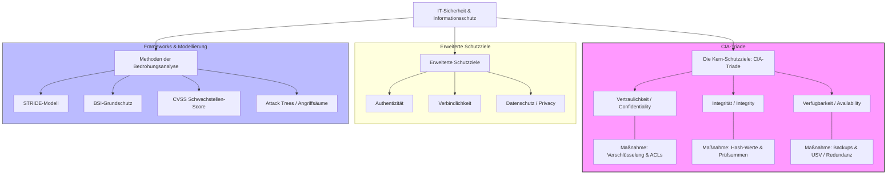

tags: [fisi, ihk, lernsheet]
## 🧭 Navigation & Zusammenhänge
- **Vorausgesetztes Thema:** [[19_Netzwerkprotokolle, Kern-Dienste & IHK-Portmatrix]]
- **Nächstes Thema:** [[02_DSGVO_und BDSG]]
- **Verwandte Bausteine:** [[08_Von der Qualität zur Sicherheit & Schutzziele (CIANA+PS)]], [[16_Security by Design, IT-Grundschutz & Kontrollebenen]]
---

🎯 IHK-Prüfungsrelevanz

> [!IMPORTANT] AP01: Einrichten eines IT-gestützten Arbeitsplatzes
> 
> - **Relevanz:** Mittel
> - **Fokus:** Implementierung grundlegender Schutzmaßnahmen am Client, wie lokale Verschlüsselungsverfahren (BitLocker), sichere Passwörter und das Verständnis von Zugriffskontrollen zur Gewährleistung der Vertraulichkeit.

> [!WARNING] AP02: Konzeption, Administration & Netzwerke
> 
> - **Relevanz:** Hoch
> - **Fokus:** Kernkompetenz für Systemintegratoren. Die IHK fordert regelmäßig die Definition und Abgrenzung der CIA-Schutzziele, die Klassifizierung von Risiken sowie die systematische Bedrohungsanalyse (z. B. mittels STRIDE-Modell oder Angriffsvektoren).

---

📖 Einfache Erklärung & Praxisbeispiele

Die **Informationssicherheit** umfasst den Schutz von Informationen und Informationssystemen vor unbefugtem Zugriff, Ausfällen, Manipulationen und Katastrophen. Während sich die _Informationssicherheit_ auf alle Datenmedien (auch Papier) bezieht, konzentriert sich die _IT-Sicherheit_ spezifisch auf den Schutz digitaler IT-Prozesse und technischer Systeme. Das Fundament bildet hierbei die sogenannte **CIA-Triade** (Vertraulichkeit, Integrität und Verfügbarkeit).

Unterthemen & Anschauliche Beispiele:

- **Vertraulichkeit (Confidentiality):** Daten dürfen nur von Personen eingesehen werden, die die entsprechende Berechtigung besitzen. Sie wird durch Verschlüsselung, Schulungen und Zugangskontrollen sichergestellt.
    - 💡 **Praxisbeispiel:** Ein Systemadministrator richtet für die Personalabteilung eine Ende-zu-Ende-Verschlüsselung sowie eine strikte ACL (Access Control List) ein, damit sensible Gehaltsdaten nicht von Mitarbeitern anderer Abteilungen eingesehen werden können.
- **Integrität (Integrity):** Die Unversehrtheit und absolute Korrektheit von Daten muss sowohl bei der Übertragung als auch bei der Speicherung garantiert sein. Manipulationen müssen ausgeschlossen oder sofort erkennbar sein.
    - 💡 **Praxisbeispiel:** Beim Download eines neuen Server-Betriebssystems prüft der FISI den SHA-256-Hash-Wert der ISO-Datei, um sicherzustellen, dass das Image auf dem Transportweg nicht durch einen Angreifer verändert wurde.
- **Verfügbarkeit (Availability):** Autorisierte Benutzer müssen jederzeit bei Bedarf auf Daten, Dienste und IT-Systeme zugreifen können. Ausfälle werden durch Redundanzen abgefangen.
    - 💡 **Praxisbeispiel:** Zur Absicherung des zentralen Datenbankservers installiert das IT-Team eine unterbrechungsfreie Stromversorgung (USV) im Serverraum und konfiguriert ein redundantes Storage-System (RAID) sowie tägliche automatisierte Backups.
- **Systematische Bedrohungsanalyse:** Um Schwachstellen frühzeitig aufzudecken, werden strukturierte Frameworks eingesetzt. Das **STRIDE-Modell** (Spoofing, Tampering, Repudiation, Information Disclosure, Denial of Service, Elevation of Privilege) hilft dabei, gezielt Angriffsvektoren zu identifizieren.
    - 💡 **Praxisbeispiel:** Vor dem Release einer neuen internen Web-API führt der FISI ein Threat Modeling durch, um zu prüfen, ob Angreifer über SQL-Injections (Information Disclosure) oder Rechteausweitung (Elevation of Privilege) unbefugten Zugriff erhalten könnten.

