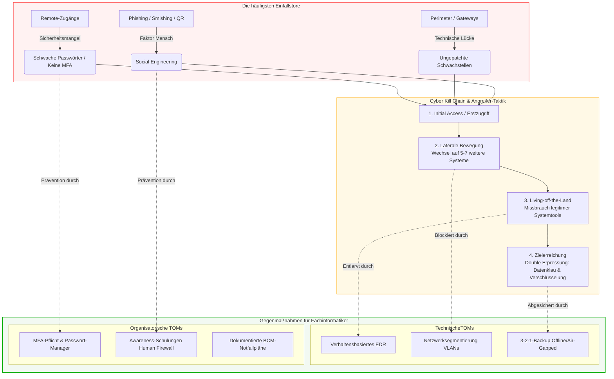

tags: [fisi, ihk, lernsheet]
## 🧭 Navigation & Zusammenhänge
- **Vorausgesetztes Thema:** [[02_DSGVO_und BDSG]]
- **Nächstes Thema:** [[04_Rechtliche Rahmenbedingungen & IT-Sicherheitsberatung]]
- **Verwandte Bausteine:** [[09_Cyber-Security & Social Engineering]], [[15_Bedrohungsszenarien & Schadenspotenziale in der IT]]
---

🎯 IHK-Prüfungsrelevanz

> [!IMPORTANT] AP01: Einrichten eines IT-gestützten Arbeitsplatzes
> 
> - **Relevanz:** Hoch
> - **Fokus:** Durchsetzung restriktiver Client-Sicherheitsvorgaben wie komplexer **Passwortrichtlinien (MFA, 12 Zeichen)**, Absicherung lokaler Systeme gegen Infektionen über Wechselmedien oder Drive-by-Downloads sowie Sensibilisierung der Anwender gegen Phishing-Varianten.

> [!WARNING] AP02: Konzeption, Administration & Netzwerke
> 
> - **Relevanz:** Hoch
> - **Fokus:** Absolutes Kernwissen. Die IHK verlangt die genaue Abgrenzung moderner Angriffsformen (z. B. **Living-off-the-Land**, **Cyber Kill Chain**) sowie die Dimensionierung technischer und organisatorischer Schutzkonzepte (z. B. **EDR**, **Netzwerksegmentierung** und die **3-2-1-Backup-Regel**).

---

📖 Einfache Erklärung & Praxisbeispiele

Die Bedrohungslandschaft in der IT-Infrastruktur wächst rasant; laut BSI-Lagebericht werden täglich **309.000 neue Schadprogramm-Varianten** gesichtet. Einfallstore bilden technische Schwachstellen an den Perimetern (z. B. VPN-Gateways), aber vor allem der Faktor Mensch über psychologische Manipulation (**Social Engineering**). Angreifer gehen hochgradig professionell vor, nutzen **Ransomware-as-a-Service (RaaS)**-Geschäftsmodelle und durchlaufen strukturierte Angriffsphasen (**Cyber Kill Chain**), bei denen nach dem Erstzugriff oft legitime, bordeigene Systemwerkzeuge missbraucht werden (**Living-off-the-Land**).

Unterthemen & Anschauliche Beispiele:

- **Moderne Malware-Typen:** Schadprogramme beschränken sich nicht mehr auf klassische Viren.
    - **Ransomware:** Verschlüsselt Daten und erpresst Lösegeld (z. B. LockBit, Black Basta). Häufig über _Doppelte Erpressung_ (Datenklau + Verschlüsselung).
    - **Trojaner & Info-Stealer:** Tarnen sich als nützliche Software und entwenden unbemerkt Passwörter oder Bankdaten.
    - **Fileless Malware & EDR-Killer:** Operieren rein im Arbeitsspeicher (hinterlassen keine Dateispuren) oder versuchen mittels _BYOVD_ (Bring Your Own Vulnerable Driver) die Sicherheitssoftware gezielt zu deaktivieren.
    - 💡 **Praxisbeispiel:** Ein Client fängt sich im Speicher **Fileless Malware** ein. Ein herkömmlicher dateibasierter Virenscanner schlägt nicht an, da keine ausführbare Datei auf der Festplatte abgelegt wurde. Nur ein verhaltensbasiertes **EDR-System** (Endpoint Detection & Response) erkennt die anomalen Systemaufrufe in Echtzeit.
- **Social Engineering & Phishing-Varianten:** Manipulation von Menschen statt Code.
    - **Spear-Phishing:** Hochgradig personalisierte, passgenaue Angriffe auf spezifische Personen mit extrem hoher Erfolgsrate.
    - **CEO-Fraud:** Täter spiegeln die Identität von Führungskräften vor, um unter hohem Zeitdruck dringende Überweisungen einzufordern.
    - **Smishing & QR-Code-Phishing:** Angriffe per SMS/Messenger oder über manipulierte, visuelle QR-Codes, um Zugangsdaten (häufig für Microsoft 365) abzufangen.
    - 💡 **Praxisbeispiel:** Ein Mitarbeiter erhält eine scheinbar interne Nachricht mit einem gefälschten QR-Code für die "M365-Passwort-Verlängerung". Das Abfangen wird nur verhindert, weil das Unternehmen eine strikte **Multi-Faktor-Authentifizierung (MFA)** erzwingt, die dem Angreifer trotz erbeutetem Passwort den Zugriff verwehrt.
- **Technische Schutzmaßnahmen:**
    - **Netzwerksegmentierung:** Unterteilt das Firmennetz in logische Zonen (z. B. VLANs), um die _laterale Bewegung_ (das Ausbreiten des Angreifers von System zu System) stark einzudämmen.
    - **Die 3-2-1-Backup-Regel:** Der ultimative Schutz vor Datenverlust durch Ransomware. Erstellt werden **3 Kopien**, auf **2 unterschiedlichen Medientypen** und mindestens **1 Kopie offline** (luftspaltisoliert / Air-Gapped).
    - 💡 **Praxisbeispiel:** Ein Krypto-Trojaner befällt den Fileserver und verschlüsselt das gesamte Netzlaufwerk. Dank **Netzwerksegmentierung** bleibt das Produktionsnetzwerk verschont. Das IT-Team bereinigt den Server und spielt den Vortagesstand über ein unberührtes **Offline-Backup** wieder ein.
- **Organisatorische Maßnahmen & Human Firewall:**
    - Implementierung einer **Passwortrichtlinie** (min. 12 Zeichen, Alphanumerisch + Sonderzeichen, MFA-Pflicht für kritische Systeme).
    - Durchführung kontinuierlicher **Security-Awareness-Trainings** zur Etablierung einer _Human Firewall_. Effektive Schulungen senken die Phishing-Klickrate nachweislich um 50-70%.

