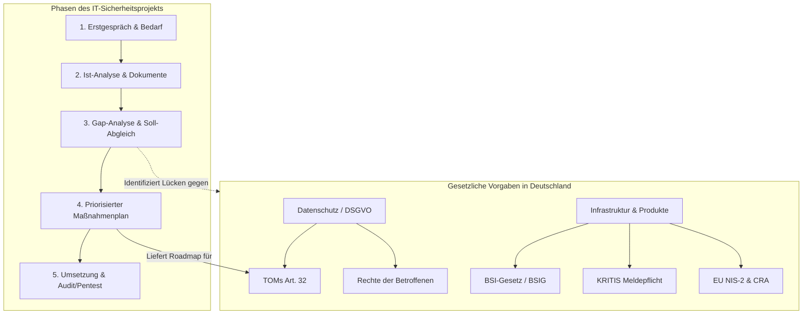

tags: [fisi, ihk, lernsheet]
## 🧭 Navigation & Zusammenhänge
- **Vorausgesetztes Thema:** [[03_Gefahrenquellen, Malware-Typen & Gegenmaßnahmen]]
- **Nächstes Thema:** [[05_Qualitätsmanagement (QM) & Der IT-Dreiklang]]
- **Verwandte Bausteine:** [[02_DSGVO_und BDSG]], [[17_Rahmenbedingungen und Kundenberatung]]
---

🎯 IHK-Prüfungsrelevanz

> [!IMPORTANT] AP01: Einrichten eines IT-gestützten Arbeitsplatzes
> 
> - **Relevanz:** Mittel
> - **Fokus:** Einhaltung grundlegender, gesetzlicher Vorgaben bei der Client-Konfiguration (z. B. Umsetzung von TOMs zur Einhaltung der DSGVO, Einbindung anerkannter kryptographischer Verfahren nach eIDAS).

> [!WARNING] AP02: Konzeption, Administration & Netzwerke
> 
> - **Relevanz:** Hoch
> - **Fokus:** Ein absolutes Standard-Szenario für ganzheitliche Prüfungsaufgaben. Die IHK verlangt das präzise Einordnen von IT-Infrastrukturen in gesetzliche Rahmenbedingungen (**KRITIS**, **NIS-2**, **CRA**), die rechtssichere Einordnung von **Meldepflichten** bei Vorfällen sowie die systematische Durchführung von **Kundenberatungen** (Bedarfsanalyse, Gap-Analyse und priorisierter Maßnahmenplan).

---

📖 Einfache Erklärung & Praxisbeispiele

Als Fachinformatiker für Systemintegration bewegst du dich in einem engen Netz gesetzlicher Vorgaben. Es reicht nicht mehr aus, Netzwerke nur technisch stabil zu halten – sie müssen den nationalen und europäischen Compliance-Standards entsprechen. Bei der **Kundenberatung zur IT-Sicherheit** analysierst du systematisch den Ist-Zustand des Kunden, deckst gesetzliche sowie technische Lücken auf (**Gap-Analyse**) und entwickelst einen verhältnismäßigen Fahrplan mit kurz-, mittel- und langfristigen Maßnahmen.

Unterthemen & Anschauliche Beispiele:

- **Nationale Gesetze & Behörden:**
    - **BSIG & BSI-Gesetz:** Regelt die Aufgaben des _Bundesamtes für Sicherheit in der Informationstechnik_ als zentrale Cybersicherheitsbehörde (Zertifizierung, Warnung vor Lücken, Standardentwicklung).
    - **IT-Sicherheitsgesetz (1.0 / 2.0):** Setzt Mindeststandards für die IT-Sicherheit und legt Bußgelder sowie erweiterte Befugnisse des BSI fest.
    - **KRITIS (Kritische Infrastrukturen):** Organisationen aus lebenswichtigen Sektoren (z. B. Energie, Gesundheit, Wasser, IT/TK) unterliegen extremen Sicherheitsanforderungen und einer sofortigen **Meldepflicht bei erheblichen IT-Störungen** direkt an das BSI.
    - 💡 **Praxisbeispiel:** Ein FISI wartet die Leitstands-Software eines regionalen Stromversorgers (**KRITIS-Sektor Energie**). Bei einer Kompromittierung des Systems durch Ransomware muss das IT-Team den Vorfall zwingend und unverzüglich an das **BSI** melden.
- **Moderne EU-Regulierungen:**
    - **NIS-2-Richtlinie:** Weitet den Kreis der betroffenen Unternehmen ("wichtige" und "besonders wichtige" Einrichtungen) massiv aus und harmonisiert die europaweiten Meldepflichten.
    - **Cyber Resilience Act (CRA):** Verpflichtet Hersteller von Produkten mit digitalen Elementen zu _Security by Design_ und _by Default_. Sie müssen über den gesamten Lebenszyklus Sicherheitsupdates bereitstellen; Cybersicherheit wird Teil der **CE-Kennzeichnung**.
    - **eIDAS-Verordnung:** Einheitlicher Rahmen für elektronische Identifizierung und Vertrauensdienste (z. B. digitale Signaturen).
    - 💡 **Praxisbeispiel:** Ein deutscher Hardware-Hersteller entwickelt einen neuen smarten Netzwerk-Router. Nach dem **Cyber Resilience Act** darf das Gerät nur ein **CE-Kennzeichen** erhalten, wenn Sicherheitsupdates für die voraussichtliche Nutzungsdauer garantiert sind und Schwachstellen ab Werk geschlossen wurden.
- **Der strukturierte IT-Beratungsprozess:**
    
    1. **Erstgespräch & Bedarfsanalyse:** Ermittlung von Branche, Größe, regulatorischen Pflichten und Erwartungen des Kunden.
    2. **Bestandsaufnahme (Ist-Zustand):** Analyse der bestehenden Infrastruktur, Anwendungen und dokumentierten Prozesse.
    3. **Gap-Analyse:** Abgleich des Ist-Zustands mit den gesetzlichen und technischen Soll-Anforderungen zur Identifikation von Sicherheitslücken.
    4. **Maßnahmenplan & Roadmap:** Aufteilung in _Kurzfristig (Quick Wins)_, _Mittelfristig_ und _Langfristig_ unter Beachtung der Verhältnismäßigkeit.
    5. **Umsetzungsbegleitung & Erfolgskontrolle:** Einführung kontinuierlicher Prozesse (z. B. Schwachstellenscans, Audits oder Penetrationstests).
    
    - 💡 **Praxisbeispiel:** Ein mittelständischer Betrieb beauftragt dich mit einer Sicherheitsanalyse. Du stellst fest, dass Firewalls veraltet sind (technische Lücke) und keine Passwortrichtlinie existiert (organisatorische Lücke). Als _Quick Win_ (kurzfristig) führst du eine Passwortrichtlinie ein; die Beschaffung einer Next-Generation Firewall (NGFW) planst du langfristig ein.

---

👨‍💻 IHK-Prüfungs-Fallstudie: Plaste GmbH

_Dieses Szenario entspricht exakt einer typischen IHK-Handlungsschritt-Aufgabe in der gestreckten Abschlussprüfung._

**Ausgangslage & Ist-Zustand:**

Mittelständischer Kunststoffhersteller, **45 Mitarbeiter**.  
**Mängel:** Kein Verzeichnis von Verarbeitungstätigkeiten (VVT), veraltete Web-Datenschutzhinweise, kein Datenschutzbeauftragter (DSB) benannt, keine dokumentierten TOMs, unvollständige/veraltete AV-Verträge mit IT-Dienstleistern, rein mündliche Verpflichtung neuer Mitarbeiter auf die Vertraulichkeit.

**IHK-Musterlösung & Analyse der Leitfragen:**

|IHK-Leitfrage|Fachlich korrekte Prüfungsantwort|
|---|---|
|**Ist die Benennung eines DSB verpflichtend?**|**Nein.** Nach deutschem Recht (§ 38 BDSG) ist ein DSB erst verpflichtend, wenn in der Regel **mindestens 20 Personen** ständig mit der automatisierten Verarbeitung personenbezogener Daten beschäftigt sind. Da die Plaste GmbH insgesamt 45 Mitarbeiter hat, ist entscheidend, wie viele davon _tatsächlich_ im Büro/HR/Vertrieb digital mit Daten arbeiten. Liegt diese Zahl unter 20 (da Großteil in der Produktion), besteht **keine gesetzliche Pflicht**. _(Hinweis: Eine freiwillige Benennung ist dennoch ratsam)._|
|**Welche Dokumente/Prozesse müssen angepasst werden?**|1. **VVT (Verzeichnis von Verarbeitungstätigkeiten)** nach Art. 30 DSGVO zwingend anlegen (für Kundendaten, HR-Personalakten, Lieferanten, Werksausweis-Fotos).   2. **Datenschutzhinweise** auf der Website rechtssicher aktualisieren.   3. **AV-Verträge (Auftragsverarbeitung)** mit allen externen IT-Dienstleistern (Cloud, Hoster, Wartung) prüfen und aktualisieren.   4. **Schriftliche Verpflichtung** der Mitarbeiter auf das Datengeheimnis (mündlich ist nicht nachweisbar/rechenschaftspflichtig).|
|**Wie sollten die TOMs (Art. 32 DSGVO) aussehen?**|**Technische Maßnahmen:** Einführung einer zentralen Passwortrichtlinie via Active Directory, Implementierung von Multi-Faktor-Authentisierung (MFA) für Remote-Zugänge, Verschlüsselung der HR-Clients.   **Organisatorische Maßnahmen:** Einführung einer Clean-Desk-Policy, Festlegung von Rollen und Rechten (Zugriffskontrolle), Erstellung eines Backup- und Wiederherstellungskonzepts.|

**Priorisierter Zeit- & Maßnahmenplan (Roadmap):**

1. **Priorität 1: Sofort / Kurzfristig (Wochen 1–2):** Schriftliche Verpflichtung der Mitarbeiter nachholen, Website-Datenschutzhinweise aktualisieren, Einrichten einer Passwort-Mindestlänge (12 Zeichen via GPO). _(Grund: Hohes Risiko bei Abmahnungen/externer Sichtbarkeit)._
2. **Priorität 2: Mittelfristig (Monat 1–2):** Erstellung des VVT, Überarbeitung und Neuabschluss der AV-Verträge, Strukturierung und Dokumentation der TOMs.
3. **Priorität 3: Langfristig (Monat 3+):** Durchführung von regelmäßigen Security-Awareness-Schulungen für die Belegschaft, Etablierung eines automatisierten Schwachstellenscans für die Systeme.

