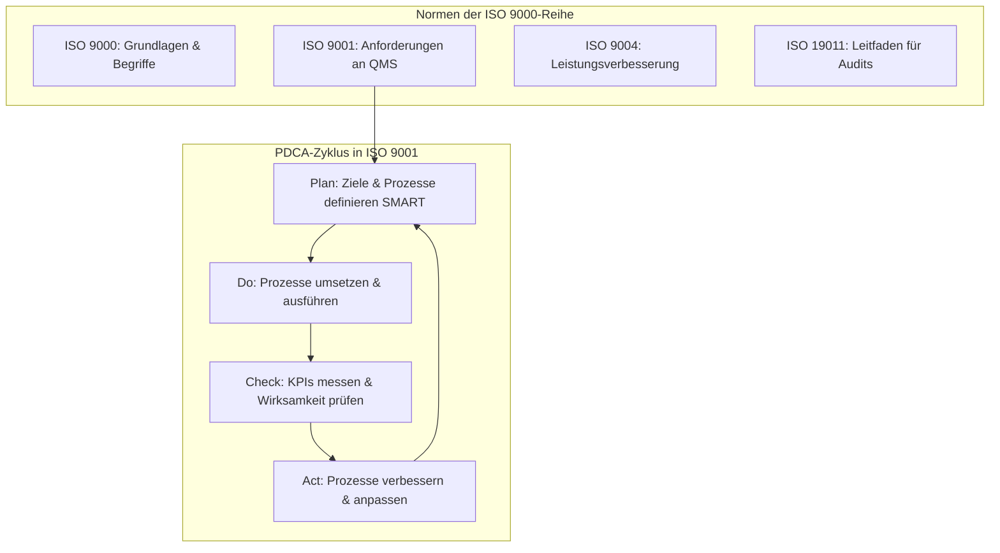

## 🧭 Navigation & Zusammenhänge
- **Vorausgesetztes Thema:** [[06_Audits & Zertifizierungen]]
- **Nächstes Thema:** [[08_Von der Qualität zur Sicherheit & Schutzziele (CIANA+PS)]]
- **Verwandte Bausteine:** [[05_Qualitätsmanagement (QM) & Der IT-Dreiklang]], [[14_Ursachenanalyse & Kontinuierlicher Verbesserungsprozess (KVP)]]
## 🎯 IHK-Prüfungsrelevanz

> [!IMPORTANT] AP01: Einrichten eines IT-gestützten Arbeitsplatzes
> 
> - **Relevanz:** Mittel
>     
> - **Fokus:** Einhaltung von Vorgaben, Arbeitsanweisungen und Dokumentierten Informationen beim Bereitstellen von IT-Systemen sowie die Verwendung von Checklisten (z. B. Rollout-Prozesse, Benutzererstellung).
>     

> [!WARNING] AP02: Konzeption, Administration & Netzwerke
> 
> - **Relevanz:** Hoch
>     
> - **Fokus:** Qualitätslenkung und -sicherung bei IT-Projekten (z. B. Test-Backups, Sicherheitsupdates), Formulierung SMARTer Qualitätsziele, Messung der Service-Qualität über KPIs (Systemverfügbarkeit, Ticket-Zeiten) und Anwendung des PDCA-Zyklus.
>     

## 📖 Einfache Erklärung & Praxisbeispiele

Ein **Qualitätsmanagementsystem (QMS)** ist ein formaler Rahmen zur Steuerung von Qualität in einem Unternehmen. Es definiert klare Prozesse, Rollen und Dokumentationsstandards, um Fehler zu minimieren, die Nachvollziehbarkeit zu gewährleisten und die Qualität nach außen nachweisbar zu machen.

### Wichtige ISO-Normen im Überblick:

- **ISO 9000:** Grundlagen und Begriffe des Qualitätsmanagements.
    
- **ISO 9001:** Enthält die eigentlichen **Anforderungen** an ein QMS (Standard für Zertifizierungen).
    
- **ISO 9004:** Leitfaden zur nachhaltigen Leistungsverbesserung.
    
- **ISO 19011:** Leitfaden für die Auditierung (Überprüfung) von Managementsystemen.
    

### Unterthemen & Anschauliche Beispiele:

- **PDCA-Zyklus (Deming-Kreis):** Das zentrale Strukturprinzip der ISO 9001 für kontinuierliche Verbesserung (KVP).
    
    - **Plan (Planung):** Ziele festlegen, Risiken analysieren und Ressourcen bereitstellen.
        
    - **Do (Umsetzung):** Prozesse etablieren und wie geplant ausführen.
        
    - **Check (Überprüfung):** Wirksamkeit und Arbeitsergebnisse messen und bewerten (Soll-Ist-Vergleich).
        
    - **Act (Verbesserung):** Korrekturen vornehmen und Erfahrungen umsetzen.
        
    - 💡 **Praxisbeispiel:** Ein Systemintegrator plant das Einspielen eines kritischen Sicherheitsupdates auf Core-Switchen (**Plan**). Er führt das Update in einem definierten Wartungsfenster durch (**Do**). Anschließend prüft er das Monitoring und loggt die Netzwerkerreichbarkeit (**Check**). Bei einer unerwarteten Latenz wird die Konfiguration angepasst und die Dokumentation aktualisiert (**Act**).
        
- **Rollen im Qualitätsmanagement:** Clear responsibilities verhindern Unklarheiten.
    
    - **Führungskräfte:** Tragen die Gesamtverantwortung und setzen Qualitätsanforderungen durch.
        
    - **QM-Beauftragte (QMB):** Koordinieren, dokumentieren und steuern das QMS.
        
    - **Mitarbeitende:** Setzen die Qualitätsvorgaben im Alltag um.
        
    - **Auditoren:** Prüfen das QMS neutral und objektiv auf Konformität.
        
    - 💡 **Praxisbeispiel:** Nach der Erstellung eines Benutzerkontos im Active Directory hakten Auszubildende früher oft ab, ohne Rechte zu prüfen. Der **QMB** führt eine Checkliste ein, die **Mitarbeitenden** nutzen sie im Alltag, und der **Auditor** stichprobt, ob alle Berechtigungen korrekt zugewiesen und dokumentiert wurden.
        
- **SMART-Kriterien für Qualitätsziele:** Qualitätsziele müssen **S**pezifisch, **M**essbar, **A**kzeptiert, **R**ealistisch und **T**erminiert sein.
    
    - 💡 **Praxisbeispiel (Systemintegration):** _"Die Erfolgsquote von Test-Backups und Wiederherstellungen im Rechenzentrum soll bis zum 31.12.2026 bei mindestens 98 % liegen, nachgewiesen durch monatliche Wiederherstellungstests."_
        
- **Qualitätskennzahlen (KPIs) & Qualitätslenkung:** Zahlenbasierte Messung der Prozessleistung.
    
    - **First-Time-Fix-Rate:** Anteil der Tickets, die direkt beim Erstkontakt gelöst werden.
        
    - **Systemverfügbarkeit:** Uptime in Prozent (z. B. 99,9 % Verfügbarkeit).
        
    - 💡 **Praxisbeispiel:** Über ein KPI-Dashboard stellt das Operations-Team fest, dass die First-Time-Fix-Rate bei VPN-Problemen unter 40 % liegt. Als Lenkungsmaßnahme wird eine Standard-Arbeitsanweisung (SOP) erstellt.

