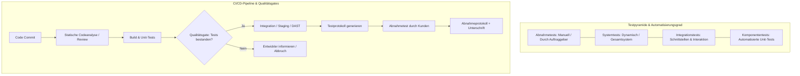

## tags: [fisi, ihk, lernsheet]
## 🧭 Navigation & Zusammenhänge
- **Vorausgesetztes Thema:** [[10_IT-Qualitätsplanung & Qualitätslenkung in der Praxis]]
- **Nächstes Thema:** [[12_Kennzahlen & Soll-Ist-Vergleich im IT-Betrieb]]
- **Verwandte Bausteine:** [[09_Software-Qualität, Testing & Künstliche Intelligenz]], [[10_IT-Qualitätsplanung & Qualitätslenkung in der Praxis]]
## 🎯 IHK-Prüfungsrelevanz

> [!IMPORTANT] AP01: Einrichten eines IT-gestützten Arbeitsplatzes
> 
> - **Relevanz:** Hoch
>     
> - **Fokus:** Strukturierter Aufbau eines Testfalls (Kennung, Schrittfolge, Soll/Ist-Ergebnis), Ausfüllen von Test- und Übergabeprotokollen mit Versionsnummer bei Rollouts sowie Durchführung von Funktionstests am Arbeitsplatz.
>     

> [!WARNING] AP02: Konzeption, Administration & Netzwerke
> 
> - **Relevanz:** Sehr hoch
>     
> - **Fokus:** Verifikation vs. Validierung, Einordnung statischer vs. dynamischer Prüfverfahren, Schichten der Testpyramide, Unterscheidung aller Testarten (Regressions-, Last-, Penetrations-, Abnahmetests), Einbindung von Qualitätsgates in CI/CD-Pipelines sowie rechtlich/vertraglich korrekte Dokumentation (Test- vs. Abnahmeprotokoll).
>     

## 📖 Einfache Erklärung & Praxisbeispiele

Bevor eine Software oder ein System live geht, muss sichergestellt werden, dass es fehlerfrei ist und genau das tut, was es soll. Hier ist eine einfache und verständliche Erklärung dieser Qualitätsprüfungen, gefolgt von einem praktischen Glossar.

## 1. Verifikation vs. Validierung: Der Unterschied

- **Verifikation ("Haben wir das System richtig gebaut?"):** Hier prüft man, ob die Software exakt nach den vorgegebenen Plänen, Regeln und technischen Spezifikationen entwickelt wurde.
    
- **Validierung ("Haben wir das richtige System gebaut?"):** Hier prüft man, ob das fertige System auch wirklich das Problem des Anwenders löst und im Alltag den gewünschten Nutzen bringt.
    

## 2. Statische vs. Dynamische Prüfverfahren

- **Statische Verfahren (Ohne Ausführen):** Der Code oder die Dokumente werden nur gelesen und analysiert – wie ein Buch, das Korrektur gelesen wird. Das hilft, Denk- und Logikfehler aufzudecken, noch bevor das Programm überhaupt das erste Mal gestartet wird.
    
- **Dynamische Verfahren (Mit Ausführen):** Die Software wird tatsächlich gestartet und in einer Testumgebung bedient. Man schaut sich an, wie sich das laufende System verhält.
    

## 3. Die wichtigsten Testmethoden einfach erklärt

### Statische Prüfverfahren

- **Reviews:** Ein Team setzt sich zusammen, liest gemeinsam Dokumente oder Code durch und bespricht mögliche Fehler oder Verbesserungen.
    
- **Walkthroughs:** Ein entspannter, vom Ersteller geführter Durchgang durch den Code oder Entwurf. Der Autor führt die anderen durch sein Werk, um frühzeitig Feedback zu bekommen.
    
- **Inspektionen:** Eine sehr formelle und strenge Qualitätsprüfung nach festen Regeln. Hier wird systematisch und mit Checklisten nach Fehlern gesucht (meistens von speziell geschulten Prüfern).
    
- **Statische Codeanalyse:** Ein automatisierter Prozess, bei dem ein spezielles Analyse-Tool den Quellcode nach Fehlern, schlechten Programmierstil oder Sicherheitsrisiken durchsucht, ohne dass der Code läuft.
    

### Dynamische Prüfverfahren

- **Funktionstest:** Testet, ob eine konkrete Funktion (z. B. der "Kaufen"-Button in einem Shop) genau das tut, was sie soll.
    
- **Last- und Performancetest:** Prüft, wie schnell das System reagiert und ob es stabil bleibt, wenn plötzlich sehr viele Menschen gleichzeitig darauf zugreifen (hohe Last).
    
- **Sicherheitstest:** Ein gezielter Test auf Schwachstellen und Sicherheitslücken, um zu sehen, ob sich Hacker Zugriff verschaffen oder sensible Daten abgreifen könnten.
    

### Unterthemen & Anschauliche Beispiele:

- **Die Testpyramide (von unten nach oben):**
    
    - **Komponententests (Unit Tests):** Viele schnelle, automatisierte Tests einzelner Code-Einheiten/Module.
        
    - **Integrationstests:** Prüfen das Zusammenspiel mehrerer Schnittstellen und Komponenten.
        
    - **System- & Abnahmetests:** Wenige, langsamere Tests des Gesamtsystems entlang kompletter Geschäftsprozesse.
        
    - ⚠️ **Kippende Pyramide (Anti-Pattern):** Wenn meiste Prüfungen manuell durchgeklickt werden (Eiscreme-Hörnchen-Effekt), steigen Feedbackzeiten und Wartungskosten drastisch an.
        
    - 💡 **Praxisbeispiel:** Bei der Gastronomie-Software "Bella Napoli" prüft ein _Komponententest_ in Millisekunden die Netto-Brutto-Berechnung. Ein _Integrationstest_ prüft die Übergabe vom Webshop an das Terminal des Zahlungsdienstleisters. Ein _Abnahmetest_ prüft den Gesamtprozess von der App-Bestellung bis zum Bondruck in der Küche.
        
- **Übersicht wichtiger Testarten:**
    
    - **Funktionstest (Positiv & Negativ):** Prüft das Fachverhalten. Negativtests untersuchen das Systemverhalten bei unzulässigen Eingaben.
        
    - **Regressionstest:** Wiederholt bestandene Tests nach Änderungen, um unerwartete Seiteneffekte auszuschließen.
        
    - **Last-, Stress- & Performancetest:** Prüfen Antwortzeiten unter erwarteter Last (Last) sowie das Stabilitäts- und Absturzverhalten jenseits der Belastungsgrenze (Stress).
        
    - **Sicherheitstest (SAST, DAST, Pen-Test):** SAST analysiert den Quellcode; DAST testet die laufende Anwendung von außen. Ein _Penetrationstest_ ist ein echter Angriffsversuch und erfordert zwingend eine vorherige schriftliche Beauftragung!
        
    - 💡 **Praxisbeispiel:** Ein Systemintegrator führt am Samstag vor dem Go-Live einen _Stresstest_ durch, um zu sehen, ob der Kassen-PC bei 200 zeitgleichen Anfragen geordnet Fehler meldet anstatt absturzzubedingt Daten zu verlieren.
        
- **Automatisierung & Qualitätsgates:**
    
    - **Automatisierbar:** Alles mit vorab eindeutig feststehendem Ergebnis (Unit-Tests, Regressionen, Lasttests).
        
    - **Nicht automatisierbar:** Usability-Bewertungen, exploratives Testen und die rechtliche Abnahme.
        
    - **Qualitätsgate:** Eine maschinell prüfbare Bedingung in einer CI/CD-Pipeline (z. B. 0 kritische Befunde, 85 % Testabdeckung), die den Übergang in die nächste Phase steuert.
        
- **Dokumentation & Protokolle (Test- vs. Abnahmeprotokoll):**
    
    - **Testfall (Kleinste Einheit):** Enthält Kennung, Voraussetzung, Handlungsschritte, erwartetes Soll-Ergebnis und tatsächliches Ist-Ergebnis.
        
    - **Testprotokoll:** Wird von der testenden Seite verfasst und belegt, was wann, womit und mit welchem Ergebnis geprüft wurde. Die **Versionsnummer des Systems** ist die wichtigste Angabe!
        
    - **Abnahmeprotokoll:** Eine schriftliche Willenserklärung der Auftraggeberseite (Ergebnis: Abgenommen, Abgenommen unter Vorbehalt mit Mängelliste, Nicht abgenommen).

