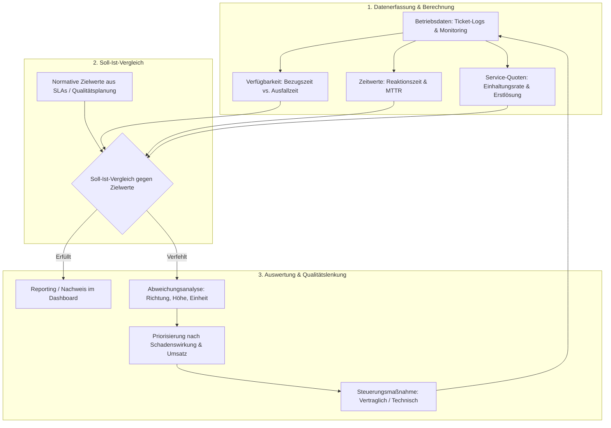

## tags: [fisi, ihk, lernsheet]
## 🧭 Navigation & Zusammenhänge
- **Vorausgesetztes Thema:** [[11_Prüf- und Testverfahren in der IT]]
- **Nächstes Thema:** [[13_IT-Qualitätsmessung, -überwachung & -verbesserung]]
- **Verwandte Bausteine:** [[07_Controlling]], [[10_Controlling im IT-Projekt (Soll-Ist-Vergleich & Nachkalkulation)]]
## 🎯 IHK-Prüfungsrelevanz

> [!IMPORTANT] AP01: Einrichten eines IT-gestützten Arbeitsplatzes
> 
> - **Relevanz:** Mittel
>     
> - **Fokus:** Erfassung von Service-Ticket-Zeiten (Erstlösungsquote, Bearbeitungszeit), Einhaltung von Reaktionszeiten im First-Level-Support und Nachvollziehbarkeit von Dokumentierten Informationen in der Support-Historie.
>     

> [!WARNING] AP02: Konzeption, Administration & Netzwerke
> 
> - **Relevanz:** Sehr hoch
>     
> - **Fokus:** Mathematische Berechnung von System-Verfügbarkeiten unter Berücksichtigung definierter Bezugszeiträume (Kalendermonat vs. kritische Servicezeit/Umsatzfenster), Umrechnung von Prozentwerten in erlaubte Ausfallminuten, Differenzierung von Zeitkennzahlen (Reaktionszeit vs. Wiederherstellzeit/MTTR vs. MTBF), methodische Durchführung eines Soll-Ist-Vergleichs sowie Ableitung wirksamer Maßnahmen nach Schadenswirkung.
>     

## 📖 Einfache Erklärung & Praxisbeispiele

Ein **Soll-Ist-Vergleich** macht den Erfolg von IT-Services messbar und bewertbar. Dabei wird eine aus Betriebsdaten berechnete **Kennzahl (Ist)** einem vorher festgelegten **Zielwert (Soll)** gegenübergestellt, um Abweichungen zu erkennen und Korrekturmaßnahmen einzuleiten.

### Grundbegriffe im Überblick:

- **Leistungsvereinbarung (SLA):** Relevante Zusage an Kunden mit vertraglichen Rechtsfolgen.
    
- **Kennzahl (Ist):** Mathematisch aus Betriebsdaten berechnete Größe für einen definierten Bezugszeitraum.
    
- **Zielwert (Soll):** Von Menschen normativ festgelegter Richtwert, den eine Kennzahl erreichen soll.
    
- ⚠️ **Kritischer Prüfungsfakt:** Wer eine Kennzahl ohne definierten **Bezugszeitraum** oder ohne **Zielwert** angibt, liefert eine bloße Zahlenreihe ohne Aussagekraft für die Lenkung!
    

### Unterthemen & Anschauliche Beispiele:

- **Verfügbarkeitsberechnung & Bezugszeiträume:**
    
    - **Formel:**
        
        $$\text{Verfügbarkeit (\%)} = \frac{\text{Bezugszeit} - \text{Ausfallzeit}}{\text{Bezugszeit}} \times 100$$
        
    - 💡 **Praxisbeispiel (Pizzeria "Bella Napoli"):** Im September 2026 (30 Tage = 43.200 Min.) treten insgesamt 162 Ausfallminuten am Webshop auf.
        
        - _Betrachtung Kalendermonat (24/7):_
            
            $$\text{Verfügbarkeit} = \frac{43.200 - 162}{43.200} \times 100 = 99,625\% \quad (\text{Ziel: } 99,5\% \rightarrow \mathbf{Erfüllt})[cite: 242]$$
            
        - _Betrachtung Umsatzfenster (4 Samstage à 18-21 Uhr = 720 Min.):_ Davon fielen 90 Min. in die Hauptgeschäftszeit.
            
            $$\text{Verfügbarkeit} = \frac{720 - 90}{720} \times 100 = 87,5\% \quad (\text{Ziel: } 99,5\% \rightarrow \mathbf{Massiv\ verfehlt})[cite: 243]$$
            
        - _Lerneffekt:_ Erlaubt waren im Umsatzfenster nur $720 \times (1 - 0,995) = 3,6$ Ausfallminuten!
            
- **Differenzierung der Zeitkennzahlen:**
    
    - **Reaktionszeit:** Zeitspanne vom Auftreten/Melden einer Störung bis zur ersten Bearbeitungshandlung durch den Support.
        
    - **Wiederherstellzeit (MTTR - Mean Time to Restore):** Zeitspanne von der Störung bis zur vollständigen Wiederverfügbarkeit des Systems.
        
    - **Zeit zwischen Ausfällen (MTBF - Mean Time Between Failures):**
        
        $$\text{MTBF} = \frac{\text{Betriebszeit}}{\text{Anzahl Ausfälle}}[cite: 247, 260]$$
        
    - ⚠️ **Mittelwert vs. Einhaltungsquote:** Ein Notfall-Support erreicht im Schnitt eine Reaktionszeit von 11,0 Min. (Ziel: $\le 15$ Min.). Da aber 2 von 6 Fällen verzögert bearbeitet wurden, liegt die **Einhaltungsquote** nur bei $66,7\%$ (Ziel: $95\%$)! Der Mittelwert verschleiert Ausreißer – maßgeblich für Service-Qualitäten ist die Einzelfallquote.
        
- **Methodik des Soll-Ist-Vergleichs & Maßnahmenableitung:**
    
    - **Abweichungsbenennung:** Angabe von Richtung, Absolutwert/Prozentpunkten und Wirkung.
        
    - **Priorisierung nach Wirkung:** Nicht die rechnerisch größte Prozentpunkt-Abweichung entscheidet über die Priorität, sondern der wirtschaftliche Schaden (Umsatzverlust, Kundenzufriedenheit, Compliance).
        
    - 💡 **Praxisbeispiel:** Beim Online-Shop liegt die Einhaltungsquote der Reaktionszeit 28,3 Prozentpunkte unter dem Soll, die Verfügbarkeit im Umsatzfenster 12,0 Prozentpunkte unter Soll. Die Maßnahme setzt prioritär beim Umsatzfenster an (Anpassung der Hostings-Servicezeiten und Datenbank-Optimierung), da dort 40 % des Wochenumsatzes auf dem Spiel stehen.

