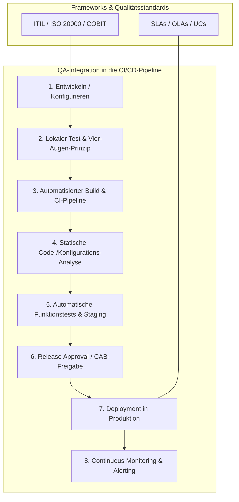

## tags: [fisi, ihk, lernsheet]
## 🧭 Navigation & Zusammenhänge
- **Vorausgesetztes Thema:** [[12_Kennzahlen & Soll-Ist-Vergleich im IT-Betrieb]]
- **Nächstes Thema:** [[14_Ursachenanalyse & Kontinuierlicher Verbesserungsprozess (KVP)]]
- **Verwandte Bausteine:** [[09_IT-Qualitätsmessung, -überwachung & -verbesserung]], [[14_Ursachenanalyse & Kontinuierlicher Verbesserungsprozess (KVP)]]
## 🎯 IHK-Prüfungsrelevanz

> [!IMPORTANT] AP01: Einrichten eines IT-gestützten Arbeitsplatzes
> 
> - **Relevanz:** Hoch
>     
> - **Fokus:** Einhaltung von Qualitätsstandards und Checklisten bei Arbeitsplatz-Rollouts, Durchführung von lokalen Tests und Anwendung des Vier-Augen-Prinzips sowie saubere Dokumentation (z. B. Testprotokolle).
>     

> [!WARNING] AP02: Konzeption, Administration & Netzwerke
> 
> - **Relevanz:** Sehr hoch
>     
> - **Fokus:** Abgrenzung und Anwendung von IT-Frameworks (ITIL, ISO 20000, COBIT), Implementierung präventiver, detektiver und korrektiver Qualitätskontrollen, Definition von Service-Standards (SLAs, OLAs, UCs) sowie Einbindung von CI/CD-Pipelines und Testautomatisierung im Systembetrieb.
>     

## 📖 Einfache Erklärung & Praxisbeispiele

Qualitätsmanagement (QM) im IT-Kontext umfasst die gezielte Planung, Lenkung, Messung und kontinuierliche Verbesserung von Services, Prozessen und Systemen. Es minimiert Ausfallzeiten, vermeidet teure Nacharbeiten und schafft verlässliche IT-Strukturen.

### Frameworks im Überblick:

- **ITIL:** Detaillierter Best-Practice-Leitfaden für den gesamten IT-Service-Lebenszyklus (Strategy, Design, Transition, Operation, CSI).
    
- **ISO 20000:** International prüfbarer Standard mit verbindlichen Anforderungen für die Zertifizierung von IT-Service-Management-Systemen.
    
- **COBIT:** Governance-Framework zur Ausrichtung der IT-Prozesse an den Unternehmenszielen und Compliance-Anforderungen.
    
- **DevOps & Agile:** Integrieren die Qualitätssicherung (QA) als kontinuierlichen, automatisierten Prozess direkt in den Entwicklungs- und Betriebszyklus (Continuous Testing/CI/CD).
    

### Unterthemen & Anschauliche Beispiele:

- **Qualitätsplanung & SMART-Ziele:** Vorausschauende Festlegung messbarer Qualitätskriterien (Verfügbarkeit, Performance, Sicherheit, Usability, Wartbarkeit).
    
    - 💡 **Praxisbeispiel:** Das Infrastructure-Team definiert für eine neue Core-Datenbank folgendes SMART-Ziel: _"Die Verfügbarkeit des Datenbanksystems muss im Produktionsbetrieb ab Q1 2027 mindestens 99,9 % pro Monat betragen, gemessen über das automatisierte Monitoring."_
        
- **Qualitätsstandards (SLAs, OLAs, UCs):** Vertragliche und operative Rahmenwerke zur Festlegung der Servicequalität.
    
    - **SLA (Service Level Agreement):** Vereinbarung zwischen IT-Dienstleister und Kunde.
        
    - **OLA (Operational Level Agreement):** Interne Vereinbarung zwischen IT-Abteilungen (z. B. Network Team & Helpdesk).
        
    - **UC (Underpinning Contract):** Vertrag mit einem externen Zulieferer/Provider (z. B. Internetdienstanbieter).
        
    - 💡 **Praxisbeispiel:** Gegenüber dem Fachbereich garantiert die IT per **SLA** die Behebung kritischer Serverausfälle innerhalb von 2 Stunden. Damit das gelingt, vereinbart das Systemadministrator-Team intern per **OLA** eine Reaktionszeit von 15 Minuten und sichert sich über einen **UC** mit dem Hardware-Hersteller einen 4-Stunden-Vor-Ort-Ersatzteilservice.
        
- **Qualitätskontrollen (Präventiv, Detektiv, Korrektiv):**
    
    - **Präventiv:** Verhindert Fehler im Vorfeld (z. B. Vier-Augen-Prinzip, automatisierte Code-Analysen).
        
    - **Detektiv:** Deckt aufgetretene Fehler während des Betriebs auf (z. B. Monitoring & Alerting, Audits).
        
    - **Korrektiv:** Behebt aufgetretene Störungen im Nachgang (z. B. Rollback-Pläne, Incident Management).
        
    - 💡 **Praxisbeispiel:** Vor dem Deployment eines Server-Updates prüft eine CI/CD-Pipeline automatisch die Konfiguration (**Präventiv**). Nach der Freigabe überwacht das Monitoring-Tool Zabbix die CPU-Auslastung (**Detektiv**). Kommt es zu Störungen, startet das automatische Rollback auf das vorherige Snapshot-Image (**Korrektiv**).
        
- **Organisatorische Qualitätskontrollen:**
    
    - **Change Advisory Board (CAB):** Ein Gremium zur strukturierte Bewertung und Genehmigung risikoreicher Systemänderungen.
        
    - **Definition of Done (DoD):** Verbindliche Kriterienliste, die erfüllt sein muss, damit ein Task/Ticket als abgeschlossen gilt.
        
    - 💡 **Praxisbeispiel:** Ein Major-Upgrade der zentralen Firewalls darf erst durchgeführt werden, nachdem das **CAB** das Risiko und den Wartungsplan freigegeben hat. Die **Definition of Done** schreibt vor: _"Update installiert, Funktionstest erfolgreich, Doku angepasst, Ticket geschlossen."_
        
- **Qualitätsökonomie & Shift-Left-Ansatz:**
    
    - **Shift-Left:** Verlagerung von Test- und Prüfaktivitäten in frühe Phasen der Entstehung, da Fehlerbehebung in späteren Phasen exponentiell teurer wird.
        
    - 💡 **Praxisbeispiel:** Ein Konfigurationsfehler in einem Ansible-Playbook wird direkt beim lokalen Testen durch das Vier-Augen-Prinzip korrigiert (Aufwand: 5 Minuten), anstatt erst nach dem Ausfall von 500 Client-Workstations im laufenden Betrieb behoben zu werden (Aufwand: mehrere Stunden Ausfallzeit & hohe Fehlerkosten).

