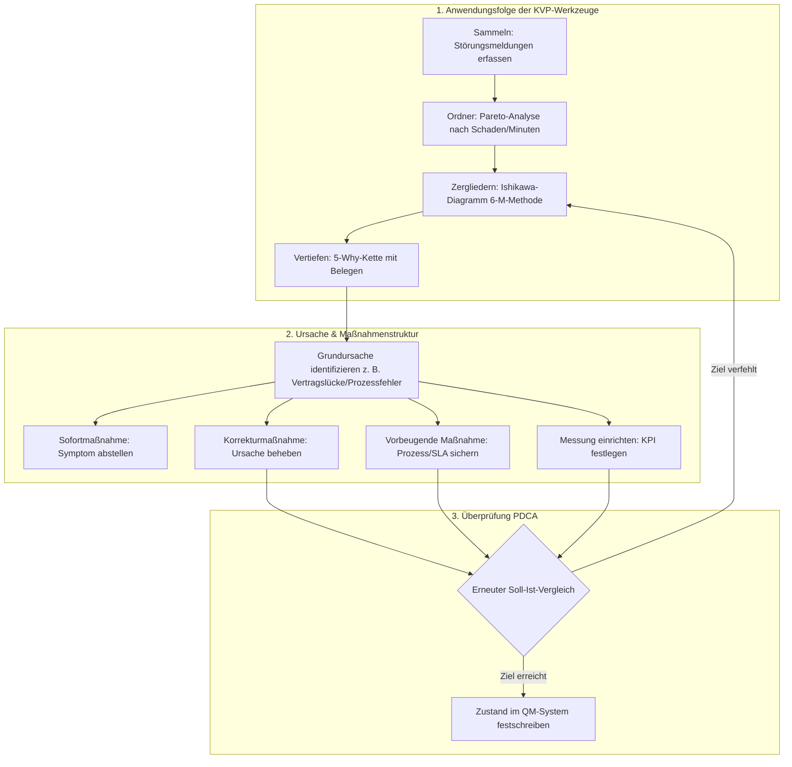

## tags: [fisi, ihk, lernsheet]

## 🧭 Navigation & Zusammenhänge
- **Vorausgesetztes Thema:** [[13_IT-Qualitätsmessung, -überwachung & -verbesserung]]
- **Nächstes Thema:** [[15_Bedrohungsszenarien & Schadenspotenziale in der IT]]
- **Verwandte Bausteine:** [[07_Qualitätsmanagementsysteme & Normen (ISO 9000er-Reihe)]], [[13_IT-Qualitätsmessung, -überwachung & -verbesserung]]

## 🎯 IHK-Prüfungsrelevanz

> [!IMPORTANT] AP01: Einrichten eines IT-gestützten Arbeitsplatzes
> 
> - **Relevanz:** Mittel
>     
> - **Fokus:** Erfassung wiederkehrender Hardware-/Softwarefehler am Arbeitsplatz (z. B. leere Akkus, Bedienfehler) und Ableitung präventiver Maßnahmen/Standardarbeitsanweisungen.
>     

> [!WARNING] AP02: Konzeption, Administration & Netzwerke
> 
> - **Relevanz:** Sehr hoch
>     
> - **Fokus:** Methodische Differenzierung zwischen Symptom und Ursache, Priorisierung von Fehlern nach Schadenswirkung statt bloßer Häufigkeit mittels Pareto-Analyse, Anwendung des Ishikawa-Diagramms (6-M-Methode) und der 5-Why-Technik mit Belegen sowie die geschlossene Steuerung des KVP-Zyklus (PDCA).
>     

## 📖 Einfache Erklärung & Praxisbeispiele

Die **Ursachenanalyse** ist der systematische Weg von einer gemessenen Soll-Ist-Abweichung über die tatsächliche Grundursache hin zur nachhaltigen Fehlerbeseitigung im Rahmen des **Kontinuierlichen Verbesserungsprozesses (KVP)**.

### Symptom vs. Ursache:

- **Symptom:** Das, was beobachtet, gemeldet und wahrgenommen wird (wo es auffällt). Ein Symptom lässt sich vorübergehend abstellen, kehrt ohne Ursachenbehebung jedoch wieder.
    
- **Ursache:** Der eigentliche Grund, der das Symptom erzeugt. Liegt oft in ganz anderen Systemen oder Verträgen. Wird die Ursache beseitigt, verschwindet das Symptom dauerhaft.
    
- ⚠️ **Kritische Falle (Typische Denkfehler):** Wer bei der ersten plausiblen Erklärung anhält, nur nach Personen/Schuldigen sucht oder rein nach der Fehlerhäufigkeit statt nach der finanziellen Schadenswirkung priorisiert, steuert am Problem vorbei.
    

### Unterthemen & Anschauliche Beispiele:

- **Pareto-Analyse (80/20-Regel):**
    
    - **Prinzip:** Ordnet Fehlerkategorien absteigend und berechnet den kumulierten Anteil.
        
    - **Priorisierung nach Schaden:** Fehler dürfen keinesfalls nur nach der schlichten Anzahl der Meldungen geordnet werden, sondern primär nach den **Ausfallminuten / finanziellen Schäden**.
        
    - 💡 **Praxisbeispiel (Gastronomie-IT "Bella Napoli"):**
        
        - _Nach Häufigkeit:_ "Bedienfehler" stehen mit 30 Meldungen auf Platz 1 (nur 153 Ausfallminuten).
            
        - _Nach Schaden:_ "Überlastete Datenbank" erzeugt zwar nur 13 Meldungen, führt aber zu 408 Ausfallminuten (davon 340 Min. in der Hauptgeschäftszeit)! Die Datenbanküberlastung wird somit mit oberster Priorität analysiert.
            
- **Ishikawa-Diagramm (Fischgräten-Diagramm / 6-M-Methode):**
    
    - **Funktion:** Visuelle Sammlung und Strukturierung möglicher Fehlerursachen. Die beobachtete Wirkung steht rechts, 6 Hauptäste führen darauf zu:
        
        1. **Mensch:** z. B. Fehlende Einweisung / Überlastung.
            
        2. **Maschine:** z. B. Server-Performance, ältere Hardware.
            
        3. **Material:** z. B. Fehlender Datenbank-Index, riesige Tabellen.
            
        4. **Methode:** z. B. Abfrageintervalle, fehlende Skripte.
            
        5. **Messung:** z. B. Falscher Messpunkt (Server statt Client).
            
        6. **Umfeld:** z. B. Spitzenlastzeiten, Lücken in Dienstleister-Verträgen.
            
    - ⚠️ Kein Ast darf unbeachtet leer bleiben! Ein leerer Ast signalisiert meist, dass dort schlicht nicht nachgesehen wurde.
        
- **5-Why-Methode (Die 5-Warum-Fragen mit Belegen):**
    
    - Iteratives Hinterfragen von der beobachteten Erscheinung bis zur Wurzel des Problems. Jede Antwort muss auf jeder Stufe durch **konkrete Daten, Zahlen oder Nachweise** belegt sein.
        
    - 💡 **Praxisbeispiel:**
        
        - _Warum 1 (Erscheinung):_ Küchen-Tablets zeigen Bestellungen samstags verspätet an. _(Beleg: 8 Ticketmeldungen)_
            
        - _Warum 2:_ Die automatische Abfrage der Tablets läuft in ein Timeout. _(Beleg: Logfile-Timeouts)_
            
        - _Warum 3:_ Die Datenbank braucht unter Last länger als 5 Sekunden für Antworten. _(Beleg: Monitoring-Auswertung)_
            
        - _Warum 4:_ Die SQL-Abfrage durchsucht eine Tabelle mit 214.000 Zeilen ohne Index. _(Beleg: Ausführungsplan des Hosters)_
            
        - _Warum 5 (Grundursache):_ Weder Archivierung noch Indexierung wurden vereinbart, weil die Pflege im Servicevertrag fehlte. _(Beleg: SLA/Leistungsbeschreibung)_
            
- **Klassifikation der Maßnahmen & KVP-Kreislauf:**
    
    - **Sofortmaßnahme:** Stellt das Symptom kurzfristig ab (z. B. Server neu starten).
        
    - **Korrekturmaßnahme:** Beseitigt die Ursache nachhaltig (z. B. SQL-Index anlegen, Alt-Daten archivieren).
        
    - **Vorbeugende Maßnahme:** Passt Verträge/Prozesse an, damit der Fehler nie wieder auftritt (z. B. Datenbankpflege in den Servicevertrag aufnehmen).
        
    - **Messung einrichten:** Schafft erst die Messbarkeit über eine KPI zur Kontrolle.

