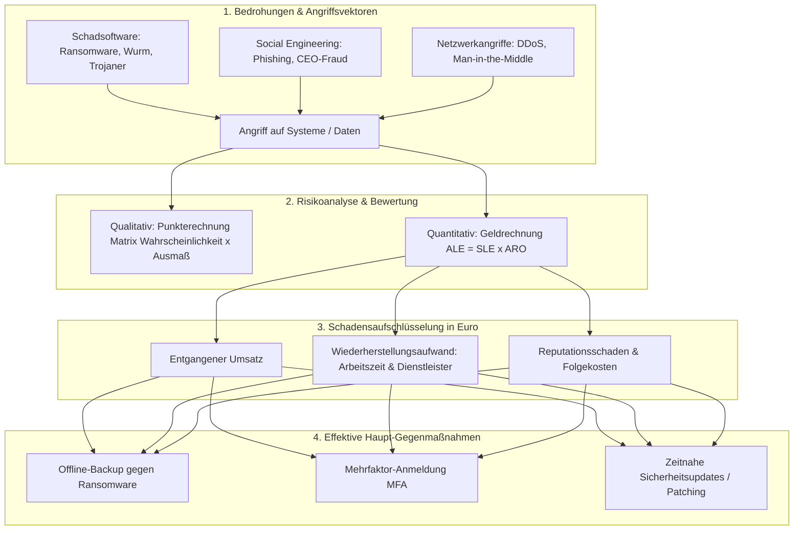

## tags: [fisi, ihk, lernsheet]

## 🧭 Navigation & Zusammenhänge
- **Vorausgesetztes Thema:** [[14_Ursachenanalyse & Kontinuierlicher Verbesserungsprozess (KVP)]]
- **Nächstes Thema:** [[16_Security by Design, IT-Grundschutz & Kontrollebenen]]
- **Verwandte Bausteine:** [[03_Gefahrenquellen, Malware-Typen & Gegenmaßnahmen]], [[18_Risikoanalyse_Sicherheitscheck_Wirksamkeit]]
## 🎯 IHK-Prüfungsrelevanz

> [!IMPORTANT] AP01: Einrichten eines IT-gestützten Arbeitsplatzes
> 
> - **Relevanz:** Hoch
>     
> - **Fokus:** Schutz von Client-Workstations vor Malware (Schadsoftware) durch lokale Antiviren-Programme, Erzwingen von Mehrfaktor-Authentifizierung (MFA) und Kennwort-Richtlinien gegen Credential Stuffing und Phishing sowie Benutzerschulungen zum Erkennen von Social Engineering.
>     

> [!WARNING] AP02: Konzeption, Administration & Netzwerke
> 
> - **Relevanz:** Sehr hoch
>     
> - **Fokus:** Schutz der Server- und Netzwerkinfrastruktur vor Ransomware durch Offline-Backups (3-2-1-Regel), Absicherung gegen DDoS-Angriffe und MitM-Attacken (Netztrennung/VLANs), methodische Risikoanalyse (Vergleich: Qualitative Punkterechnung vs. Quantitative Geldrechnung mit SLE, ARO und ALE) sowie präzise Schadensberechnung in Ausfallstunden und Euro.
>     

## 📖 Einfache Erklärung & Praxisbeispiele

IT-Bedrohungen gefährden die Schutzziele der Informationssicherheit. Ein wirksames Sicherheitskonzept muss Bedrohungsszenarien bezüglich ihrer Angriffswege analysieren und das damit verbundene **Schadenspotenzial** sowohl in Ausfallstunden als auch finanziell in Euro bewerten.

### Wichtige Schadprogramme & Angriffsvektoren im Überblick:

- **Virus / Wurm / Trojaner:** Ein Virus benötigt ein Wirtsprogramm und menschliche Interaktion; ein Wurm breitet sich selbstständig über Netzwerkschwachstellen aus; ein Trojaner tarnt sich als nützliche Software.
    
- **Ransomware:** Verschlüsselt Daten/Systeme und erpresst Lösegeld. Oft kombiniert mit "Double Extortion" (vorheriger Datenabfluss). Das BSI rät strikt von Lösegeldzahlungen ab.
    
- **Credential Stuffing:** Automatisiertes Ausprobieren von gestohlenen Benutzername/Passwort-Kombinationen über viele Dienste hinweg.
    
- **Social Engineering:** Manipulationsangriffe auf Menschen (Phishing, Spear-Phishing, Smishing, CEO-Fraud) unter Ausnutzung von Hilfsbereitschaft, Autorität oder Zeitdruck.
    
- **Man-in-the-Middle (MitM) & DDoS:** Abfangen/Manipulieren des Datenverkehrs in ungesicherten Netzen bzw. Überlastung von Servern durch verteilte Botnetze.
    

### Unterthemen & Anschauliche Beispiele:

- **Schadensberechnung: Ausfallzeit vs. Arbeitszeit vs. Euro-Schaden:**
    
    - **Ausfallzeit:** Die reine Dauer, in der der IT-Dienst/das System nicht genutzt werden kann (bestimmt den entgangenen Umsatz).
        
    - **Arbeitszeit:** Die aufsummierten Personennacharbeitsstunden (z. B. 2 Techniker arbeiten 4 Stunden = 8 Personenstunden).
        
    - **Drei Posten des Euro-Schadens:**
        
        1. _Entgangener Umsatz:_ Nicht getätigte Verkäufe während der Ausfallzeit.
            
        2. _Wiederherstellungsaufwand:_ Kosten für Arbeitszeit, externen Dienstleister und Hardware-Ersatz.
            
        3. _Reputationsschaden:_ Verlust von Kunden, Imageverlust, Strafzahlungen.
            
    - 💡 **Praxisbeispiel (Gastronomie-IT "Bella Napoli"):** Samstags um 19:00 Uhr verschlüsselt Ransomware das Kassensystem und zwei Küchen-Tablets.
        
        - _Entgangener Umsatz:_ Der Ausfall betrifft 2 Stunden im kritischen Samstags-Umsatzfenster (Hauptgeschäftszeit) $\rightarrow$ ca. 2.667 € entgangener Umsatz.
            
        - _Wiederherstellung:_ 8 Personenstunden Aufwand durch externen IT-Service à 100 €/Std. = 800 €.
            
        - _Schutzmaßnahme:_ Eine saubere **Offline-Sicherung (Air-Gapped-Backup)** verkürzt die Wiederherstellung drastisch und verhindert den Totalverlust.
            
- **Risikoanalyse: Qualitativ (Punkterechnung) vs. Quantitativ (Geldrechnung):**
    
    - **Qualitative Risikoanalyse (Punkterechnung):** Bewertet Eintrittswahrscheinlichkeit und Schadensausmaß auf einer definierten Stufenskala (z. B. $1 \text{ bis } 5$ oder $0 \text{ bis } 4$).
        
        $$\text{Risikowert (Punkte)} = \text{Wahrscheinlichkeit} \times \text{Ausmaß} \quad \text{(erfordert Angabe von Skala \& Schwellen!)} \quad \text{[cite: 367, 369, 370]}$$
        
    - **Quantitative Risikoanalyse (Geldrechnung):** Rechnet mit exakten Monitären Werten in Euro.
        
        - $\text{SLE (Single Loss Expectancy)} = \text{Schadenshöhe bei einem Ereignis in €}$
            
        - $\text{ARO (Annual Rate of Occurrence)} = \text{Jährliche Eintrittshäufigkeit}$
            
        - $\text{ALE (Annual Loss Expectancy)} = \text{Erwarteter Jahresverlust in €}$
            
            $$\text{ALE} = \text{SLE} \times \text{ARO} \quad \text{[cite: 367]}$$
            
    - 💡 **Praxisbeispiel:** Wenn ein Serverausfall bei einem Online-Shop einen Schaden von $10.000\ €$ verursacht ($\text{SLE}$) und statistisch alle 2 Jahre eintritt ($\text{ARO} = 0{,}5$), beträgt der erwartete Jahresverlust:
        
        $$\text{ALE} = 10.000\ € \times 0{,}5 = 5.000\ € / \text{Jahr} \quad \text{[cite: 367]}$$
        
        Eine Schutzmaßnahme (z. B. redundantes Netzteil) ist wirtschaftlich sinnvoll, wenn ihre jährlichen Kosten unter $5.000\ €$ liegen.

