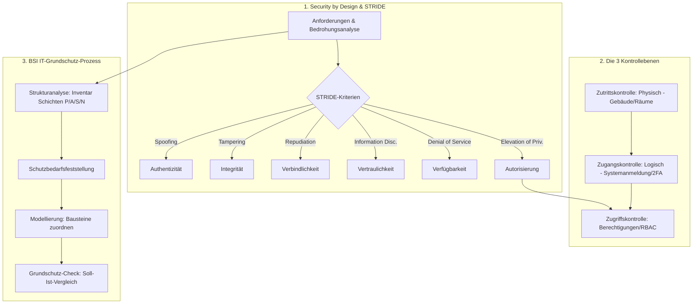

## tags: [fisi, ihk, lernsheet]

## 🧭 Navigation & Zusammenhänge
- **Vorausgesetztes Thema:** [[15_Bedrohungsszenarien & Schadenspotenziale in der IT]]
- **Nächstes Thema:** [[17_Rahmenbedingungen und Kundenberatung]]
- **Verwandte Bausteine:** [[01_Grundlagen der IT-Sicherheit & Schutzziele]], [[08_Von der Qualität zur Sicherheit & Schutzziele (CIANA+PS)]]
## 🎯 IHK-Prüfungsrelevanz

> [!IMPORTANT] AP01: Einrichten eines IT-gestützten Arbeitsplatzes
> 
> - **Relevanz:** Hoch
>     
> - **Fokus:** Einhaltung von Security by Default auf Client-Systemen (keine Standardkennwörter, Dienstminimierung), sichere Vergabe benutzerspezifischer Accounts beim Onboarding sowie physische Absicherung von Arbeitsplätzen und Medien (Zutritts- und Zugangskontrollen).
>     

> [!WARNING] AP02: Konzeption, Administration & Netzwerke
> 
> - **Relevanz:** Sehr hoch
>     
> - **Fokus:** Anwendung von Security by Design / STRIDE bei Systemarchitekturen, Strukturierung präventiver, erkennender und reagierender Maßnahmen, Durchführung von Strukturanalyse und Schutzbedarfsfeststellung nach BSI IT-Grundschutz, Unterscheidung der 3 Kontrollebenen (Zutritt, Zugang, Zugriff) und Konzeption rollenbasierter Zugriffskontrollen (RBAC, DAC, MAC, ABAC).
>     

## 📖 Einfache Erklärung & Praxisbeispiele

Informationssicherheit muss von Grund auf in Systeme integriert und strukturiert überwacht werden. **Security by Design** fordert, dass Sicherheitseigenschaften bereits in der Konzeptionsphase definiert werden. Der **BSI IT-Grundschutz** bietet hierfür einen systematischen Leitfaden, während die **3 Kontrollebenen** (Zutritt, Zugang, Zugriff) steuern, wer worauf zugreifen darf.

### Kernkonzepte im Überblick:

- **Security by Design:** Sicherheit steht von Beginn an als funktionale/nicht-funktionale Anforderung im Pflichtenheft. Nachträgliches Nachrüsten im Betrieb verursacht um ein Vielfaches höhere Kosten.
    
- **Security by Default:** Auslieferung von Systemen in der sichersten Konfiguration (z. B. keine Standard-Passwörter, dektivierte ungenutzte Ports/Dienste).
    
- **Principle of Least Privilege (Geringste Rechte):** Jede Rolle und jeder Dienst erhält exakt die Rechte, die zur Aufgabenerfüllung zwingend nötig sind.
    

### Unterthemen & Anschauliche Beispiele:

- **Bedrohungsanalyse mit dem STRIDE-Modell:**
    
    - **Spoofing (Identität vortäuschen):** Verletzt _Authentizität_.
        
    - **Tampering (Daten verändern):** Verletzt _Integrität_.
        
    - **Repudiation (Abstreiten einer Handlung):** Verletzt _Verbindlichkeit / Nichtabstreitbarkeit_.
        
    - **Information Disclosure (Daten preisgeben):** Verletzt _Vertraulichkeit_.
        
    - **Denial of Service (Dienst lahmlegen):** Verletzt _Verfügbarkeit_.
        
    - **Elevation of Privilege (Rechte ausweiten):** Verletzt _Autorisierung / Zugriffskontrolle_.
        
    - 💡 **Praxisbeispiel (App-Vorbestellfunktion):** Bei der Stornierung einer Online-Bestellung verhindert ein STRIDE-Check _Tampering_ und _Elevation of Privilege_, indem serverseitig verifiziert wird, ob das angemeldete Konto tatsächlich der Käufer der Pizza ist.
        
- **Klassifikation von Sicherheitsmaßnahmen:**
    
    - **Nach Art:**
        
        - _Technisch:_ Verschlüsselung, MFA, Firewalls.
            
        - _Organisatorisch:_ Arbeitsanweisungen, Notfallpläne, Abnahme-Prozesse.
            
        - _Personell:_ Mitarbeiterschulungen, Vertretungsregeln.
            
        - _Baulich/Physisch:_ Zylinderschlösser, Server-Rack-Verriegelung, USV.
            
    - **Nach Wirkungszeitpunkt:**
        
        - _Vorbeugend (Präventiv):_ Verhindert den Eintritt (z. B. Härtung, Patching).
            
        - _Erkennend (Detektiv):_ Bemerkt den Vorfall (z. B. IDS/IPS, Log-Monitoring).
            
        - _Reagierend (Korrektiv):_ Begrenzt und behebt den Schaden (z. B. Backups einspielen, Notfallplan).
            
- **Vorgehensweise nach BSI IT-Grundschutz:**
    
    1. **Sicherheitsleitlinie:** Bekenntnis der Geschäftsführung zur IT-Sicherheit.
        
    2. **Strukturanalyse:** Modellierung der IT-Landschaft in Schichten (Prozesse, Anwendungen, IT-Systeme, Räume/Netze) mit eindeutigen Kürzeln (z. B. A001, S001).
        
    3. **Schutzbedarfsfeststellung:** Einstufung der Zielobjekte bzgl. Vertraulichkeit, Integrität und Verfügbarkeit (Normal, Hoch, Sehr hoch).
        
    4. **Modellierung & Grundschutz-Check:** Zuordnung relevanter BSI-Bausteine (z. B. `APP.3.1`, `SYS.1.1`) und Durchführung eines Soll-Ist-Vergleichs.
        
    5. **Umsetzung & Audit:** Realisierung fehlender Maßnahmen und Prüfung auf Konformität.
        
- **Die 3 Kontrollebenen der IT-Sicherheit:**
    
    - **Zutrittskontrolle (Wer darf wohin?):** Schutz von Gebäuden und Serverräumen vor unbefugtem physischem Betreten (z. B. Schlüssel, Chipkarten, Zäune).
        
    - **Zugangskontrolle (Wer darf sich anmelden?):** Verhinderung der unbefugten Nutzung von IT-Systemen (z. B. benutzerspezifische Logins, 2FA, Kennwort-Policies).
        
    - **Zugriffskontrolle (Wer darf was sehen/tun?):** Beschränkung der Daten- und Funktionsnutzung auf autorisierte Benutzer.
        
    - 💡 **Modelle der Zugriffskontrolle (Access Control):**
        
        - **RBAC (Role-Based Access Control):** Rechte werden an Berechtigungsrollen geknüpft (z. B. Rolle "Küche", "Filialleiter") – Best Practice für Unternehmen.
            
        - **DAC (Discretionary Access Control):** Der Eigentümer eines Objekts bestimmt die Rechte (z. B. NTFS-Freigaben durch User).
            
        - **MAC (Mandatory Access Control):** Das System vergibt Rechte starr anhand von Geheimhaltungsstufen (z. B. Militär).
            
        - **ABAC (Attribute-Based Access Control):** Feingranulare Vergabe anhand von Kontext-Attributen (Uhrzeit, Standort, Gerät).

