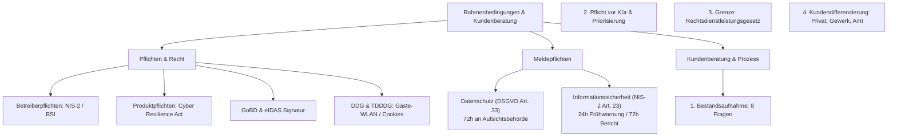

## tags: [fisi, ihk, lernsheet]

## 🧭 Navigation & Zusammenhänge
- **Vorausgesetztes Thema:** [[16_Security by Design, IT-Grundschutz & Kontrollebenen]]
- **Nächstes Thema:** [[18_Risikoanalyse_Sicherheitscheck_Wirksamkeit]]
- **Verwandte Bausteine:** [[04_Rechtliche Rahmenbedingungen & IT-Sicherheitsberatung]], [[08_Kundenberatung und Marketing in der IT]]

## 🎯 IHK-Prüfungsrelevanz

> [!IMPORTANT] AP01: Einrichten eines IT-gestützten Arbeitsplatzes
> 
> - **Relevanz:** Mittel
>     
> - **Fokus:** Beachtung von rechtlichen Rahmenbedingungen beim Arbeitsplatzbetrieb (z. B. Datenschutz bei Beschäftigtendaten, Gäste-WLAN-Trennlinie nach DDG, sichere lokale Datensicherung gegen Ransomware).
>     

> [!WARNING] AP02: Konzeption, Administration & Netzwerke
> 
> - **Relevanz:** Hoch
>     
> - **Fokus:** Unterscheidung von Hersteller- und Betreiberpflichten (Cyber Resilience Act vs. NIS-2-Richtlinie), Einhaltung von GoBD-Vorgaben für Kassen/Buchhaltung, korrekte Durchführung einer strukturierten Kundenbestandsaufnahme vor System- oder Cloud-Empfehlungen sowie Kenntnis der Meldewege bei Sicherheitsvorfällen.
>     

## 📖 Einfache Erklärung & Praxisbeispiele

In der Systemintegration reicht es nicht aus, technische Probleme nur rein funktional zu lösen. IT-Systeme müssen rechtssicher betrieben und Produkte compliant vertrieben werden. Zudem erfordert professionelle Kundenberatung eine strukturierte Bestandsaufnahme (Bestandsanalyse) anstelle von vorschnellen Produktempfehlungen, wobei stets die gesetzlichen Grenzen (wie das Rechtsdienstleistungsgesetz) gewahrt werden müssen.

### Unterthemen & Anschauliche Beispiele:

- **Betreiber- vs. Herstellerpflichten (NIS-2 & CRA):**
    
    - _Betreiberpflichten:_ Treffen den, der Systeme betreibt (z. B. NIS-2-Richtlinie bzw. BSI-Gesetz für kritische und wichtige Einrichtungen).
        
    - _Produktpflichten:_ Treffen den Hersteller/Inverkehrbringer von Produkten mit digitalen Elementen (z. B. Cyber Resilience Act - CRA, EU 2024/2847) mit Pflicht zu Sicherheitsupdates ab Entwurf und CE-Kennzeichnung.
        
    - 💡 **Praxisbeispiel:** Eine Firma, die Kassensoftware herstellt und diese im eigenen Rechenzentrum für Kunden betreibt, unterliegt sowohl den Produktpflichten (CRA) als auch den Betreiberpflichten.
        
- **GoBD & eIDAS in der Buchhaltung:**
    
    - _GoBD:_ Buchungsbelege und Jahresabschlüsse müssen 8 bzw. 10 Jahre unveränderbar und nachvollziehbar gespeichert werden (§ 147 AO); Stornierungen dürfen Buchungen niemals überschreiben.
        
    - _eIDAS:_ Regelt elektronische Signaturen (einfach, fortgeschritten, qualifiziert); eine qualifizierte elektronische Signatur ersetzt die gesetzliche Schriftform nach § 126a BGB (wobei z. B. Kündigungen im Arbeitsrecht nach § 623 BGB dennoch ausgeschlossen bleiben).
        
- **Meldepflichten (Datenschutz vs. Informationssicherheit):**
    
    - _Datenschutz (DSGVO Art. 33):_ Meldung von Verletzungen personenbezogener Daten innerhalb von 72 Stunden an die Aufsichtsbehörde.
        
    - _Informationssicherheit (NIS-2 Art. 23):_ Meldung erheblicher Sicherheitsvorfälle an das CSIRT/Behörden in gestuften Fristen (Frühwarnung nach 24 Std., ausführlicher Bericht nach 72 Std.).
        
- **Kundenberatung & Bestandsaufnahme (8 Fragen):**
    
    - Vor jeder Empfehlung (z. B. Cloud-Migration oder Firewall) müssen Datenquellen, Speicherorte, Zugriffe, Ausfallszenarien und Verträge systematisch erhoben werden.
        
    - _Grenze der Rechtsberatung:_ Nach dem Rechtsdienstleistungsgesetz (RDG) darf ein IT-Berater rechtliche Hintergründe informieren, aber keine verbindliche Einzelfallprüfung (wie „Dieser Vertrag reicht für euch aus“) als Hauptleistung durchführen.
        
- **Kundenkategorien & Fallbeispiele (z. B. Cloud-Anfrage):**
    
    - Unterscheidung zwischen Privatkunden (private Ausnahmeregelung der DSGVO), gewerblichen Kunden (mit/ohne Daten Dritter, GoBD) und der öffentlichen Hand (Vergaberecht/VgV, Vorbefassungsverbot).
        
    - 💡 **Praxisbeispiel:** Dieselbe Frage („Sollen unsere Daten in die Cloud?“) verlangt bei einer Pizzeria (Luigi, Kassen- und Kundendaten nach DSGVO/GoBD), einer Privatperson (Ransomware-Schutz) und einer Behörde (Ausschreibung nach VgV) völlig unterschiedliche vertragliche und konzeptionelle Ansätze.

#### Typische IHK-Stolperfallen

- **Hersteller- vs. Betreiberpflichten verwechseln:** In der Prüfung wird oft ein Szenario geschildert, in dem eine Firma Software entwickelt _und_ selbst hostet. Wer hier nur an den _Cyber Resilience Act (CRA)_ (Produktpflicht) denkt, vergisst die Betreiberpflichten (wie _NIS-2_ bzw. das BSI-Gesetz). Beide Seiten müssen getrennt betrachtet werden.
    
- **Meldewege bei Vorfällen vermischen:** Die 72-Stunden-Frist der DSGVO (Datenschutz bei personenbezogenen Daten) wird gerne mit den gestuften Fristen der NIS-2 (24-Stunden-Frühwarnung für erhebliche Sicherheitsvorfälle) verwechselt.
    
- **Rechtsberatung durch ITler:** Ein beliebter Prüfungsfall ist der IT-Berater, der einem Kunden verbindlich bestätigt: „Dieser Vertrag zur Auftragsverarbeitung (AVV) ist rechtlich sicher.“ Das verstößt gegen das Rechtsdienstleistungsgesetz (RDG) – der Berater darf informieren, aber keine verbindliche Einzelfallprüfung als Hauptleistung erbringen.
    
- **GoBD-Missverständnis bei Kassen:** Das Überschreiben oder nachträgliche Korrigieren von Buchungsbelegen (auch bei Fehlern) ist absolut unzulässig. Die GoBD verlangen zwingend Nachvollziehbarkeit und Unveränderbarkeit (Stornierung statt Überschreibung).
