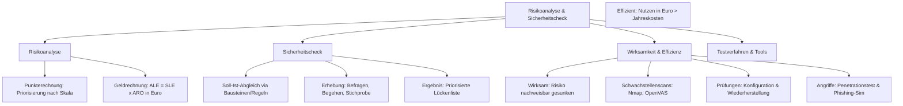

## tags: [fisi, ihk, lernsheet]

## 🧭 Navigation & Zusammenhänge
- **Vorausgesetztes Thema:** [[17_Rahmenbedingungen und Kundenberatung]]
- **Nächstes Thema:** [[01_IT-Vertragsarten & Leistungsdokumentation]] *(Übergang zu Modul 08)*
- **Verwandte Bausteine:** [[15_Bedrohungsszenarien & Schadenspotenziale in der IT]], [[06_Audits & Zertifizierungen]]
## 🎯 IHK-Prüfungsrelevanz

> [!IMPORTANT] AP01: Einrichten eines IT-gestützten Arbeitsplatzes
> 
> - **Relevanz:** Mittel
>     
> - **Fokus:** Durchführung kleinerer Sicherheitschecks am Arbeitsplatz (z. B. Kennwortrichtlinien, lokale Kontentrennung, Updates) und grundlegende Absicherung gegen Bedrohungen wie Ransomware.
>     

> [!WARNING] AP02: Konzeption, Administration & Netzwerke
> 
> - **Relevanz:** Hoch
>     
> - **Fokus:** Methodischer Vergleich von quantitativen (Geldrechnung: SLE, ARO, ALE) und qualitativen (Punkterechnung) Risikoanalysen, Abgrenzung von Soll-Ist-Sicherheitschecks, Nachweis von Wirksamkeit und Effizienz von IT-Sicherheitsmaßnahmen sowie Auswahl geeigneter Testverfahren und Werkzeuge (Nmap, OpenVAS, Penetrationstests).
>     

## 📖 Einfache Erklärung & Praxisbeispiele

Um IT-Risiken in einem Unternehmen zu beherrschen, reichen reine Vermutungen nicht aus. Betriebe müssen Risiken strukturiert bewerten (entweder über Punkte oder in Euro), Sicherheitslücken mittels Soll-Ist-Abgleichen aufdecken und die Wirksamkeit sowie Wirtschaftlichkeit (Effizienz) getroffener Schutzmaßnahmen nachweisen.

### Unterthemen & Anschauliche Beispiele:

- **Risikoanalyse (Punkterechnung vs. Geldrechnung):**
    
    - _Punkterechnung:_ Ordnet Risiken auf Basis von Erfahrungswerten in ein Raster ein, um schnell Prioritäten zu setzen (beantwortet: _Was kommt zuerst?_).
        
    - _Geldrechnung:_ Berechnet den erwarteten Jahresverlust (ALE) aus Schaden je Eintritt (SLE) und Eintrittshäufigkeit pro Jahr (ARO), um wirtschaftliche Entscheidungen zu treffen (beantwortet: _Was darf eine Maßnahme kosten?_).
        
    - 💡 **Praxisbeispiel:** Ein Webshop-Ausfall bei der Pizzeria Bella Napoli wird per Punkterechnung als hohes Risiko (16/25 Punkten) eingestuft und in der Geldrechnung mit einem erwarteten Jahresverlust von 6.000 Euro beziffert.
        
- **Sicherheitscheck (Soll-Ist-Abgleich):**
    
    - Überprüft bestehende Systeme, Räume und Abläufe anhand eines Standards (z. B. Grundschutz-Bausteine) durch Befragen, Begehen, Lesen von Unterlagen und Stichproben.
        
    - 💡 **Praxisbeispiel:** Beim Check von Bella Napoli fällt auf, dass am Kassen-PC ein gemeinsames Konto für alle Mitarbeitenden genutzt wird – eine kritische Lücke, die sofort behoben werden muss.
        
- **Wirksamkeit & Effizienz:**
    
    - _Wirksam:_ Das Risiko ist nachweisbar kleiner geworden (Vorher-Nachher-Vergleich mit gleicher Messgröße).
        
    - _Effizient:_ Der finanzielle Nutzen (Einsparung beim Jahresverlust) übersteigt die jährlichen Gesamtkosten der Maßnahme.
        
    - 💡 **Praxisbeispiel:** Ein Betreuungsvertrag für 4.000 Euro im Jahr, der den Webshop-Ausfall so stark reduziert, dass ein Nutzen von 4.500 Euro entsteht, ist wirksam und effizient (500 Euro nettokaufmännischer Vorteil).
        
- **Testverfahren und Werkzeuge:**
    
    - Einsatz von Scannern wie Nmap (Netzwerk erkunden) und OpenVAS/Nessus (Schwachstellen finden) oder Durchführung von Penetrationstests, Konfigurationsprüfungen und Wiederherstellungstests, um Schutzmaßnahmen objektiv zu verifizieren.
        
    - 💡 **Praxisbeispiel:** Ein regelmäßiger Wiederherstellungstest beweist erst, ob eine lokale Datensicherung im Ernstfall innerhalb akzeptabler Zeit zurückgespielt werden kann.

#### ⚠️ Typische IHK-Stolperfallen

- **Wirksamkeit mit Effizienz verwechseln:** Eine Maßnahme kann hochwirksam sein (das Risiko sinkt massiv), aber völlig unwirtschaftlich bzw. ineffizient, wenn die jährlichen Kosten den erzielten finanziellen Nutzen (veriedelte Schadenssumme) übersteigen (Beispiel: 1.500 Euro Kosten für eine Maßnahme, die nur 1.200 Euro Schaden verhindert).
    
- **Fehlende Messgröße beim Vorher-Nachher-Vergleich:** In Konzeptaufgaben wird oft gefordert, die Wirksamkeit einer Sicherheitsmaßnahme nachzuweisen. Ein reines „Es ist jetzt sicherer“ reicht in der IHK-Korrektur nicht – es wird ein messbarer Indikator (z. B. Anzahl offener Schwachstellen, Ausfallminuten oder Klick-Quote bei Phishing) gefordert.
    
- **Verwechslung von Sicherheitscheck und Risikoanalyse:** Ein Sicherheitscheck prüft starr gegen ein Soll (z. B. Grundschutz-Bausteine) und liefert eine Lückenliste. Eine Risikoanalyse bewertet dagegen individuell, was ein Schadeneintritt tatsächlich kostet und wie wahrscheinlich er ist (oft über Geldrechnung: $\text{ALE} = \text{SLE} \times \text{ARO}$).
    
- **Glauben, dass ein Test „alles“ schützt:** Ein Schwachstellenscan oder Penetrationstest ist immer nur eine _Momentaufnahme_ und beweist niemals, dass absolut _keine_ Lücken im System existieren oder ein Netzwerk unknackbar ist.