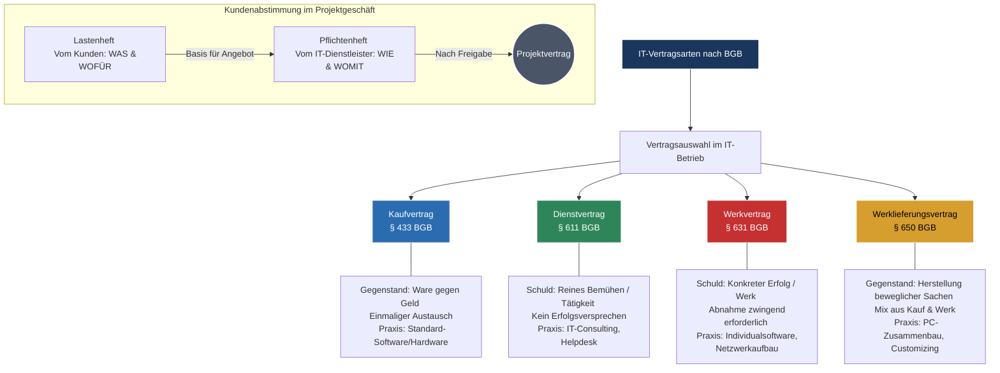

## 🧭 Navigation & Zusammenhänge
- **Vorausgesetztes Thema:** [[18_Risikoanalyse_Sicherheitscheck_Wirksamkeit]]
- **Nächstes Thema:** [[02_Change Management & IT-Kommunikation]]
- **Verwandte Bausteine:** [[03_Leistungsstörungen, Vollmachten & Cloud-Steuerung]], [[04_Formale Abnahme, Mängelprotokolle & Projektabschluss]]
---

## 🎯 IHK-Prüfungsrelevanz
> [!IMPORTANT] AP01: Einrichten eines IT-gestützten Arbeitsplatzes
> - **Relevanz:** Mittel
> - **Fokus:** Vertrautheit mit Gewährleistungsansprüchen bei Beschaffung von Standard-Hardware/Software (Kaufvertrag) sowie korrekte Abnahme von Arbeitsplätzen.

> [!WARNING] AP02: Konzeption, Administration & Netzwerke
> - **Relevanz:** Hoch
> - **Fokus:** Wirtschaftliche und rechtliche Grundlagen im Kernbereich "Wirtschafts- und Sozialkunde" sowie "Ganzheitliche Aufgabe". Die exakte Abgrenzung von Dienst- und Werkverträgen bei IT-Projekten sowie Kundenabstimmungen über Lasten- und Pflichtenhefte sind regelmäßige IHK-Prüfungsbrenner.

---

## 📖 Einfache Erklärung & Praxisbeispiele
Im IT-Alltag werden ständig Leistungen erbracht, Produkte beschafft oder Systeme gemietet. Das Bürgerliche Gesetzbuch (BGB) regelt hierbei die rechtlichen Rahmenbedingungen. Für Fachinformatiker ist die **Dokumentation** kein lästiges Übel, sondern oft Teil der geschuldeten vertraglichen Leistung. Fehlt eine vereinbarte Dokumentation (z. B. ein Netzwerkplan oder ein Administrator-Handbuch), kann dies rechtlich als **Sachmangel** gewertet werden.

### Unterthemen & Anschauliche Beispiele:
- **Der Kaufvertrag (§ 433 BGB):** Ein einmaliger Austausch von Ware gegen Geld. Der Verkäufer muss die Sache frei von Sach- und Rechtsmängeln übergeben, der Käufer muss bezahlen und die Ware abnehmen.
  - 💡 **Praxisbeispiel:** Das Systemhaus kauft 50 Originallizenzen von Windows 11 für ein Kundenprojekt. Das Versandrisiko (Gefahrübergang) wechselt im B2B-Geschäft bereits bei der Übergabe an den Spediteur.
- **Der Dienstvertrag (§ 611 BGB):** Geschuldet wird das reine Bemühen bzw. die Tätigkeit. Es gibt **kein Erfolgsversprechen**. Die Vergütung erfolgt meist nach Zeitaufwand (z. B. Stundensatz) – auch bei Misserfolg.
  - 💡 **Praxisbeispiel:** Ein Systemintegrator wird für eine dreistündige, komplexe Fehlersuche an einem defekten SAN-Storage gebucht. Selbst wenn die Ursache am Ende der drei Stunden nicht gefunden wird, muss der Kunde die Zeit bezahlen.
- **Der Werkvertrag (§ 631 BGB):** Geschuldet wird ein **konkreter, funktionstüchtiger Erfolg** (das "Werk"). Das finanzielle Risiko liegt beim Auftragnehmer. Das Geld wird erst nach der offiziellen **Abnahme** durch den Kunden fällig.
  - 💡 **Praxisbeispiel:** Die Programmierung einer maßgeschneiderten internen App zur Zeiterfassung ("Katzen-App") oder die schlüsselfertige Installation und Konfiguration eines neuen Firmennetzwerks zum Pauschalpreis.
- **Der Werklieferungsvertrag (§ 650 BGB):** Ein Mix aus Kauf- und Werkvertragsrecht. Er greift, wenn eine bewegliche Sache erst noch hergestellt oder angepasst werden muss.
  - 💡 **Praxisbeispiel:** Ein Systemhaus stellt aus Standardkomponenten (RAM, CPU, Mainboard) einen spezialisierten Virtualisierungsserver für den Kunden zusammen oder passt eine Standardsoftware tiefgreifend an (Customizing).
- **Lastenheft vs. Pflichtenheft:** 
  - Das **Lastenheft** kommt vom Kunden und beschreibt das *Was* und *Wofür* (Soll-Zustand/Anforderungen).
  - Das **Pflichtenheft** kommt vom Auftragnehmer und beschreibt detailliert das *Wie* und *Womit* (technische Umsetzung). Es wird nach Freigabe verbindlicher Vertragsbestandteil.

---

## 📊 Visuelle Darstellung (Mermaid.js)

