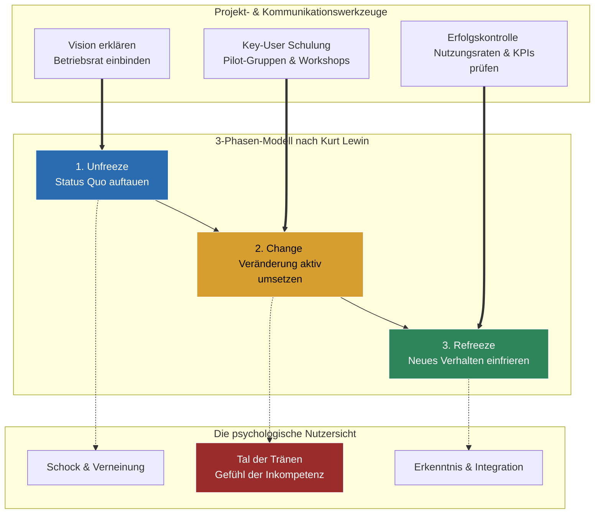

## 🧭 Navigation & Zusammenhänge
- **Vorausgesetztes Thema:** [[01_IT-Vertragsarten & Leistungsdokumentation]]
- **Nächstes Thema:** [[03_Leistungsstörungen, Vollmachten & Cloud-Steuerung]]
- **Verwandte Bausteine:** [[08_Kommunikation, Beratung & CRM]], [[02_Management, Projektplanung & Arbeitsplatz-Ergonomie]]
---

## 🎯 IHK-Prüfungsrelevanz
> [!IMPORTANT] AP01: Einrichten eines IT-gestützten Arbeitsplatzes
> - **Relevanz:** Niedrig bis Mittel
> - **Fokus:** Durchführung von standardisierten Einweisungen und Schulungen bei Benutzern nach der Bereitstellung neuer Arbeitsplatzsysteme.

> [!WARNING] AP02: Konzeption, Administration & Netzwerke
> - **Relevanz:** Hoch
> - **Fokus:** Der Faktor Mensch bei der Systemintegration. Die IHK prüft im Kernbereich "Wirtschafts- und Sozialkunde" sowie in den ganzheitlichen Aufgaben zunehmend Projektmanagement-Kompetenzen: Stakeholder-Analysen (Power-Interest-Grid), Schulungsmethodiken, Eskalationsstrategien bei schwierigen Kunden und die zwingende Einbindung des Betriebsrats bei Systemen mit Überwachungspotenzial.

---

## 📖 Einfache Erklärung & Praxisbeispiele
Ein IT-Projekt kann technisch noch so perfekt umgesetzt sein – wenn die Endanwender die neue Software oder Infrastruktur verweigern, ist das Projekt wirtschaftlich gescheitert. **Change Management** bezeichnet die strukturierte Begleitung von Veränderungen vom Ist- zum Soll-Zustand, um die Akzeptanz zu erhöhen und einen Produktivitätsabfall beim Go-Live zu minimieren. Im IT-Umfeld unterscheidet man technologische (z. B. Cloud-Migration), organisatorische (z. B. Outsourcing) und kulturelle Veränderungen (z. B. agiles Arbeiten).

### Unterthemen & Anschauliche Beispiele:
- **Modelle des Wandels:**
  - **Kurt Lewin (3 Phasen):** *Unfreeze* (Status Quo aufbrechen, Notwendigkeit erklären) $\rightarrow$ *Change* (Einführung des Neuen, Unsicherheit managen) $\rightarrow$ *Refreeze* (Stabilisierung des neuen Zustands, um Rückfälle in alte Muster zu verhindern).
  - **ADKAR-Modell (5 Stufen):** Beschreibt den individuellen Wandel eines Mitarbeiters durch die Phasen **A**wareness (Bewusstsein), **D**esire (Wunsch), **K**nowledge (Wissen), **A**bility (Können) und **R**eiforcement (Verankerung).
- **Umgang mit Widerständen:** Widerstand ist eine normale menschliche Reaktion auf Veränderung und resultiert meist aus der Angst vor Kompetenzverlust oder Überforderung. Er tritt *aktiv* (Laut: Widerspruch, Streit) oder *passiv* (Leise: Dienst nach Vorschrift, Fernbleiben von Schulungen) auf.
  - 💡 **Praxisbeispiel:** Bei der Einführung einer neuen mobilen Zeiterfassungs-App blockieren Außendienstmitarbeiter aus Angst vor Totalüberwachung ("Gläserner Mitarbeiter"). **Gegenstrategie:** Frühzeitige Einbindung des Betriebsrats (Mitbestimmungsrecht bei Überwachungspotenzial) und Nutzung des *Key-User-Konzepts*, bei dem erfahrene Kollegen als Multiplikatoren ihre Teams schulen.
- **Kommunikationstechniken im IT-Support:**
  - **Aktives Zuhören:** Ausreden lassen, Blickkontakt halten und durch Techniken wie *Paraphrasieren* ("Habe ich richtig verstanden, dass...") Missverständnisse abbauen.
  - **Ich-Botschaften:** Konflikte auf der Sachebene halten. Statt "Sie haben das Passwort schon wieder falsch eingegeben!" (Angriff) sagt man: "Ich sehe hier im Log systemseitig eine Fehlermeldung bei der Anmeldung" (Beobachtung).
  - **Toxic User:** Destruktive Anwender blockieren den Erfolg. Strategie: Keine öffentliche Bühne bieten, sondern das sachliche 4-Augen-Gespräch suchen ("Was genau brauchen Sie?").
- **Einweisung & Schulung:** Schulungen sind oft ein vertraglich geschuldeter Bestandteil der Leistung. Die Methodik folgt dem Prinzip: **Vormachen $\rightarrow$ Erklären $\rightarrow$ Nachmachen** (Praxis statt reinem "PowerPoint-Kino"). Wichtig für den IT-Dienstleister: Teilnehmerlisten zwingend unterschreiben lassen (Nachweispflicht für die spätere Abnahme).

---

## 📊 Visuelle Darstellung (Mermaid.js)

