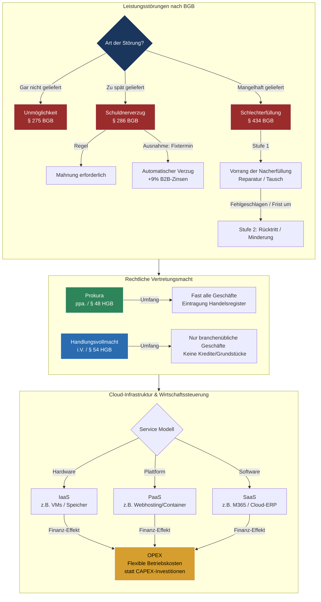

tags: [fisi, ihk, lernsheet]
## 🧭 Navigation & Zusammenhänge
- **Vorausgesetztes Thema:** [[02_Change Management & IT-Kommunikation]]
- **Nächstes Thema:** [[04_Formale Abnahme, Mängelprotokolle & Projektabschluss]]
- **Verwandte Bausteine:** [[01_IT-Vertragsarten & Leistungsdokumentation]], [[15_Recht, Lizenzen & Handelskalkulation]]
---

🎯 IHK-Prüfungsrelevanz

> [!IMPORTANT] AP01: Einrichten eines IT-gestützten Arbeitsplatzes
> 
> - **Relevanz:** Mittel
> - **Fokus:** Identifikation von Fehlern und Falschlieferungen bei IT-Komponenten (Aliud- und Manko-Lieferung) sowie die Anwendung grundlegender Vor-Ort- vs. Remote-Kriterien.

> [!WARNING] AP02: Konzeption, Administration & Netzwerke
> 
> - **Relevanz:** Hoch
> - **Fokus:** Ein absoluter Kernbereich für "Wirtschafts- und Sozialkunde" sowie Projektmanagement-Teile. Die IHK fordert die exakte Unterscheidung rechtlicher Folgen (Mängelrechte, Verzug ohne Mahnung bei Fixterminen, B2B-Verzugszinsen), organisatorischer Kompetenzen (Prokura vs. Handlungsvollmacht) sowie technischer Bereitstellungsmodelle (IaaS, PaaS, SaaS) inklusive des wirtschaftlichen Wandels von CAPEX zu OPEX.

---

📖 Einfache Erklärung & Praxisbeispiele

Im Geschäftsalltag läuft nicht jedes Projekt reibungslos. Eine **Leistungsstörung** liegt immer dann vor, wenn die Ist-Leistung von der vertraglich vereinbarten Soll-Leistung abweicht. Damit ein IT-Betrieb handlungsfähig bleibt, sind klare Hierarchien und **Vollmachten** gesetzlich geregelt. Gleichzeitig müssen IT-Infrastrukturen strategisch gesteuert werden – sei es durch Qualitätsmethoden wie den **PDCA-Zyklus** oder durch den flexiblen Einsatz moderner **Cloud-Modelle**.

Unterthemen & Anschauliche Beispiele:

- **Die drei Hauptarten der Leistungsstörung:**
    - **Unmöglichkeit (§ 275 BGB):** Die Leistung kann von niemandem (objektiv) oder vom Schuldner (subjektiv) erbracht werden. Der Anspruch auf die Gegenleistung entfällt ("Ohne Arbeit kein Lohn").
    - **Schuldnerverzug (§ 286 BGB):** Die Leistung ist fällig, möglich, wird aber nicht erbracht. Für den Verzugseintritt ist grundsätzlich eine **Mahnung** erforderlich. _Ausnahme:_ Bei kalendermäßig bestimmten Terminen ("Fixterminen") oder endgültiger Verweigerung tritt Verzug automatisch ein. Im B2B-Bereich fallen dann **Verzugszinsen** von 9 Prozentpunkten über dem Basiszinssatz an.
    - **Schlechterfüllung / Sachmangel (§ 434 BGB):** Die gelieferte IT-Sache hat Mängel (z. B. Montagefehler, mangelhafte Anleitung laut "IKEA-Klausel"). Es gilt der **Vorrang der Nacherfüllung (Stufe 1)**: Der Verkäufer darf zuerst reparieren oder neu liefern. Schlägt dies fehl, greifen **sekundäre Rechte (Stufe 2)** wie Minderung, Rücktritt oder Schadensersatz.
- **Vollmachten im Betrieb (Wer darf was?):**
    - **Handlungsvollmacht (i.V. / i.A. nach § 54 HGB):** Berechtigt zu allen branchenüblichen Geschäften (z. B. Hardware einkaufen). Sie gilt _nicht_ für Grundstücke, Darlehen oder Bilanzen.
    - **Prokura (ppa. nach § 48 HGB):** Höchste betriebliche Vertrauensstellung. Berechtigt zu fast allen gerichtlichen und außergerichtlichen Geschäften. Sie muss zwingend im **Handelsregister** eingetragen werden.
- **Der PDCA-Zyklus (Plan-Do-Check-Act):** Ein ständiger Steuerungskreis zur Qualitätsverbesserung.
    - 💡 **Praxisbeispiel (Deployment):** **Plan:** Konzept für Softwareverteilung erstellen \(\rightarrow \) **Do:** Auf Testsystem ausrollen \(\rightarrow \) **Check:** Im User Acceptance Test (UAT) prüfen \(\rightarrow \) **Act:** Global auf Produktivsysteme live schalten.
- **Cloud-Service-Modelle & Finanzen:**
    - **IaaS:** Reine virtuelle Hardware (z. B. nackte VMs bei AWS; Admin-Pflichten für OS/Software liegen beim Kunden).
    - **PaaS:** Bereitstellung einer Laufzeitumgebung (z. B. Kubernetes-Plattform; OS wird vom Cloud-Anbieter verwaltet).
    - **SaaS:** Fertige Softwareanwendung (z. B. Microsoft 365; keine Admin-Pflichten für Infrastruktur).
    - 💡 **Wirtschaftlicher Wandel (On-Demand):** Cloud-Infrastruktur führt zum Wandel von **CAPEX** (Investitionsausgaben für teure physische Server hardware) zu **OPEX** (Betriebsausgaben durch nutzungsabhängige Abrechnung / Pay-per-Use).

---

📊 Visuelle Darstellung (Mermaid.js)

