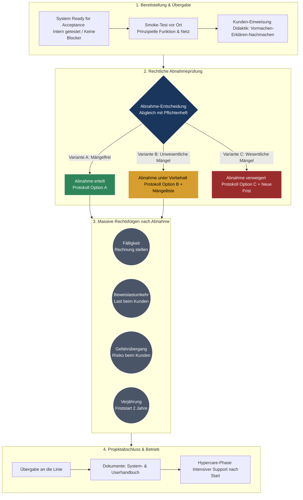

tags: [fisi, ihk, lernsheet]
## 🧭 Navigation & Zusammenhänge
- **Vorausgesetztes Thema:** [[03_Leistungsstörungen, Vollmachten & Cloud-Steuerung]]
- **Nächstes Thema:** [[05_Kosten erfassen und bewerten (Kostenartenrechnung)]]
- **Verwandte Bausteine:** [[01_IT-Vertragsarten & Leistungsdokumentation]], [[10_Controlling im IT-Projekt (Soll-Ist-Vergleich & Nachkalkulation)]]
---

🎯 IHK-Prüfungsrelevanz

> [!IMPORTANT] AP01: Einrichten eines IT-gestützten Arbeitsplatzes
> 
> - **Relevanz:** Mittel
> - **Fokus:** Ordnungsgemäßer Smoke-Test (Funktionsprüfung vor Ort) und rechtssichere Einweisung von Endanwendern inklusive Dokumentation gegen spätere Bedienfehler.

> [!WARNING] AP02: Konzeption, Administration & Netzwerke
> 
> - **Relevanz:** Hoch
> - **Fokus:** Ein absoluter Kernbereich für rechtliche und organisatorische Prüfungsfragen. Die IHK prüft intensiv die massiven Rechtsfolgen der Abnahme im Werkvertragsrecht (§ 640 BGB), die Klassifizierung von Mängeln nach Auswirkung (wesentlich vs. unwesentlich) sowie die Abgrenzung der verschiedenen Abnahmeformen (ausdrücklich, konkludent, fiktiv).

---

📖 Einfache Erklärung & Praxisbeispiele

Die **Abnahme (§ 640 BGB)** ist der rechtlich wichtigste Moment im Werkvertrag. Sie beschreibt die körperliche Hinnahme und die Billigung des Gewerks durch den Kunden als im Wesentlichen vertragsgemäß. Mit der Abnahme ändert sich die Rechtslage massiv: Das Projekt geht in den regulären Betrieb (Linie) über, der Vergütungsanspruch (Rechnungsstellung) entsteht und die Gewährleistungsfrist beginnt zu laufen.

Unterthemen & Anschauliche Beispiele:

- **Die 4 massiven Rechtsfolgen der Abnahme:**
    - **Fälligkeit:** Der IT-Dienstleister darf die Schlussrechnung stellen.
    - **Beweislastumkehr:** Vor der Abnahme muss der Dienstleister beweisen, dass seine Arbeit fehlerfrei ist. Nach der Abnahme muss der _Kunde_ beweisen, dass ein Mangel vorliegt.
    - **Gefahrübergang:** Das Risiko für Zufallsschäden (z. B. Serverraum-Brand oder Diebstahl) geht auf den Kunden über.
    - **Verjährung:** Die gesetzliche Mängelhaftungsfrist (in der Regel 2 Jahre bei IT-Systemen) startet.
- **Formen der Abnahme:**
    - **Ausdrücklich:** Schriftlich mittels eines unterzeichneten Abnahmeprotokolls (dringend empfohlen).
    - **Stillschweigend (konkludent):** Der Kunde nutzt das System nach dem Rollout ohne Rüge im echten Produktivbetrieb.
    - **Fiktiv (§ 640 Abs. 2 BGB):** Der Dienstleister setzt eine angemessene Frist zur Abnahme. Reagiert der Kunde bis zum Ablauf nicht, gilt das Werk automatisch als abgenommen.
- **Klassifizierung von Mängeln nach Auswirkung:**
    - **Wesentlicher Mangel:** Eine Kernfunktion ist gestört (z. B. tägliche Systemabstürze des neuen Datenbankservers oder massiver Datenverlust). Der Kunde darf die Abnahme berechtigt verweigern.
    - **Unwesentlicher Mangel:** Die Funktion ist nur leicht beeinträchtigt (z. B. Tippfehler in der UI-Oberfläche oder falscher Farbcode des Logos). Der Kunde **muss** die Abnahme erteilen (ggf. unter Vorbehalt), darf sie aber _nicht_ verweigern.
- **Spezialfälle im IT-Abschluss:**
    - **Abnahmeverzug (§ 640 Abs. 2 BGB):** Zögert der Kunde den Termin grundlos hinaus, kann die Übergabe förmlich angeboten und eine Frist gesetzt werden, um den Gefahrübergang vorzuziehen.
    - **Phantom-Mängel:** Der Kunde meldet gefühlte, nicht greifbare Fehler (z. B. "Das System fühlt sich heute so langsam an"). **Lösung:** Objektivierung durch standardisierte Messprotokolle und Abgleich mit dem Pflichtenheft.
        
    - **Hypercare-Phase:** Zeitlich begrenzte Phase erhöhter Aufmerksamkeit und intensiver Betreuung direkt nach dem Go-Live, um letzte Kinderkrankheiten abzufangen.

---

📊 Visuelle Darstellung (Mermaid.js)

mermaid

