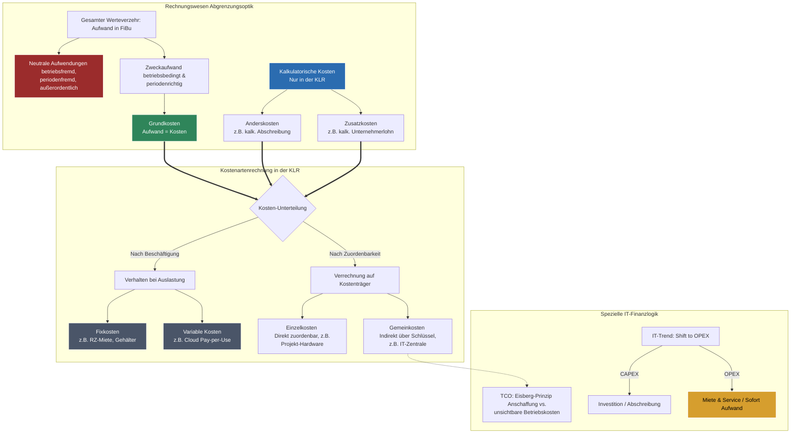

## 🧭 Navigation & Zusammenhänge
- **Vorausgesetztes Thema:** [[04_Formale Abnahme, Mängelprotokolle & Projektabschluss]]
- **Nächstes Thema:** [[06_Kalkulation, Preisbildung & IT-Stundensatz]]
- **Verwandte Bausteine:** [[06_Kalkulation, Preisbildung & IT-Stundensatz]], [[07_Controlling]]
---

## 🎯 IHK-Prüfungsrelevanz
> [!IMPORTANT] AP01: Einrichten eines IT-gestützten Arbeitsplatzes
> - **Relevanz:** Niedrig
> - **Fokus:** Grundwissen über direkte Materialkosten (Einzelkosten) bei der Beschaffung spezifischer Hardwarekomponenten für Arbeitsplätze.

> [!WARNING] AP02: Konzeption, Administration & Netzwerke
> - **Relevanz:** Hoch
> - **Fokus:** Ein fundamentaler Baustein für den Prüfungsbereich "Wirtschafts- und Sozialkunde". Die IHK verlangt regelmäßig die fehlerfreie Abgrenzung zwischen externem Rechnungswesen (FiBu) und internem Rechnungswesen (KLR). Absolutes Kernwissen sind die exakte Einteilung von Kosten (fix vs. variabel, einzel vs. gemein), das Verständnis spezieller IT-Konzepte (TCO, CAPEX vs. OPEX) sowie Berechnungen zur Wirtschaftlichkeit und dem Break-Even-Point.

---

## 📖 Einfache Erklärung & Praxisbeispiele
Die IT ist in modernen Unternehmen kein reiner Selbstzweck, sondern ein wesentlicher **Kostenfaktor und strategischer Enabler**. Um fundierte Entscheidungen zu treffen und Preise richtig zu kalkulieren, müssen angefallene Kosten systematisch erfasst und bewertet werden. Die **Kostenartenrechnung** bildet hierbei die erste Stufe der Kosten- und Leistungsrechnung (KLR) und beantwortet die Frage: *Welche Kosten sind überhaupt angefallen?*

### Unterthemen & Anschauliche Beispiele:
- **Finanzbuchhaltung (FiBu) vs. Kosten- und Leistungsrechnung (KLR):**
  - Die **FiBu (extern)** erfasst alle Aufwendungen (jeden Werteverzehr einer Periode, z. B. Spenden, Brandschäden) nach HGB-Vorschriften für das Finanzamt und Banken. 
  - Die **KLR (intern)** ist gesetzlich freiwillig und dient der Geschäftsführung. Sie betrachtet nur den **betriebsbedingten Werteverzehr** (= Kosten, z. B. Administrator-Gehalt, Serverraum-Strom).
  - *Abgrenzung:* **Neutrale Aufwendungen** (z. B. Spenden, periodenfremde Steuernachzahlungen) fließen *nicht* in die KLR ein. **Kalkulatorische Kosten** (Zusatzkosten wie der fiktive *Unternehmerlohn* oder Anderskosten wie die *kalkulatorische Abschreibung* vom Wiederbeschaffungswert) existieren hingegen nur in der KLR, um Preise ehrlich zu kalkulieren.
- **Kostenstrukturen: Fix vs. Variabel und Einzel vs. Gemein:**
  - **Fixe Kosten (Bereitschaftskosten):** Unabhängig vom Output (z. B. Miete fürs Rechenzentrum, Gehälter). Bei steigender Menge sinken die Fixkosten pro Stück (**Fixkostendegression**). Achtung bei **sprungfixen Kosten**: Ab einer bestimmten Grenze (z. B. User 101) wird ein zweiter Server benötigt, wodurch die Fixkosten sprunghaft steigen.
  - **Variable Kosten:** Ändern sich mit der Beschäftigung (z. B. Cloud-Traffic via Pay-per-Use, Freelancer-Stunden).
  - **Einzelkosten (Direkte Kosten):** Lassen sich einem Projekt/Produkt direkt zuordnen (z. B. eingekaufte SSD für Kunde Meier).
  - **Gemeinkosten (Indirekte Kosten):** Fallen für alle gemeinsam an und erfordern einen Verteilschlüssel (z. B. Strom allgemein, Geschäftsführer-Gehalt). *Sonderfall unechte Gemeinkosten:* Eigentlich Einzelkosten, deren Erfassung aber zu teuer wäre (z. B. Schrauben in der PC-Montage).
- **Spezielle IT-Kostenkonzepte:**
  - **CAPEX vs. OPEX:** Der Trend in der IT verschiebt sich von CAPEX (Investitionsausgaben, z. B. Server kaufen und über Jahre abschreiben) hin zu OPEX (Betriebsausgaben, z. B. monatliche SaaS- oder Cloud-Miete, die sofort steuerlich wirksam ist).
  - **Total Cost of Ownership (TCO):** Das Eisberg-Prinzip besagt, dass der sichtbare Anschaffungspreis oft nur einen Bruchteil ausmacht. Der Großteil der Kosten ist unsichtbar (Wartung, Schulung, Support, Strom).
- **Wirtschaftliche Kennzahlen:**
  - **Break-Even-Point (Gewinnschwelle):** Punkt, an dem Erlöse alle Kosten decken (Gewinn = 0). Formel: $\text{Fixkosten} / (\text{Preis} - \text{variable Stückkosten})$.
  - **Wirtschaftlichkeit:** $\text{Ertrag} / \text{Aufwand}$ (muss $> 1$ sein).
  - **Umsatzrentabilität (Marge):** $(\text{Gewinn} / \text{Umsatz}) \times 100$.

---

## 📊 Visuelle Darstellung (Mermaid.js)

