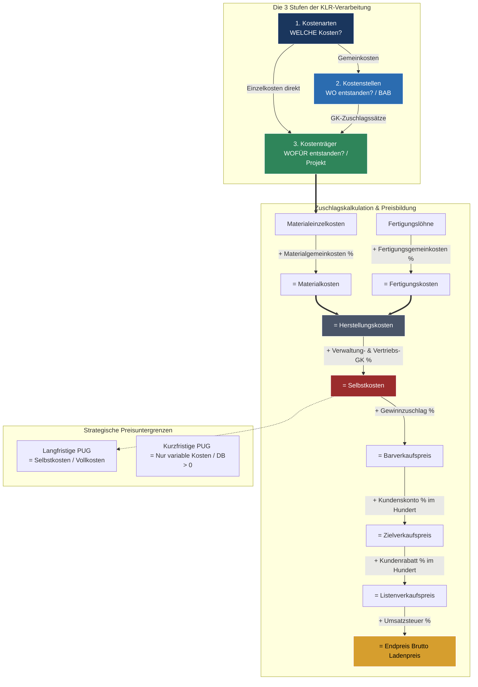

## 🧭 Navigation & Zusammenhänge
- **Vorausgesetztes Thema:** [[05_Kosten erfassen und bewerten (Kostenartenrechnung)]]
- **Nächstes Thema:** [[07_Finanzierung & Buchführung]]
- **Verwandte Bausteine:** [[05_Kosten erfassen und bewerten (Kostenartenrechnung)]], [[15_Recht, Lizenzen & Handelskalkulation]]
---

## 🎯 IHK-Prüfungsrelevanz
> [!IMPORTANT] AP01: Einrichten eines IT-gestützten Arbeitsplatzes
> - **Relevanz:** Niedrig bis Mittel
> - **Fokus:** Einfache Vorwärtskalkulation zur Ermittlung des Brutto-Verkaufspreises von Handelswaren (z. B. Laptops, Monitore) für den Endkunden.

> [!WARNING] AP02: Konzeption, Administration & Netzwerke
> - **Relevanz:** Höchste (Prüfungsdauerbrenner)
> - **Fokus:** Das Beherrschen des vollständigen **Kalkulationsschemas** (Zuschlagskalkulation) ist absolute Pflicht für die ganzheitlichen Aufgaben und den WiSo-Teil. Die IHK prüft regelmäßig die exakte Berechnung von **IT-Stundensätzen** auf Basis produktiver Stunden sowie strategische Preiskonzepte wie die **Deckungsbeitragsrechnung** und **Preisuntergrenzen (PUG)** bei Unterbeschäftigung.

---

## 📖 Einfache Erklärung & Praxisbeispiele
Nachdem die Kostenarten erfasst wurden, regeln die **Kostenstellenrechnung (BAB)** und die **Kostenträgerrechnung (Kalkulation)** die genaue Verteilung und Zurechnung der Kosten. Ein Kostenträger ist das Endprodukt oder der Kundenauftrag. Während Einzelkosten direkt zugeordnet werden, müssen Gemeinkosten über **Gemeinkostenzuschlagssätze (GKZS)** verrechnet werden. In der IT-Dienstleistung ist Zeit die einzige verkaufbare Ware, weshalb unproduktive Zeiten (Leerlauf, Weiterbildung, Krankheit) zwingend in den Stundensatz einkalkuliert werden müssen.

### Unterthemen & Anschauliche Beispiele:
- **Das kaufmännische Kalkulationsschema (Vorwärtskalkulation):**
  Der „Heilige Gral“ zur Ermittlung des Angebotspreises:
  $$\begin{aligned}
  &\text{Materialeinzelkosten (MEK)} \\
  + &\text{Materialgemeinkosten (MGK)} \\
  = &\text{\textbf{Materialkosten (MK)}} \\
  + &\text{Fertigungslöhne (FL)} \\
  + &\text{Fertigungsgemeinkosten (FGK)} \\
  + &\text{Sondereinzelkosten der Fertigung (SEKf)} \\
  = &\text{\textbf{Fertigungskosten (FK)}} \\
  \hline
  = &\text{\textbf{Herstellungskosten (HK)}} \quad \textit{(Wert am Werkstor)} \\
  + &\text{Verwaltungsgemeinkosten (VwGK)} \quad \textit{(auf Basis der HK)} \\
  + &\text{Vertriebsgemeinkosten (VtGK)} \quad \textit{(auf Basis der HK)} \\
  + &\text{Sondereinzelkosten des Vertriebs (SEKvt)} \\
  = &\text{\textbf{Selbstkosten (SK)}} \quad \textit{(Langfristige Preisuntergrenze)}
  \end{aligned}$$
  Ab den Selbstkosten werden Gewinn, Skonto und Rabatt aufgeschlagen, um zum Listen- und Bruttoverkaufspreis zu gelangen. **Wichtig für die IHK:** Skonto und Rabatt müssen bei der Vorwärtskalkulation **"im Hundert"** (Basis = 100% minus Abzugssatz) draufgerechnet werden!
- **Berechnung des IT-Stundensatzes:**
  Ein IT-Mitarbeiter kostet das Unternehmen deutlich mehr als sein Bruttogehalt. 
  - *Schritt 1 & 2 (Zeitrechnung):* Ein Jahr hat 365 Tage. Nach Abzug von Wochenenden, Feiertagen, Urlaub und Krankheit verbleiben ca. 210 Anwesenheitstage. Da interne Meetings, Weiterbildung und Leerlauf nicht fakturierbar sind, bleiben realistisch oft nur **1.200 bis 1.400 produktive Stunden** pro Jahr übrig.
  - *Schritt 3 & 4 (Kosten):* Die Gesamtkosten (Bruttogehalt + ca. 21% AG-Anteil Sozialversicherung + Arbeitsplatzkosten + Gemeinkostenumlage) werden durch die produktiven Stunden geteilt, um den **Selbstkosten-Stundensatz** zu erhalten.
- **Preisuntergrenzen (PUG) & Deckungsbeitrag:**
  - **Langfristige PUG:** Entspricht den Selbstkosten (Vollkosten). Wird sie dauerhaft unterschritten, droht die Insolvenz.
  - **Kurzfristige PUG:** Deckt bei Unterbeschäftigung ("Besser als nichts") **nur die variablen Kosten** ab. Jede zusätzliche Einnahme darüber hinaus generiert einen positiven **Deckungsbeitrag (DB = Erlös - variable Kosten)**, der zur Deckung der fixen Kosten beiträgt.
- **Weitere Kalkulationsformen:**
  - **Rückwärtskalkulation (Target Costing):** Der Markt diktiert den Preis. Man rechnet rückwärts, um die maximal erlaubten Selbstkosten zu ermitteln (*Design to Cost*).
  - **Differenzkalkulation:** Marktpreis und Kosten sind fix. Es wird ermittelt, wie hoch der verbleibende Gewinn ist, um über die Auftragsannahme zu entscheiden.

---

## 📊 Visuelle Darstellung (Mermaid.js)

